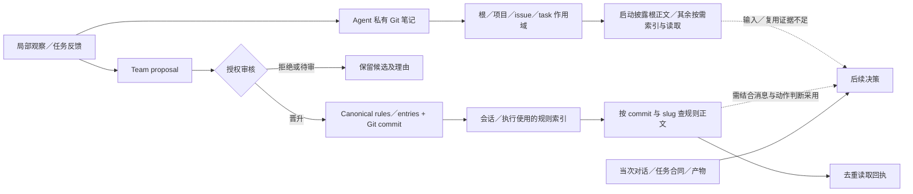
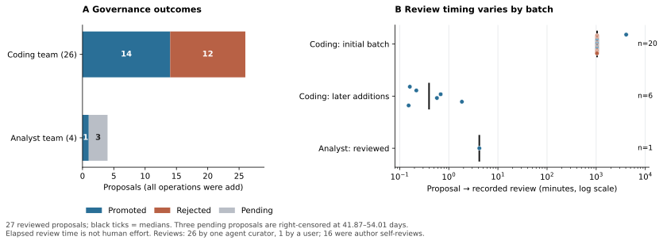
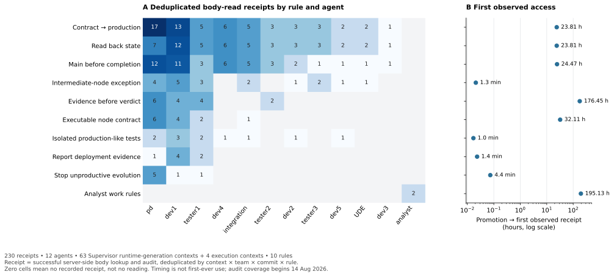

# P5 研究报告：记忆的存储、共享与有条件复用

作者：oopslink · [作者主页](https://github.com/oopslink)
日期：2026-11-03（America/Los_Angeles）；轮次：memory-011 / round-002
状态：单 AI 探索，尚未人工复核；无资助。M1–M3 首轮完成，历史部署与私有记忆覆盖仍不完整；尚未进行记忆对照实验或形成定稿论文。

> 本报告作为memory-011 / round-002研究记录保留。按问题、方法与结论重组的[第五篇论文工作稿](papers-010/p5-memory-applicability/paper.md)见015修订；外部文献比较与记忆对照实验仍未完成。

## 1. 本轮发现

**Agent Center 的 Team 记忆已形成可核验的知识发布与读取路径；最有解释力的问题是知识的适用边界，而不是“有没有存下来”。** 两个有内容的 Team 仓库保存 57 个提交，与数据库中 30 次提案、15 次晋升、12 次拒绝逐一对应。230 条去重正文读取回执均能解析到指定 commit 下启用且适用该 phase 的规则。其中 9 条编码团队规则均被多名 agent 读取。这是共享通路实际被使用的证据，还不是自动交付收益的估计。

共享也可以传播过宽的行为约束。一条要求所有任务先合入 `origin/main` 才能完成的规则，与“候选冻结→独立验收→最终合并”的任务合同形成循环。把候选节点改名为 evidence-only 后，原生阻塞理由仍指出同一冲突。后来新增的规则明确区分中间候选与最终交付；在另一组真实任务中，PD 与 tester 引用该规则完成验收接力，随后集成节点完成。**有用的变化是适用条件和完成边界被说清楚，而不只是库里增加了一条文本。** 此链条支持局部机制解释，不能分离记忆、owner 提示、候选证据及改图各自的因果贡献。

个人使用与团队正式知识之间也存在分离。analyst 的三个提案在快照截止时仍 pending，等待约 41.87–54.01 天；但其中一种新工作方法在提案前的同一会话输出中已经出现。审批状态可以衡量共享知识发布，不能代替对实际采用的判断。私有 agent／项目记忆缺少足够历史与读取记录，本轮无法比较其与 Team 记忆的有效复用率。

## 2. 数据与方法

复用 2026-11-02 06:41:08.656823 UTC 完成的只读 SQLite 快照；原采集清单 SHA-256 为 `fbc9cca0e1147a6bed9feddaf71bc9b17651a76a5983b49de68ad199ac159838`，本轮未重算约 45 GB 文件。随后只读采集可用记忆 Git、文件、版本元数据和日志。Git／文件的观测时间约为 2026-11-04 06:03 UTC，各存储单独留时，不声称与旧数据库构成一次原子快照。所有 pending 时长统一以数据库截止时间计算。

| 数据层 | 可恢复材料 | 使用边界 |
|---|---|---|
| Team／平台 Git | 4 个 Team 仓库、1 个平台 global 仓库；2 个 Team 非空，共 57 个提交 | 覆盖现存可达 refs；不含已删除对象、丢失仓库或历史未提交编辑 |
| 私有 agent Git | 2 个存续 home，各 2 个 bootstrap 提交、2 份骨架文件 | 初始化于 10 月 23 日；不能代表此前 16 个 DB agent 的完整历史 |
| 遗留 Worker 笔记 | 23 个 Markdown 文件，129,938 bytes，未发现 Git 历史 | 2 个根文件、3 个项目文件、3 个 issue 文件、15 个 task 文件；文件路径表示组织，不证明共享 |
| 原生 Team 事件 | 57 条，全部与 Git commit／提案状态匹配 | 证明持久化变更；事件时间、SQL 入库时间、Git 时间分开保留 |
| 规则读取审计 | 230 条；2026-08-14 至 09-21 | 服务端成功查得正文并登记回执；不是所有读取次数、任务数或模型理解次数 |
| 对话与案例 | 全库 26,961 条消息词法检索得到 585 候选；按机制定向扩展 7 组材料 | 候选不等于逐条深读；案例相互关联，不是随机样本或失败率分母 |
| 版本与源码 | 56 个留存部署目录、2 个 current 指针；3 个参考 commit 的 27 份源码副本 | 目录存在／mtime 不等于版本曾激活；源码相同不证明 dirty binary 相同 |

存储清单、CSV、验证结果和脚本见[数据包](memory-011/round-002/README.md)；逐案证据与排除见[案例附录](agent-harness-memory-cases-011.md)。私有 Git bundle、原始对话、日志片段和源码副本保存在仓库外 `run-001/memory-011/round-002/`。仓库只放研究报告、必要定位、派生统计和重建脚本，不提交私有记忆全文。

证据按“保存→发布／可见→正文回执→明确采用→局部结果→独立交付”逐层判断，不把不同单位做成一个虚假的转化漏斗。明显系统 bug、未接线、运行时恢复和部署故障从设计效应中排除；可以分离的语义片段保留，混合片段不强行归因。所有案例均保留反证和竞争解释。

## 3. Git 历史与部署版本能补齐到哪里

### 3.1 实现演变与实际发生是两条时间线

| 源码节点 | Git 时间所对应的实现变化 | 本轮生产侧证据 |
|---|---|---|
| `4e588233`，06-27 | scoped memory 接入运行时 | 后续遗留项目／任务笔记存在；没有这些早期运行的完整输入 |
| `d80eb55e`，07-01 | `CLAUDE.md` 改为 `MEMORY.md` | 遗留目录两种文件并存；不据此推断两份都被注入 |
| `c5ba6eed`，07-12；`332ca77f`，07-31 | 渐进加载与记忆管理 | 文件和接口存在不作为效果证明 |
| `50f2812b`、`bacc8eaf`，08-08 | Team rules 与规划快照 | 规则内容与后续读取可恢复 |
| `fe5e05c6`、`61cebc7b`，08-09 | 受控提案及服务契约 | 最早原生提案发生于 08-10，证明该能力不晚于此时可用 |
| `4f0e990c`、`38172447`，08-13／14 | commit 绑定注册表与按需正文读取 | 第一条现存正文读取审计为 08-14；不能反推此前从未读取 |

这些日期来自源码 Git 元数据，不是部署完成时间。完整 SHA、时区与 commit subject 已保存。`fix` 标题也不能单独认定某个案例受该 bug 影响。

### 3.2 部署证据矩阵

| 来源 | 观测值 | 可信范围与缺口 |
|---|---|---|
| Center current／COMMIT | `main-9e09f2a2`／`9e09f2a2064e155c4b673b63a270f92130b543c1` | 当前磁盘指针及标签 |
| Center binary build info | ldflags 与 `vcs.revision` 均指向 `9e09f2a2`；`vcs.modified=true` | 标签一致，但构建包含未提交修改，不能重建精确源码树 |
| Worker current／COMMIT | `main-71cde362`／`71cde362622df2a28c156e7abfa8d8906a0aeebb` | 当前磁盘标签 |
| Worker binary build info | ldflags 为 `71cde362`，`vcs.revision` 却为 `fc601b2544a9acb50c216e564322638bf0e28cf0`；modified=true | 两种嵌入式来源冲突；不选择其中一个冒充精确构建来源 |
| DB Worker 心跳自报 | `main-71cde362+71cde362`；启动时间 10-23 02:10:37 UTC；最后心跳 11-02 06:39:37 UTC | 支持快照时段的自报版本，不能覆盖 8–9 月每次执行 |
| 历史部署目录 | Center 29、Worker 27；其 COMMIT 均可解析为本地 Git 对象 | 留存产物清单，不是激活／回滚时间线；mtime 不作部署时间 |

对 `9e09f2a2`、`71cde362` 和首轮源码基线 `48892d61`，本轮核验的 9 个文件内容全部一致，涵盖记忆 runtime、同步、提案存储／服务、读取 API、审计存储／迁移及规划缓存。由此可以更可靠地解释现存审计字段；仍不能证明每个历史二进制逐字对应任一参考 commit。PID 文件对应的进程在本轮查询中未返回结果，也未据此声称当前服务正在运行某版。

**本轮补齐了可得 Git 历史、留存部署产物和版本冲突，未补齐逐执行的精确部署映射。** 版本来源冲突列为归因限制，没有被当成记忆架构负效应。

## 4. Agent、项目与 Team 记忆不是同一条共享路径

图 1：已核验源码路径与证据层次。实线表示存储／接口路径，虚线表示还需要行为证据的关系；并非所有图中节点均有完整生产轨迹。entries 不由当前 rule-load 审计覆盖。

Agent 私有仓库的 `projects/<id>/...` 是组织局部知识的作用域，不能仅凭目录名称为“所有项目成员共享的项目记忆”。旧 Worker 根目录还属于历史存储形态，不能直接套用当前每 agent home 的所有权。项目仓库中由 Git 协作共享的规约文件是另一种载体，也不等同于这里的私人 project scope。

Team 路径则有明确的提出、审核和 canonical 发布边界。编码团队配置 `curator_auto`，授权 PD；analyst 团队为 `proposal_only`。前者的 26 次审核由同一个 agent curator 完成，后者可见 1 次用户批准。审核主体和权限可追溯，但授权与独立复核是两件事：27 次已审核提案中有 16 次作者与审核者相同，不能描述为“全部经独立审查”。

## 5. 写入与治理：过滤确实发生，代价不能用提案数量代替

| 指标 | 编码 Team | analyst Team | 解释 |
|---|---:|---:|---|
| 提案 | 26 | 4 | 全部为 add；没有观察到 update／disable／delete 提案 |
| 晋升／拒绝／pending | 14／12／0 | 1／0／3 | 状态不是知识正确率或团队效率 |
| Canonical rules／entries | 9／5 | 1／0 | 15 个知识文件，不含 proposal 和索引 |
| 有记录的审核 | 26 次 agent curator | 1 次 user | 无可靠人工耗时数据 |
| 最早一批整理 | 20 个候选→8 个晋升、12 个拒绝 | — | 一次集中清理，不是 20 次独立实验 |

图 2：全量 30 个提案的状态及 27 次已审核事件的等待时间。黑线为各组中位数；3 个 pending 右删失，不填入已完成审核的均值。时间表示从提案到记录审核的墙钟间隔，不是审阅人时。

早期 20 个候选的审核等待中位数为 1,042.52 分钟（约 17.38 小时）；后续编码团队 6 个新增提案的中位数为 0.396 分钟（约 23.8 秒）；analyst 唯一已审核提案为 4.18 分钟。合并后的 27 个审核中位数为 1,041.89 分钟，但掩盖了“批量整理”与“即时追加”的差异，因此不能用于概括机制始终缓慢或始终快速。

M01 的 12 条拒绝理由中，11 条明确指向被 canonical 条目吸收、拆分或替代；剩余 1 条认为尚未稳定的 DAG 实现不宜升级为全局硬规则。一条还指出机器本地绝对路径不适合作为团队通则。这证明治理层进行了可见的边界整理，而非只是存储所有经验。其反面是：这些是同一个 curator 的判断，尚未做独立内容真值复核；拒绝 12 条不能算“阻止 12 条错误知识”，也不能直接换算节省 token。

新增规则通常靠追加而非替换。纠正中间节点门禁后，旧的宽规则仍 enabled，新规则也 enabled。这保留了最终交付门禁，但把两条规则的组合解释留给消费者。它是值得进一步实验的维护负担，现有材料没有测出冲突发生率或额外推理成本。

## 6. 共享与读取：真实访问可见，理解和收益不能自动推导

| 审计口径 | 本轮结果 |
|---|---:|
| 去重正文回执 | 230 |
| 唯一 agent／规则 | 12／10 |
| Supervisor runtime-generation 上下文 | 63 个，对应 211 条回执 |
| execution ID 上下文 | 4 个，对应 19 条回执 |
| 有至少一条回执的 canonical rules | 10／10 |
| 被多名 agent 读取的 rules | 9／10；另 1 条 analyst 规则只有该 agent 的记录 |
| commit、slug、enabled、phase 均可核验 | 230／230 |
| 相对读取前最新已入库 Team 事件的旧 commit 回执 | 0／230 |

图 3：左图是 agent×规则的去重回执，空格表示无此审计记录，不表示从未读过；右图是晋升到首次可见回执的间隔，不是首次使用或正确复用时长。历史审计覆盖从 08-14 开始，较早规则的延迟尤其受左截断影响。

原生 API 在 `ReadTeamRule` 成功后写入审计，再输出 HTTP 响应。因此回执比“消息声称已读”更强，但仍不能证明客户端完整收到正文、模型理解或正确执行。唯一键为上下文×team×commit×rule，不包含 phase；重复读取不会新建行。表中的 execute 125、plan 38、review 40、recovery 27 是**首次留存回执的 phase 标签**，不能当成各阶段全部读取量或 token 成本。这里的 planning generation 是 Supervisor 运行代际，不是 DAG generation。

全部 230 条回执的 commit 都等于读取之前最新已入库 Team 变更的 commit，规则正文 blob 也一致。这是对“commit 冻结必然导致旧知识误用”的反证；它只覆盖有审计的读取时点，不能证明长会话的后续输入永远新鲜，或没有绕过此 API 的访问。

读取分布也不能用来决定哪条规则“最有用”：契约到生产链有 60 条回执，写后回读 49，main 门禁 46，中间候选例外 19；需求暴露、规则年龄、agent 活跃程度和上下文重启频率均不同，尚无有效复用机会的共同分母。

## 7. 真实案例揭示的机制

### 7.1 过宽知识可以被正确传递，却被用在不适用的层级

M02 中的 main 规则本意是避免候选分支被误报为最终交付，却把“整个 Plan／最终集成完成”与“中间任务完成”写成同一约束。候选必须先验收才能合 main，而验收又依赖候选节点 completed，于是正确遵守两个局部要求也无法推进。一次只把候选任务改为 evidence-only 的 DAG 调整没有改变规则文本的适用范围，第二个节点仍明确 block。

这一现象不需要用读取失败、角色名字或模型遗忘解释：规则、任务合同和阻塞理由本身已足以表达逻辑冲突。也没有证据证明增加上下文长度可以解决它。当前可支持的设计问题是**将局部收口经验发布为无条件团队通则**。由于 owner 在对话中也强调同一约束，不能把全部影响专归因于持久记忆。

### 7.2 有效复用依赖条件化规则和可审计产物

M03 的新规则允许中间实现／验收以唯一、不可变、远端可达的候选完成，仍保留最终 main 门禁。它在另一组任务中被 PD 和 tester 明确引用；原生事件确认独立验收节点完成，之后集成节点完成。相比抽象地要求“记住正确流程”，这里复用的是可以落实到当前候选 SHA 和任务阶段的判定条件。

正面证据仅限局部交接。PD 的即时提示、已有验收报告与产物、补充集成／发布节点同时参与恢复；无法说单靠记忆让任务通过。后续部署调用超时且没有 attempt 记录，整个 Plan 未据此算成功。前段 executor 重置与后段部署故障均从记忆设计效果排除，不把它们算作记忆失效。

### 7.3 私人采用不等于团队发布，未发布不等于未采用

M04 中，analyst 明确区分个人 issue 笔记自报提交与 Team pending 提案。Git 证实 Team 提案已保存，直到观测时仍未晋升；9 月 21 日的回执使用包含 9 月 9 日提案的 repo commit，却仍读取原 canonical 工作规则。**repo HEAD 前移，并不意味着提案正文已经成为生效规则。**

反证同样明确：新的 HOT／STORY 双榜结构在 9 月 9 日提案前的同一会话输出中已经出现，说明当次对话可以传递方法。个人笔记的 `0a003f7` 只有消息自报，未恢复相应私有 Git；不能由此宣称私人记忆成功支持了后续会话。三个 pending 的长等待可描述为共同知识发布缺口，原因、必要性和交付影响尚未判定。日报中事实或评分的正确性不在本轮审核范围。

### 7.4 笔记有记录价值，历史缺失阻止效果归因

M05 的遗留项目／任务笔记保存用户定稿要求、候选与验收缺口；对应任务的原生 block 也保留相同边界。它们有明确的追溯用途，但没有证据把“写了笔记”连接成后续自动读取和正确交付。相邻 executor 空转、接口未接线问题不能转化为记忆机制负例。

M06 的私人 quickfix 指令漂移只有事后自述，且混有并发工作区问题，因此从设计效应中排除。M07 的两个新 home 只有初始化骨架，启动日志虽记录 included=2、body_bytes=645，却没有业务知识；这证明组装通路启动过，不证明知识保留成功。旧 home 缺失，不能推断原来的 agent 从未写记忆。

## 8. 当前设计启示与尚未验证的解释

| 取舍 | 证据支持到的程度 | 下一步需要检验什么 |
|---|---|---|
| 为记忆记录来源、版本与审核决定 | Git／事件／回执已经使真实行为可追溯；值得保留 | 增加输入版本与后续采用锚点能否降低归因成本 |
| 以任务阶段与条件约束知识适用性 | 宽 main 规则与中间节点冲突；条件化规则有局部采用正例 | 同一任务／事实下比较无条件规则、明确条件规则、旧新规则并存及显式 supersedes |
| 分开私人笔记与项目／Team 共享库 | 存储与治理边界确实不同 | 相同正文、权限、预算下，跨 agent 的信息可达性与污染；不能只改 scope 标签 |
| 给提案、canonical、已读、采用不同状态 | pending 与当前采用可以并存；repo 更新不等于规则生效 | 是否需要明确的“等待发布／本地已采用”提示以及新任务刷新通知 |
| 保留审核但不把授权等同于独立真值检查 | 有实质拒绝／归并；16 次自审也真实存在 | 审核是否拦截错误泛化，人工与 agent curator 的收益及耗时分别测量 |
| 把有界记忆与自动交付分开评价 | 9 条规则跨 agent 读取；完整交付效果仍缺可比数据 | 多步、跨会话端到端验收；不能继续用短问答或读取量代替交付 |

本轮没有必要事实输入真值、完整模型调用或复用机会分母，故不报告命中率、有效复用率、污染率、节省 token、自动交付提升或显著性检验。私有存储缺失、审计左截断、回执去重、版本冲突及多个同步干预也不适合用一个总“记忆成功率”掩盖。

## 9. 下一轮与保全

下一轮优先从 M02／M03 构造**无 LLM 的合同一致性回放**：固定候选、验收先后关系和权限，比较宽规则、条件化规则、并存规则及明确废弃关系；先确认 fixture 没有系统 bug，再做配对模型试点。另从 M04 构造同一事实的私人保存、Team pending、canonical 发布、旧快照／新任务刷新四个状态，评价可达性与后续采用。正式模型实验仍需冻结版本、预算、重复次数和独立验收，不把这轮观察写成已完成对照。

历史精确构建映射、遗失的私有仓库、模型完整输入及人工复核仍待补充；若不可恢复，应保持范围限制而非无限追查。新文献比较尚未完成，本报告没有加入未经核验的外部文献主张，沿用严格引用／撤稿处理策略。

研究原件、查询、候选筛选、7 组案例、源码比较、派生数据、图表、脚本、分析失败记录、修改前后文档和校验清单均保存在本地 `run-001/memory-011/round-002/`。本轮仅改变研究材料，没有修改产品、生产数据库或记忆 Git，也没有触发生产 agent、付费模型调用或自动 commit／push。
