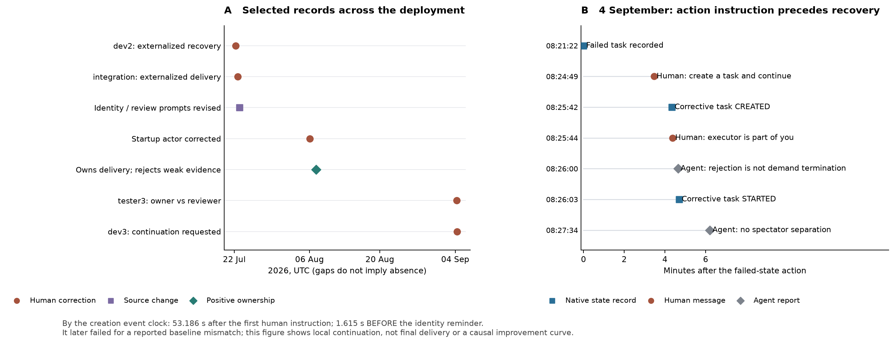

# P1 纵向增补：责任外推、人工纠偏与后期残留

2026-11-03（America/Los_Angeles），revision-014。作者 oopslink，无资助。单部署探索及 AI 辅助分析，尚未人工复核。本文补充现象与时间顺序，修正原短题实验的解释范围，不改变原实验评分，不新增付费模型调用。

## 1. 为什么修订结论

作者补充：Supervisor–Executor 封装在早期反复出现 confuse，agent 把 executor 当作自身以外的主体，执行失败后没有继续处理，流程依赖多次人工提醒才逐步改善，后来仍偶发。本轮将其保存为**操作者回顾性观察**（A20），同时回查当时记录。它不是一项新的问卷或全量统计，“经常／逐步改善／偶尔”不转换成发生率。

原稿的主要偏差是把两个问题混在一起：**是否观察到持续责任中断**，与**是否已经独立识别架构相对替代方案的净因果效应**。前者已有直接消息及若干原生动作；后者尚无充分对照。缺少后者不能让前者从结论中消失。类似地，线程或工作区 bug 可以解释首次执行为什么失败，却未必解释 Supervisor 为什么把后续责任外推；应分别记录故障触发、可用恢复动作和恢复责任解释。

“executor 不是我”也不能仅按字面评分。executor 确实可以处在不同进程、会话和权限边界；需要解释的错误是将这种执行隔离外推为“它失败后不再由我继续交付”。反过来，没有权限修复基础设施时向外升级是合理行为，不因其提到外部主体就判为身份混淆。

## 2. 检索与证据分层（A21）

同一冻结 SQLite 快照共 26,961 条消息。新增角色词检索命中 8,866 条，其中用户消息 149 条；进一步责任／自身／修复等词过滤为 32 条用户候选。该宽词检索用于发现材料，**8,866、149、32 均不是错误数、人工纠正次数或独立任务数**。部分提醒没有命中二级词，另从既有 A02–A10 锚点补入。

定向重建 9 组材料，选择 34 条消息为直接定位锚点，并保存其 9 个完整会话作为上下文容器；未声称全部会话消息都已逐条深读。另查询 3 个九月 Task、6 条 Task action 及关联领域事件。34 条消息中既含新增材料也含重新核读的旧 A 编号，不与旧样本相加当作新独立观察。原件、只读 SQL、选择理由和 SHA-256 位于本地[014档案](/Users/oopslink/works/research/agent-harness-study/run-001/papers-010/revisions/014-p1-longitudinal/README.md)；仓库中的[派生数据](longitudinal-014/README.md)不包含对话全文。

| 组／UTC日期 | 直接证据 | 在本轮论证中的地位 | 不作的推断 |
|---|---|---|---|
| L01，07-22 | 用户提醒 dev2 executor 是其一部分；dev2 承认把恢复失败当成需外部介入 | 早期责任解释与人工纠正 | 原线程故障不计架构制造的事故；后续计划不等于已执行 |
| L02，07-22 | 用户提醒 integration-dev 负责完成而非只验收；其承认把 executor 失败当外部阻塞 | 另一主体的同类纠偏 | 空 workspace／materializer 配置问题仍排除事故效果归因 |
| L03，07-23 | 用户总结“当前所有agent”有该问题，要求修订；同日 Git 改身份与审查提示 | 当时操作者观察及工程干预 | “所有”不是逐人统计；commit 时间不是部署生效时间 |
| L04，08-06 | 已知没有 execution，却等中心创建；用户提醒后自报 fork | 后续启动主体误归属 | 工具说明缺陷仍混杂；不当作架构净因果对照 |
| L05，08-07 | 明确拥有 executor 产出并继续追踪质量缺口 | 正确承责可实现的正例 | 位于多次提醒之后，不能当无干预基线或永久改善证明 |
| L06，08-08 | 用户在进度不可见投诉中强调 executor 是其一部分 | 有限的补充观察 | 可观测性投诉不单独计作恢复责任中断 |
| L07，08-11 | PD 被提醒创建主体并改口，但此前已报告 fork accepted 无新执行 | 主体表述变化，运行故障混合 | 不将已提交请求却未执行的等待全归为认知失误；重复提醒合并看待 |
| L08，09-04 | tester3 将不合格交付标 failed；用户提醒 owner 应继续；agent 承认按评审节点处理有误 | 后期再次需要纠偏 | 随后的 runtime 重启及缺自助 reopen 使恢复受限，不计身份导致的全部停摆 |
| L09，09-04 | dev3 拒绝候选后标 failed；用户要求继续；原生记录出现纠正 Task；agent 承认旁观式切割责任 | 后期责任延续问题及局部恢复 | 第二条身份提醒晚于新 Task 创建；后继任务最终失败，不算完整交付成功 |

“反复出现”由多个有日期、有主体的片段支持；“早期频繁、后来改善但偶发”仍按操作者经历表述。数据没有足够的全时段执行暴露量、失败后可修复机会、模型／部署版本或人工干预完整计数，不能绘制发生率下降曲线。也不能把提示、当次上下文、持久记忆或模型版本变化统称为模型学会了该结构。

## 3. 九月的新增原生链条

### 3.1 tester3：内部验收失败与任务责任终止

T2166（`task-0e398848`）要求完成隔离实例中的运行时验收。06:38:08 的 Task action `01M1NJ74RCN9P07KWGWSVKX3DC` 将任务标为 failed，理由是交付没有满足所要求的部署级证据。这个质量拒绝本身并不是身份错误。

06:46:32，用户在消息 `01M1NJPH00SNX2PKBSVVMKA4RH` 指出其是任务 owner，应继续组织自己的 executor 补做，而不是以评审者身份结束任务。06:50:03 出现 runtime restart 中断消息；06:53:23 用户再写明“agent = 1 supervisor + [0..*] executor”。06:55:34，agent 明确承认把内部交付不合格处理成评审节点失败有误，但此时 terminal failed 没有自助 reopen 入口。最后一项是系统恢复能力限制，不能把该限制造成的等待继续算成身份问题。

支持的发现是：质量判断与交付责任延续之间需要人工补充关联；不支持“任何 failed 都错”“该 agent 应绕过状态机或权限自行重开”，也不证明原先的监督检查没有价值。

### 3.2 dev3：纠正发生在两种不同的人工提醒之间

T2168（`task-87bd357d`）的候选未满足已收窄的接口范围。08:21:22 的 Task action `01M1NR44ZG4ZSADSXKPQP3F9TA` 记录 failed；agent 的后续消息也将未通过验收和任务终态相连。

| UTC 时间 | 来源类型／原生ID | 可见事件 |
|---|---|---|
| 08:24:49.541359 | 用户消息 `01M1NRAFM5RP2N4TWS32W8JVJQ` | 明确要求新开任务继续修复，未做对前不要结束需求 |
| 08:25:42.726292 | `pm_tasks.created_at`，`task-2fbc52af` | 同一 agent 创建纠正任务 T2172；created_by 为 `agent:agent-584e0bdd` |
| 08:25:42.726983 | 领域事件 `01M1NRC3J767HASG2D79DFRZ8V` | 原生 created 记录与 Task 创建相容，两时钟相差0.000691秒 |
| 08:25:44.341709 | 用户消息 `01M1NRC54NBS3EBES8CTBPA7MP` | 进一步强调 executor 属于自己，不要旁观其产出 |
| 08:26:00.500255 | Agent消息 `01M1NRCMXMXT0RX58VWDAK8EZQ` | 承认把“交付不合格”误当“需求终止”，报告已新建任务 |
| 08:26:03.681327 | Task action `01M1NRCR47F3BTRZRG9B8GT9JT` | 纠正 Task 出现 agent_started |
| 08:27:34.177741 | Agent消息 `01M1NRFGD1F1NF8XPQN4F9D9E2` | 明确承认不应以“它交付、我验收”的旁观口吻切割责任 |
| 11:05:05.109683 | Task action `01M1P1FXTNQ905K0J87RCMZSGY` | 纠正 Task 因报告的候选基线不符再次 failed |

以创建领域事件的 `occurred_at` 计算，新 Task 在第一条行动指令后 **53.185624 秒**创建，却比第二条身份提醒早 **1.614726 秒**；图5采用这一口径。底表另保留 `pm_tasks.created_at` 口径的53.184933秒与1.615417秒，两套时间不改变事件顺序。因此，能够说人工介入与局部继续执行有对应关系，不能说身份提醒单独造成了恢复。最后的基线问题没有被重新编码成身份错误，也没有因新 Task 出现就宣布最终交付成功。这些原生时间间隔是记录间隔，不是独立测得的人类节省时间或修复效果量。

图5：左侧为精选日期记录，不是发生率趋势；源码改动不等同于部署生效。右侧区分原生状态、用户指令与 agent 自述，保留纠正 Task 早于身份提醒这一反证。[SVG](figures/p1-fig5-responsibility-continuity.svg)／[PDF](figures/p1-fig5-responsibility-continuity.pdf)和重建脚本、底表随派生包保存。

## 4. 原实验到底测了什么（A22）

本轮重新检查冻结设计的全部 512 个动作输入，输入哈希均匹配。**512／512** 个输入共同显式给出控制者拥有最终裁决、后续修复及合法升级责任；两种身份条件都包含这一说明。**64／64** 个 S7 输入还给出：候选已拒绝、精确修复已知且获授权、没有活动执行体／待处理请求、目标为继续交付，以及可直接调用的 `queue_repair` 工具。

| 真实问题中的待解释环节 | 原实验中的处理 | 对结论的约束 |
|---|---|---|
| 执行隔离后是否仍将失败视为自身义务 | 两身份组直接提供同样的修复义务 | 主要差异只剩一句身份表述；不识别真实封装的持续责任效应 |
| 从拒绝结果构造可执行恢复方案 | S7 已给精确、合法、授权的修复及单一入口 | 检验按显式协议选择动作，未测自行组织恢复闭环 |
| 经过多个executor、异步事件和长上下文是否保持责任 | 单次短题，最多少量模拟反馈 | 未测责任随运行消失、跨会话遗失或人工提醒的持续成本 |
| 多次人工纠正是否改善、后来是否复发 | 没有纵向干预序列 | 不能用短题未出错否定操作者反馈 |

原512次动作、32次诊断和3次事后续步的结果全部保持。它们支持更窄的解释：在责任和状态已经明确提供时，测试模型可以遵循协议，单句身份表述没有检出差异。这与早期运行中需要反复人工补充责任完全相容，既不是架构无害证明，也不是人工纠偏因果成功的正式实验。

完整机械核验见[construct-audit.json](longitudinal-014/derived/construct-audit.json)。这是事后构念检查，不能改名为原实验预注册分析。未新增引文，未重新解释训练数据内容；训练先验仍待可控干预。

## 5. 对结论与下一步实验的影响

研究主结论应恢复为：**本部署的统一逻辑 Agent 封装，没有自动产生稳定的失败恢复责任；早期出现多主体的责任外推，人工通过直接提醒、具体行动要求及提示修订维持闭环，后续仍有同类纠偏需求。** 这是一项有来源的运行问题，不能被“模型在充分说明的题目中能答对”替代。是否主要来自抽象、外部角色提示、状态机、模型行为先验或其交互，仍需要实验区分。

下一轮测量应以“真实失败后是否主动承接仍获授权的修复”为单位，固定系统无明显 bug、工具一致、任务权限和验收合同；分别改变抽象身份声明、显式责任映射及确定性恢复机制。人工提醒作为事前设计的干预与成本，比较无提醒、身份提醒、具体动作指令及结构化恢复义务；记录持续几轮、何时失效以及是否真正完成验收。保留缺外部授权时合理升级的反例，避免把无限重试或越权当作负责。

本轮只建立该修订的证据依据，没有启动新模型实验。摘要、结论和实验附录统一修正解释范围；原文、前后哈希、精确diff和AI审阅记录保留，不能将这次修订误称为人工复核或独立重复研究。
