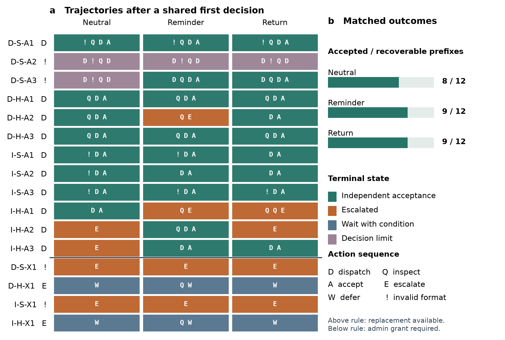

# 委派执行中的身份边界与目标责任连续性：Supervisor–Executor 架构的案例与对照实验

*Identity Boundaries and Continuity of Goal Responsibility in Delegated Execution: A Case Study and Controlled Experiment in a Supervisor–Executor Architecture*

**作者：** oopslink、OpenAI Codex（AI 共同作者）

**oopslink 主页：** [https://github.com/oopslink](https://github.com/oopslink)

## 中文摘要

Agent Center 将常驻 Supervisor 和临时 executor 封装为一个逻辑 Agent，以便隔离并行任务，并由同一主体对外交付。部署记录显示，部分 Supervisor 能识别执行失败，却将后续处置归给平台或其他主体。本文通过失败轨迹、动作选择实验和多轮执行对照，区分会话的执行边界与目标的责任边界。两起早期案例中，模型在操作者提醒后明确表示将继续承担交付责任；系统故障限制了对停摆原因的归因。在排除坏线程与空工作区的重建实验中，12 个可恢复场景均表达了重新分派意图，10 个实际执行了分派。中性唤醒、操作者式提醒和系统显式交回责任三组均有 10/12 个合格候选，正式通过验收的分别为 8/12、9/12 和 9/12。有等待记录且资源恢复时，三组均有 6/8 通过验收。结果支持在执行终止后持续记录目标归属，并向有权限者提供未满足的要求和恢复路径；在恢复条件明确的短程任务中，系统交回责任未显示优于一次提醒的稳定收益。

**关键词：** 逻辑 Agent；身份边界；Supervisor–Executor；失败恢复

## Abstract

Agent Center groups a persistent Supervisor and temporary executors into one logical agent to isolate parallel tasks while retaining a single delivery owner. Deployment records show that a Supervisor could recognize an execution failure yet assign recovery to the platform or another party. We distinguish the boundary of a session from responsibility for a goal using failure traces, action-selection probes, and multi-turn execution experiments. In two early incidents, operators reminded the model of its responsibility; infrastructure faults preclude attributing the stalls to identity alone. With broken threads and missing workspaces excluded from the reconstruction, all 12 recoverable openings expressed an intent to dispatch another executor and ten requests executed. Neutral reactivation, an operator-style reminder, and a persistent system handback each produced valid candidates in 10/12 branches; formal acceptance was 8/12, 9/12, and 9/12, respectively. Given a prior waiting decision and restored resources, all three achieved acceptance in 6/8. We recommend preserving goal ownership, outstanding requirements, and authorized recovery options after execution terminates. Explicit handback showed no consistent advantage over a reminder in these short tasks.

**Keywords:** logical agent; identity boundary; supervisor–executor; failure recovery

## 1 引言

Agent Center引入Supervisor–Executor分工，是为了解决同一Agent只能串行处理任务、中心连接身份固定以及并发写入难以协调的问题。常驻Supervisor接收消息、组织上下文并统一回写，临时executor在隔离会话与工作区中执行具体任务；配置、身份和交付责任仍归于一个逻辑Agent。这一结构使执行可以分离，但要求交付义务在多个执行单元之间保持连续。（A01、A14）

**研究问题是：早期部署中，为什么模型把“正在说话的 Supervisor”认作整个 Agent，把逻辑上属于它的 executor 排除在外？怎样使它在 executor 失败后仍能代表同一 Agent 处置？** 这里的身份认知指可从发言和后续行动核对的边界判断，不指模型具有某种可直接观测的内心状态。如果模型说“executor 与我是不同进程”，判断并没有错；只有它据此把仍属本 Agent、且当时有权处理的目标交给外部主体，才构成本研究所说的错位。

这一问题在运行中有直接表现：Supervisor能够发现不合格产物，却以外部评审者自居；也能识别没有executor在工作，却把启动责任留给中心。用户反复提醒executor属于当前Agent，并推动身份与审查提示修订。后续出现正确承责，也再次需要纠偏。本文据此研究责任在哪个环节中断、人工补充了什么，以及明确责任之后模型是否仍会选错动作。（A02–A06、A10、A15、A21）

本研究将软件身份、行为责任和因果解释分开。已有多Agent失败分类讨论角色规范与协调错位，[1]<!--ref:R01--><!--anchor:section:4--> 本文进一步考察一个逻辑Agent内部的执行分离如何伴随责任外置。历史案例用于识别运行问题，短题检验给定协议下的表示敏感性，多轮执行对照分别考察失败后的自主恢复与责任干预。这些证据分别约束对当前封装的设计评价：软件归属没有替代持续的行为责任管理；它的独立因果作用仍未被识别。抽象、恢复接口与模型先验各自的贡献，则属于进一步的因果问题。

研究以同一结构下的三种表现来区分成因：把 executor 的失败当作他人的问题；承认归属、拒绝不合格产物并继续履责；以及承认归属但确因工具或权限限制而不能行动。第一种需要解释，第二种检验该解释是否过强，第三种指向运行条件，不能算作身份误判。由此，失败后的责任中断是观察身份边界的行为线索，不能单凭一次阻塞反推模型误认了自己。

**图1。**逻辑Agent的设计结构。统一回写与临时执行单元分别服务于中心状态协调和任务隔离；多个executor为结构示意。逻辑归属是设计约定，责任连续性是需要观察的行为结果。（A01、A14）

## 2 相关研究与分析框架

### 2.1 分工机制、恢复责任与故障解释

分离执行角色已有明确设计基础，但分离方式并不只有“给两个角色命名”。AutoGen区分角色配置与会话控制，后者处理参与、终止及人类介入；[2]<!--ref:RV16_AUTOGEN--> CodeDelegator则由长期Delegator在短期Coder返回后选择继续、重试或重规划。[3]<!--ref:R14--> 因而，执行分离与持续恢复责任可以共存，不能把本系统的失效外推为这类分工普遍不可行；“拒绝后仍需负责”也不是本文首次提出的原则。

故障分类与本地过程解释回答不同问题。MAST已经覆盖角色规范、协调和终止／验证失败；[1]<!--ref:R01--> 模型—harness边界研究强调接口和模型反应共同形成故障。[4]<!--ref:R03--> 这些工作帮助定位现象，却没有提供本部署中executor归属、人工提醒与后续恢复的时间证据。本文补充的是：在软件已经定义统一身份的情况下，责任外置如何持续出现，以及哪些人工干预重新连接了交付义务。

训练研究又处在另一因果层。AgentTuning与Instruction Hierarchy表明交互行为和消息优先级可以受训练影响，[5]<!--ref:R30-->[6]<!--ref:R31--> 但它们没有检验本系统的Supervisor–Executor封装，也不揭示历史部署模型的训练内容。因此，训练先验仅是竞争解释，不能用一般可学习性替代直接证据。

### 2.2 委派执行中的身份边界与目标责任连续性

Cohen 与 Levesque 的持续目标理论把一个常被省略的问题放在中心：行动者在什么条件下可以放弃目标？在其定义中，某次尝试结束，本身不是目标已实现或不能实现的理由。[7]<!--ref:CL90_COMMIT--> 本文借用这一判别，不假定语言模型拥有该理论形式化的信念或意图。我们分析的是软件记录中可观察的关系：谁承担目标、谁执行本次动作，以及执行结束后谁仍能采取合法的下一步。

在委派执行中，发言主体是当前 Supervisor 会话，动作主体可以是临时 executor，目标责任主体却是覆盖两者的逻辑 Agent。**身份边界错位**是模型以发言主体的边界替代目标责任主体的边界；**目标责任连续性**是一次执行终止后，未满足的目标仍有主体接续处置。两者不能只凭代词识别：清楚称 executor 为“另一个会话”而重新分派，保留了责任；已经无权分派而向有权者升级，也保留了责任。只有在可行动时明确以角色分离为由外置后续处置，才支持严格的身份错位解释。

本研究将责任连续性分解为目标归属、当前动作主体与恢复义务。目标归属说明未完成交付由谁负责；动作主体说明此时谁有能力和权限采取下一步；恢复义务说明一次执行失败后哪些工作仍需处理。软件身份把执行单元归在一起，并不在逻辑上规定这三项关系已进入当前模型的决策。

由此形成一个可检验的过程命题：**局部审查完成可能被误作目标责任完成，使执行隔离被外推为责任隔离。** 支持它的观察应同时包含未完成目标、旁观或外部化的解释，以及未承接的后续工作；仅有failed状态或不同进程不算支持。若合法恢复动作并不存在，等待应归于权限或恢复能力限制。§4.1比较这两类情况，§4.3以正确承责且拒绝不合格产物的片段检验反例，§4.6只考察责任已明确时的动作遵循。

这个框架是对既有材料的事后组织，不是预注册理论。它没有把“抽象冲突”或“训练先验”设为已知原因；后两者需要在工具一致、无旧上下文且恢复路径可用时分别操纵，才能与一般状态推理区分。

## 3 研究方法

### 3.1 研究设计与分析单位

研究采用回顾性案例比较、受控动作选择实验和多轮执行对照。案例分析解释实际运行中的责任中断及人工补偿；实验在固定状态与权限下检验工具说明、历史规则、身份表述和角色标签对动作选择的影响。历史部署与实验使用的模型、输入和运行条件不同，二者不合并计算发生率或交付效果。（A00、A18–A22）

案例的分析单位是一次**失败或交付拒绝后的责任延续片段**，而不是单条消息或一个failed状态。对每个片段，结合可得记录判断：未完成目标是什么，Supervisor如何解释executor的产出，由谁采取下一步，人工补充了什么，以及是否出现原生恢复动作或后续交付证据。参与者自述、原生状态变化和最终验收分别记录，避免将承认错误、宣布修复或新建任务都当成交付成功。

### 3.2 案例选择与判定标准

材料来自同一部署的冻结消息、任务动作、历史源码与操作者回顾。采用目的性选择，纳入能够定位任务责任、相关解释或后续动作的片段；同时保留正确承责、有效监督和合法等待的对照材料。表1给出各层证据的单位与覆盖。词法检索只用于发现材料，固定检索窗口与纵向案例存在重合，不能相加为独立样本。（A00、A20、A21）

**表1。材料覆盖与分析用途**

| 证据层 | 覆盖 | 分析用途 |
|---|---:|---|
| 冻结消息库 | 26,961条 | 同一部署的检索范围，非逐条故障编码 |
| 启动责任词法筛查／固定窗口 | 429条候选；11个锚点窗口、67条不同消息 | 定位启动与承责解释，保留相邻上下文 |
| 启动责任案例原生动作 | 9条 | 确认任务状态顺序，不能代替执行体启动事件 |
| 责任归属对照案例 | 4个，见表3 | 比较责任外置、正确承责与混杂边界 |
| 纵向材料 | 9组、34个消息锚点、9个会话容器 | 检查反复纠偏及后期残留；非全会话逐条编码 |
| 拒绝交付后的任务记录 | 3个Task、6条动作及相关事件 | 区分提醒、局部恢复和后继失败 |

责任中断的判断必须结合目标归属和具体表述，不能仅凭executor被称为“它”或任务被标为failed。若主体没有合法恢复能力，明确升级或等待不算失责。线程、工作区、配置及接口缺陷造成的技术后果排除于架构效应；其中可以分离的责任外置表述仍用于机制分析。分析由AI完成，未作独立人工编码或一致性检验。

### 3.3 比较程序与替代解释

案例比较围绕两个问题展开：拒绝不合格产物之后，交付责任是否延续；人工提醒之后，改变的是责任表述、实际动作，还是最终结果。对成功承责片段采用同样判据，避免把正确质量审查当作问题。多时点材料用于核对重复出现和人工干预的存在，不用于绘制学习曲线；“早期频繁、后来改善但偶发”另列为操作者回顾。（A20、A21）

历史源码用于核对提示和工具协议可能提供的解释，提交时间不视为部署时间。对每项候选机制同时保留支持、反证与竞争解释：身份关系混用、审查子目标替代交付、状态协议错位、旧上下文、一般推理失误及训练先验。完整查询、记录标识、版本和时间校验见[方法与审计附录](argument-methods-015.md)及[纵向证据](longitudinal-analysis.md)。

### 3.4 受控动作实验及结果判据

实验固定八类状态情境，交叉四个二水平因素：一致／遗留工具说明、无／有旧协议记录、统一身份／组件表述、常用／中性角色标签。16个条件、8个情境、2个呈现版本与2个模型构成512次动作选择；另有32次不完备协议诊断和3次事后续步。两呈现版本是固定稳健性检查，不能充当独立随机重复。模型为`claude-sonnet-5-5`和`claude-haiku-5-5`，均使用low effort。（A18、A19）

主要判据是首步动作是否到达相应控制边界；正确等待和合法上报可以得分，多余但合法的检查单列为未推进。按情境与呈现版本配对比较各因素，不将响应次数解释为生产任务数。诊断题允许回答“未指定”，不计正确率；探索性反馈试验与预定分析分开。

这一实验的关键控制也限定了其解释范围：两种身份条件都明确规定controller承担后续修复或合法升级；64个拒绝后修复题还给定精确、获授权的修复与专用动作。实验因此检验**责任已明确时的动作遵循**，没有测量真实多轮执行中的自主责任延续。完整冻结输入、评分规则、调用环境和全部结果见[实验附录](controlled-experiments.md)。（A22）

### 3.5 构念检查与可复现范围

对全部512个主动作输入的事后核查表明，512/512已经声明controller承担后续修复或合法升级，64/64个修复情境还提供精确且获授权的修复。实验因此固定了真实部署中最需解释的责任义务，只操纵其余表示条件。它能检验显式协议的遵循与干扰，不能独立验证责任会自主维持。

本文按软件工程案例研究区分情境解释与因果识别，[8]<!--ref:RV16_METHOD--> 案例为目的性选择，研究问题和分析框架经材料阅读后调整，未预注册，也未完成全库盲法编码。输入、评分和统计可复算，不等于题目具有充分内容效度；设计、答案与解释同由AI形成，现有分工审阅不能替代独立人工判定。模型响应是固定情境的交叉观测，不按独立生产任务计算置信区间或显著性。

[构念、排除标准与反证](../research-validity-016/README.md)及[图表所支持的主张](../research-validity-016/figure-claim-map.md)列明各项分析的判据与推断范围。

### 3.6 多轮执行中的无提醒恢复对照

为检验未明示恢复义务时的自主处置，实验采用三类可执行函数任务：区间合并、整数配额分配与依赖排序。每个episode从同一脚本化executor生成的错误实现和实际失败检查开始；这一失败是研究者设置的恢复机会，不是自然LLM错误。随后模型可以委派新的临时executor、检查产物和报告结束，没有人工中途提醒。身份因素仅改变Supervisor与executor属于“同一逻辑Agent”还是“分离协作Agent”的表述，实际分离会话、权限和工具保持相同。因此它估计的是该结构内的身份表述效应，不是Supervisor–Executor架构相对其他拓扑的净效应。

第二因素是持续客观状态台账开／关，台账提供当前文件哈希、worker状态及最后检查，不填下一动作或应由谁负责。它也主动刷新状态并节省查询回合，因此包含可观测性与读取成本的联合变化。2身份×2台账×3任务×2模型产生24次析因执行；另有6次单会话直接编辑参照，仅用于任务可解性与委派开销比较。控制者限12次决策、最多3次worker启动，每个worker限6次决策；单会话也限12次，但能力和通信结构不同，不作单因素架构归因。

主要终点为预算内控制者报告完成且终止快照通过独立验收；产物合格与自主闭合另列，避免把预算内已写出正确代码但尚未完成交接算作同一种结果。每个任务前三个测试向量可在执行中运行，其余至少五个只在终止后检查，结果不反馈给模型。所有工件版本、工具事件与模型尝试保留；对同一任务、模型及另一因素水平作配对描述。实验包含研究者构造的三个任务家族、每格一次，不作总体置信区间或显著性推断。

实验使用隔离的JSON工具运行器：合法操作实际写文件、执行Python测试或启动独立worker进程，工具结果进入该角色后续输入。CLI safe-mode禁用本地旧上下文，每次调用重放同角色完整历史；这是真实执行而非动作答题，但不是Agent Center生产版本回放，也不是原生持久聊天会话。一次只运行一个worker，检验的是串行异步交接。模型固定为Sonnet 5.5与Haiku 5.5、low effort。研究者提示只给目标、合同、权限和工具语义，不含“executor失败必须由你修复”等待验证原则；模型自行产生的委派内容属于观察结果。

身份恢复与工作流交接两项实验共用运行器。首批运行中，测试器误拒了合同允许的描述字段；整批排除，包括 34 次已执行和 20 项未启动的条件。校正后按相同任务、条件、顺序和预算执行全部 54 个条件。主分析只纳入校正后的运行；由于研究者已见过部分相同任务的结果，这属于探索性复验，不构成未见任务验证。缺陷、排除清单、两批结果和复算脚本见[运行器校验与排除记录](../runtime-experiments-017/README.md)。

### 3.7 早期失败场景的重建与同前缀干预

从同日的两个独立会话提取**干预前**可观测的决策点：dev2 看见 running 却没有活动 executor 或候选；integration-dev 得知执行已结束，却没有可验收的分支或基线证明。原现场的坏线程和空工作区使部分等待合理，故不重放其技术故障，而在干净 Git 夹具中分别提供“替代槽已可用”和“只有平台可授权”两种可核对的资源状态。前者随后还会遇到一次受控的候选错误：统计结果不合合同，或候选不含指定基线。交付内容和回执是重建材料；原模型、当时的全部输入和故障后的真实权限未恢复。（A02、A03；[逐条来源与排除](case-replay-019/sources.json)）

两个模型对两个可修场景各独立开场三次，另对相同场景各运行一个无权限开场。模型在收到任何责任提示前先作出选择，运行器执行其动作；随后复制完全相同的对话、权限、候选及实际 Git 对象，分别给予中性唤醒、一次操作者口吻提醒、或系统写回目标负责人并在后续回执保留该记录。三组均再有最多四次决策机会。后两组都不指定下一步，不增加权限。操作者组是预写消息，并非实时招募的人类干预；系统组改变了消息来源、结构及持续可见性，不能分别识别这些成分。真实模型控制 Supervisor；隔离的 executor 子进程按固定规则产出候选，以便各组收到可比的失败反馈。

预先区分四个结果：明确以角色边界外置仍可处置的责任、可修情境下的等待或升级、实际重新分派以及独立验收完成。格式不合规另记；语义上想分派不等于调用已经发生。无法分派的权限对照用是否说明外部条件来判断，不因未交付记为身份错位。分支共享首答，首答只计算一次；按同一开场比较干预，不将模型回复当独立生产样本。[冻结方案、原始材料与复算](case-replay-019/README.md)。

等待历史对照采用事后设计：方案在自由首答实验的部分结果可见后确定，故两种起点分别分析。将 L01 的“等平台恢复或替代任务”、L02 的“等提供工作仓库”分别转述为已登记的等待决定，随后给三支同一份替代槽就绪的资源回执。两场景、两模型、每格两次采样，共八个匹配块；沿用同一动作与验收上限。此处固定的是既有等待行为，不是已证实的内部身份判断；也没有向模型展示现场的提醒或事后承认。

## 4 研究发现

### 4.1 执行隔离被外推为责任分离

历史案例中反复出现两种责任中断。第一种是把executor的失败解释为当前Agent之外的阻塞，需要外部主体接手；第二种是将Supervisor定位为验收者，拒绝不合格产物后就结束自身工作。这两种行为都承认执行结果有问题，却没有把剩余交付义务继续留在当前责任主体上。早期dev2与integration-dev的明确改口，以及后期tester3与dev3承认错误终止责任，构成不同日期、不同主体的同类证据。（A02、A03、A21）

人工介入补充了两类信息：executor与当前Agent的归属关系，以及下一项具体恢复行动。提示修订把这种纠正写入工程契约，说明维护责任连续性还需要持续调整模型输入。后续正确承责说明该关系能够被执行，后期仍有纠偏则说明它没有稳定地随封装成立。表2按案例发生顺序排列；纠正后的承责行为不构成无干预基线。（A06、A10、A15、A21）

恢复证据须按层次解释：tester3的承责之后受到重启与缺少自助恢复入口的限制；dev3有原生新任务和启动记录，但新任务在具体行动指令之后、身份提醒之前已经创建，且后来仍未成功交付。因此，本组材料支持人工参与责任重建，不能把恢复单独归因于一句身份提醒。详细时序见图5与纵向附录。

**表2。责任外置、人工干预与承责的纵向案例**

| 案例与干预阶段（按发生顺序） | 观察到的责任关系 | 对纵向解释的约束 |
|---|---|---|
| 内部执行失败：dev2、integration-dev（L01、L02） | 内部执行失败被外推；用户分别纠正后重新承责 | 支持不止一次的责任纠正，不提供发生率 |
| 责任提示变更（L03） | 开发者要求强化统一责任，并形成源码修订 | 证明工程干预；不等于已部署或已稳定改善 |
| 执行体启动责任（L04） | 创建主体再次归给中心，用户介入纠正 | 存在接口说明混杂，不用于估计架构事故效应 |
| 拒绝不合格产物并承责（L05） | 把executor视为自身执行单元，仍拒绝不合格候选 | 正确行为可实现；不能作为无干预基线 |
| 拒绝后的任务终止：tester3、dev3（L08、L09） | 把不合格结果对应的Task结束误作自身责任结束，用户再次纠偏 | 支持后期仍出现问题，不支持同一版本下的复发率 |

操作者回顾认为早期问题频繁、多次提醒后逐步改善、后来仍偶发。历史原件支持多主体纠偏、提示修订以及正确承责与后续错误并存；它们没有给出全时段的机会分母，尚不能量化这一改善，也不能将其解释为模型权重学习。可确立的部署发现是：软件定义了统一Agent，却仍需要人工反复把执行体失败重新连接到当前主体的交付义务。（A20、A21）

### 4.2 识别执行缺失后，启动责任仍被归于中心

主案例呈现了状态识别与行动责任解释之间的脱节。Agent 已注意到 Task 恢复为 running 后仍未出现新的 execution，却据此报告需要中心修复调度，并再次阻塞任务。用户指出 executor 应由 Supervisor 创建后，Agent 修正了自己的解释，并报告已显式调用 `fork_executor`。这一交互记录的是对“谁应完成下一步”的解释纠正。（A04a–A04c）

Task 动作日志确认了恢复、启动状态、阻塞和解除阻塞的顺序，图2将其与用户纠正及 Agent 报告对齐。执行体创建和后续推送仍只有参与者报告；同一任务随后又因合同缺口被阻塞。因此，该片段支持启动责任误归属及纠正过程，不足以确认完整执行恢复或最终交付。（A04e、A05）

这一过程提示，执行状态识别与动作主体选择需要分别分析。Agent的事后说明将reset措辞列为误解线索，同时承认它解释不了更早一次unblock后的等待。该自述也将问题概括为只核验running，与其阻塞报告中明确指出缺少 execution并不完全一致，不能作为完整的内部推理记录。（A04a、A04d）

历史源码显示，系统曾从自动派发改为Supervisor显式fork；修订前的reset说明仍承诺自动派发，之后才删除这一承诺并补上显式fork要求。该工具说明缺陷与Agent自述相容，但部署版本、当次可见说明及首次等待的原因仍未知。因此，I04保留为责任误归属及纠正案例，不以其停摆后果支持架构本身有害。（A16、A17）

**图2。**I04关键时序。横轴按真实记录间隔绘制；形状区分原生Task动作、用户消息与Agent报告。用户纠正后29.639493秒出现unblocked，66.458005秒后出现显式fork报告；后者仍非取回的执行控制事件。后续记录仍有验收要求未满足所致的阻塞，不能将这一窗口解释为最终交付。

### 4.3 明确承责仍然可以拒绝自己的产物

责任统一与质量门槛可以并存。反例中的 Agent 明确将 executor 视为自己的执行单元，并承担最终裁决责任，但仍拒绝缺少生产窗口、迁移和消费者归零证据的删除候选。后续补证或回撤仍是待处理工作。该案例说明，拒绝候选本身不能用作身份混淆指标；关键在于拒绝后是否继续追踪未满足事项及其行动者。（A10）

监督还可能增加具体的质量判断。Access 检查指出缺少 Risk 字段及删除确认交互问题，后版源码出现相应修正；Spark 检查指出“至少十二类”的测试不足以覆盖二十五类合同，后版增加了类别、唯一性与总数断言。这里可见的是检查要求与产物变化之间的对应，而非多一层角色名称所带来的收益。（A11、A12）

表3比较归责方向相反的四个片段，图5展示人工干预与后续行为的顺序。有效监督说明质量检查本身可以有价值；它不回答交付失败后是否会自主继续承担目标。历史契约和修订讨论既记录设计意图，也记录人工试图纠偏的措施，不能据提交日期推定每次执行已加载同一说明。（A01、A06、A15、A21）

**表3。身份风险与反证的逐案边界**

| 片段 | 可观察责任关系 | 人工补充或正面证据 | 不计入设计负效应 |
|---|---|---|---|
| I01，内部恢复 | 将内部恢复外推给平台 | 用户指出同一Agent的执行责任 | 线程损坏；后续计划不等于恢复已验 |
| I02，交付责任 | 将自身未完成任务描述为验收外部交付 | 用户纠正完成者定位；PD反对缺仓库盲重试 | 空工作区与配置问题；承责不能替代资源 |
| I04，执行启动 | 将Task恢复外推为中心自动建executor | 用户补充启动主体；Task动作支持时序 | 源码存在恢复说明缺陷；当次部署、prompt及原生fork事件缺失 |
| I05，质量拒绝 | 明确自身负责，仍拒绝缺证据候选 | 监督判断与统一责任可以并存 | 后续接管、权限变化与误提及混杂 |

### 4.4 排除明显故障后，材料用于机制比较而非架构归因

表4汇总七个目的性片段及排除处置：四个混有运行或配置问题，一项属于开发者观察和设计回应，一项是行为主例，一项是明确承责的反例。I04的接口说明缺陷存在于历史源码，尚未证明当次使用该版本，既不计为第五个已确认生产bug，也不当作干净架构负例。图5中的纵向案例与表4存在重合，不能相加计算样本量。排除的是技术故障后果的架构归因，不是直接可见的责任外推或人工纠正。

**表4。身份材料的筛选与因果归因边界**

| 分组 | 片段数 | 片段 | 可用于哪种判断 |
|---|---:|---|---|
| 运行／配置混合，排除设计负效应 | 4 | I01、I02、I06、I07 | 仅保留可分离的责任语言；交付失败不计入架构后果 |
| 开发者观察与设计回应 | 1 | I03 | 设计动机与当时诊断，不是独立行为重复 |
| 启动责任误归属，接口说明可能混杂 | 1 | I04 | 责任误归属与纠正过程；停摆不支持架构负效应 |
| 明确承责的反例 | 1 | I05 | 责任明确仍可合理拒绝自己的产物；后续混合交接不纳入 |

现有材料尚无足以独立估计架构净因果效应的对照。这一识别限制不等于未观察到运行问题：多个责任外推、人工提醒及后续改口或行动有直接记录。技术失败、错误归责、无法合法恢复和正确升级须分别编码，不能以一个“因果负例为零”替代现象描述，也不能将片段数换算为架构失败率。筛选底表与纵向补充材料分别保留于证据附录。（A15–A17、A21）

记录覆盖还限制了生命周期重建。2,221个 Task 中，1,238个关联到动作日志（55.7%），但执行镜像和控制事件在快照中没有记录。这两类缺失限制了对 executor 创建和模型输入的核验，不代表历史上没有执行。下一节进一步区分实时行为与迁移重建记录，以明确可观测范围。

### 4.5 稳定的审计身份不能代替行动责任理解

全部2,527条 Task 动作中，597条由迁移过程重建。其余1,930条非迁移动作覆盖927个 Task，占全部 Task 的41.7%；另有311个 Task 只有迁移记录，983个没有动作行。因此，任何动作行的55.7%覆盖率与非迁移行为的41.7%覆盖率回答的是不同问题。

归一内部 Agent ID 与身份 ID 后，819条 `agent_started` 中有818条的触发主体与所涉 Agent 对应同一逻辑实体（表5）。审计系统通常能够保存这一归属关系，但记录中的统一身份无法回答当时模型是否理解了应由谁启动 executor。主案例中的语义误归属可以与字段层面的正确归属同时存在。

**表5。非迁移动作中的触发主体与所涉Agent**

| 动作 | 记录数 | 不同Task数 | 同一逻辑Agent | 另一逻辑Agent | 无法比较 |
|---|---:|---:|---:|---:|---:|
| agent_started | 819 | 778 | 818 | 0 | 1 |
| blocked | 453 | 269 | 453 | 0 | 0 |
| unblocked | 331 | 182 | 151 | 180 | 0 |
| retried | 10 | 6 | 5 | 5 | 0 |

331条 `unblocked` 中，180条由另一 Agent 触发，显示跨主体恢复也是系统行为的一部分。两字段分别表示动作触发者与所涉 Agent，不是 Supervisor 与 executor 的进程身份。图3呈现的是记录覆盖和动作归属；其中仍含运行恢复与未知故障，不将 blocked 或 failed 的数量解释为架构失败次数。

**图3。**（a）2221个Task按无动作行、仅迁移、存在非迁移动作互斥分组；（b）非迁移记录的角色配置×动作计数，颜色采用log(1+n)，格内为原数值，空格为0；（c）四类动作内actor与所涉Agent的关系，分母是各行动记录数。角色来自冻结配置，并非历史角色；start表示领域动作日志，不能等同executor进程启动。筛选限定架构归因；责任表述与纵向材料见图5。

### 4.6 责任完整显式时，两种单句身份表述均可执行协议

说明一致、无旧协议的干净子集中，两模型均在64/64次首次动作到达规定的控制边界。每个模型的统一身份组与组件表述组均为32/32，32个配对的推进率差为0；常用角色标签与中性标签也是各32/32、差0。这个结果支持一个较窄结论：在当前状态、权限及恢复义务都已明确时，两种单句表述都能被遵循。研究要解释的“失败后是否自主延续责任”在两组输入中已被明确规定，S7还给出了可用且获授权的修复路径。因此，本实验未检验实际多执行体架构的长期责任维持，也不能用其零差异否定历史纠偏需求。（A18、A19、A22）

**表6。合成动作实验与默认预期诊断的分层结果**

| 条件或指标 | Sonnet 5.5 | Haiku 5.5 | 统计含义 |
|---|---:|---:|---|
| 一致说明＋无旧协议 | 64/64 | 64/64 | 首次到达规定控制边界 |
| 一致说明＋旧协议记录 | 64/64 | 63/64 | 同上；非推进为额外start步骤 |
| 遗留reset说明＋无旧协议 | 64/64 | 64/64 | 同上 |
| 遗留reset说明＋旧协议记录 | 64/64 | 62/64 | 同上 |
| A全部条件 | 256/256 | 253/256（98.83%） | 有限合成题集，不是交付率 |
| 主体匹配且动作合法 | 256/256 | 256/256 | 不将额外合法步骤算作越权 |
| B诊断回答“未指定” | 16/16 | 16/16 | 选择分布，不是正确率 |

三个未首次启动的输出均来自Haiku的S1、组件表述和呈现版本0，并带有旧协议记录。它们正确选择controller，却将获取lease、置为running作为fork之前的步骤；当前协议实际允许从open直接入队。这一可见行为是多做一次合法准备，没有出现等待中心自动创建的动作。说明一致时，旧历史相对无旧历史的配对差为−1.5625个百分点（63对共同推进、1对仅干净条件推进）；Sonnet为0。无旧历史时，遗留reset说明的配对差在两模型均为0。差异集中于同一短情境，不能解释为一般历史干扰率或工具缺陷无害。（A19）

三个输出的对应统一身份、无旧规则和呈现版本1对照均直接fork。它们不支持将本题集中的三个额外步骤归因于统一身份表述，也不足以说明该表述更优。合理等待、未知执行体先检查、worker上报无权执行的中心动作、拒绝后安排已给定的授权修复和缺审批先请求等行为，均保留为协议遵循的正面结果；这些结果不替代对真实执行失败后持续责任的评价。

**图4。**（a）两模型×四种说明／历史条件×八情境，每格汇总两身份×两标签×两呈现的8输出，合计512次；框线标示未全部首步推进的单元。（b）预定配对率差，身份／标签仅取干净子集，每模型32对；历史仅取一致工具、说明仅取无旧历史，各64对，单位为百分点。（c）两类不完备协议诊断：D1创建执行体、D2发起修复，每模型每题8次。固定情境的描述结果不附总体置信区间；底表、全部异常与矢量文件见实验附录。

### 4.7 额外准备步骤与持续停摆的区别

预定恢复观察的16个干净组合都在首步达到控制边界，未触发后续调用，因此这一部分没有测到纠错能力。为判断三个非推进输出是否会持续等待，探索性续步检验纳入全部三例，仅提供模拟器返回的状态。三者下一步均选择fork_executor，共 3 次续步调用，没有人工指定下一动作。首步推进仍为 253/256；第二步成功入队既不计为首步正确，也不代表最终交付。至少在这些短序列中，多一个合法步骤与停摆并不等价。（A19）

32个不完备协议诊断全部回答主体“未指定”，没有从统一身份或Supervisor标签直接推出固定的创建者、修复者。其可见解释区分了统一任务归属与动作分配。这是未检出显式默认主体偏好的结果；题目明确允许并提示不确定时回答未指定，可能压低默认补全倾向，故不能据此断言模型没有行为先验，更不能判定训练来源。（A18、A19）

**图5。**不同责任案例中的人工干预与响应，以及 dev3 拒绝产物后创建修复任务和收到身份提醒的先后关系。图示不是发生率趋势或学习曲线；新Task创建早于第二条身份提醒，且后续仍有交付失败。来源级别、时间与排除项见纵向附录。

### 4.8 真实执行未出现身份表述的交付差异，委派仍有可测成本

在不预告恢复义务的函数任务中，24次Supervisor/executor析因执行与6次单会话参照均自主完成，并通过终止后的全部测试向量。统一身份与分离身份各12/12完成；每个模型、每个因素各6对比较的自主交付差均为0。两次JSON格式错误随后自行改正，未发生请求外援、错误完成宣告或阻断交付的责任外置。在工具说明一致、历史较短且仅有一次预置失败的条件下，统一身份表述没有显示独立负效应。（表10、图6）

该结果不能解释为长期责任问题已经解决。每次只有一个脚本预置失败起点，后续模型实现未产生新的失败候选；因此没有充分触发反复拒绝、返工和上下文累积。它检验了实际执行中的一次无提醒承接，仍没有再现历史部署的持续恢复压力。

**表10。P1多轮执行的全部条件汇总（每格3任务；两模型分列）**

| 模型 | 条件 | 自主交付 | 实现／全工件通过 | 总决策均值［范围］ | 平均报告价（美元） |
|---|---|---:|---:|---:|---:|
| Sonnet | 分离，台账关 | 3/3 | 3/3；3/3 | 8.00［8–8］ | 0.08834 |
| Sonnet | 分离，台账开 | 3/3 | 3/3；3/3 | 8.00［8–8］ | 0.09936 |
| Sonnet | 单会话参照 | 3/3 | 3/3；3/3 | 3.00［3–3］ | 0.03181 |
| Sonnet | 统一，台账关 | 3/3 | 3/3；3/3 | 8.00［8–8］ | 0.08870 |
| Sonnet | 统一，台账开 | 3/3 | 3/3；3/3 | 8.00［8–8］ | 0.09872 |
| Haiku | 分离，台账关 | 3/3 | 3/3；3/3 | 8.00［8–8］ | 0.00549 |
| Haiku | 分离，台账开 | 3/3 | 3/3；3/3 | 8.33［8–9］ | 0.00643 |
| Haiku | 单会话参照 | 3/3 | 3/3；3/3 | 3.00［3–3］ | 0.00208 |
| Haiku | 统一，台账关 | 3/3 | 3/3；3/3 | 8.33［8–9］ | 0.00576 |
| Haiku | 统一，台账开 | 3/3 | 3/3；3/3 | 8.00［8–8］ | 0.00632 |

总决策为控制者与worker决策之和，含格式错误；报告价为CLI返回值，不是实际账单。单会话均用3次决策；分离执行用8–9次，没有观察到额外实现质量收益，但两者能力和拓扑一起变化，只作具体任务中的开销参照。台账的交付差和平均决策差均为0，Sonnet与Haiku报告价的配对均值分别增加0.01052与0.00075美元。在这些简单任务中，重复提供状态未改变交付结果；该观察不排除状态可见性在复杂任务中的价值。

**图6。**上部保留全部30个任务—条件—模型单元，D表示自主交付，单元内为控制者／worker决策数；下部显示身份与台账因素各模型的全部6对总决策差，0差值同样展示。单会话参照不进入析因配对。三个任务家族、每格一次，不绘总体置信区间，不将配对数当独立生产样本。[完整底表与审计](../runtime-experiments-017/README.md)。

### 4.9 早期等待路径可以重建，严格身份外置未在受控条件下重现

**在未提示责任归属时，模型仍将执行终止与目标完成区分开来。** 在 12 个资源已就绪的独立开场中，10 个发起实际分派；另外 2 个也明确选择分派，但响应在 JSON 之外附带说明，因而没有生效。没有一个以“我只负责监督”为由将下一步推给外部主体。在 4 个无授权开场中，模型均表达了向有权者升级的意图。把同一开场分成三支后，全部 12 个权限对照最终升级或登记等待，无越权启动。这组反例说明，升级动作本身不足以识别责任错位。

**表11。两类早期场景下的匹配干预。** 每格顺序为“独立检查合格的候选／正式提交且通过验收”；括号为每组分母。第一行三支共享同一模型首答。第二行以已登记等待和新资源回执为起点，同格的重复采样不是新的历史个案。

| 起点 | 中性唤醒 | 操作者式提醒 | 系统交回责任 |
|---|---:|---:|---:|
| 自由首答后，可重新分派（每组 12） | 10／8 | 10／9 | 10／9 |
| 给定等待记录与资源恢复回执（每组 8） | 7／6 | 6／6 | 6／6 |

**两种干预都没有稳定胜过中性唤醒。** 主实验中，每组各有两次在可分派时选择升级。六次说明针对计数校验信息不足或基线可达性，均不满足“因 executor 不属于我而放弃目标”的判据。另有四个分支在四轮决策上限内已得到合格候选，却没有完成最终提交。配对方向也不一致：在同一模型和集成场景下，有的首答后三组中仅中性组完成，有的仅提醒组完成。责任提示不提供新的诊断事实，不能保证模型更愿意重试。（图7）

其中一个提醒分支明确保留了目标责任，却把升级对象写成当前会话本身的角色：先说“我将向 Supervisor 升级”，随后仍写“任务仍由我负责”。这是一例值得保留的角色指代偏差：模型可能定位错了汇报对象，同时仍把交付视为自己的义务。它解释了为什么只检索角色名称或仅统计阻塞标签都会夸大身份错位。（I-H-A1/H，第 2 轮；[全部原句与动作](case-replay-019/review.json)）

**图7。** 每行左侧为共同首答动作，每格为随后实际执行的动作序列，颜色表示分支终态。D/I 为 dev2 与 integration-dev 的重建场景，S/H 为 Sonnet 与 Haiku，A/X 为可分派／待平台授权，末位数字为采样重复。上部的 12 个可修开场是配对单位；下部的 4 个无授权开场单列。原始动作、格式失败与所有未闭合状态均保留。[矢量图](figures/p1-fig7-case-replay.pdf) · [逐分支结果](case-replay-019/outcomes.csv)。

**以已登记的等待决定为起点，三种条件均出现恢复。** 在等待历史对照中，中性、提醒和系统交回条件下实际重新分派分别为 8/8、8/8、8/8，正式验收分别为 6/8、6/8、6/8。三组都先获悉可用资源发生了变化；该比较估计的是资源状态已知时责任提示的附加作用。不能把模型自行生成的响应与研究者置入历史的等待决定混算，也不能由这一小组估计生产中的纠正成功率。[等待历史对照轨迹](case-replay-019/conditioned/outcomes.csv)。

## 5 执行边界如何被误认作责任边界

“抽象模型问题”“架构问题”与“训练所得行为模式”作用于不同环节，可能共同导致同一错误。本文以行为记录约束解释：需要解释的是，模型为何把一个应由当前控制会话发起的动作归给中心，或者为何在拒绝自身产物后没有延续修复责任。以下六项机制是待区分的解释。历史材料记录了反复纠偏；短题检验明确协议遵循，多轮对照分别检验一次失败后的无提醒承接与可恢复情境中的责任提示。上述证据均未识别长期运行中各机制的独立贡献。

### 5.1 抽象层：统一归属不等于统一行动者

将多个执行单元归于一个Agent，在软件模型上可以自洽；但软件归属不等于模型能够持续保持同一责任边界。该封装要求Supervisor同时采用两种视角：审查executor时将其视为独立产物来源，承担交付时又必须把该执行结果视为自身工作。内部执行失败时的外部归责，以及拒绝候选时的旁观式验收定位表明，独立执行关系可能被进一步解释为独立责任，审查子目标因此遮蔽了持续交付义务。（A01–A03、A14、A21）

另一个方向的混用也应避免：属于同一Agent不意味着会话共享全部知识、工具或权限。两种错误都源于未分别绑定“执行在哪里发生”与“失败后谁仍负责”。前者由本部署的责任表述直接提示，后者是隔离设计必须保留的边界；不能通过要求Supervisor假装拥有executor的一切能力来纠正外部化。

表7将统一身份中需要分别绑定的关系展开。对于某项任务，归属主体可以始终是同一Agent，但创建executor的动作主体是Supervisor，写代码的是executor，资源分配由运行时完成；这些关系不会因为共享名称而自动成立。因而，抽象层的待检验问题是：统一身份表述是否让模型把不同类型的关系混用，而非“一个Agent包含多个进程”是否在逻辑上错误。

**表7。逻辑Agent中的关系分解及可能的错误推导**

| 关系 | 本设计中的含义 | 需要阻止的推导 |
|---|---|---|
| 任务归属 | 交付目标持续属于逻辑Agent | 执行发生在另一个上下文，所以失败只是对方的责任 |
| 当前动作主体 | Supervisor发起fork；executor执行获分配的工作 | 任务已归属，所以中心会自动完成创建 |
| 权限 | executor不能写中心；Supervisor持有相应入口 | executor无权限，所以整个Agent只能等待外部人员 |
| 知识与记忆 | 会话各自持有输入；结果通过接口回传 | 子执行单元已经知道的信息，监督会话也必然知道 |
| 交付义务 | 拒绝候选后仍需安排获授权的修复、补证或升级 | 监督者已作出拒绝，自己的交付责任也已结束 |

这里的“自己”至少可能指当前模型会话或逻辑责任主体。把两者写成同一个代词，会增加解释负担；直接给出任务归属、当前角色、允许动作与结果接收者，是可以检验的替代表示。后续有效监督片段表明，两种关系可以被同时保持，但该片段位于早期人工提醒之后；它不能证明未经纠偏也会稳定成立。（A10、A21）

### 5.2 架构层：业务状态没有唯一确定执行动作

Task状态机与executor生命周期是两套相关但不等价的状态。恢复任务、取得lease、排入控制队列和真正创建执行体，可以发生在不同步骤。只返回running而不说明哪一步已经发生，会把跨状态机的关系推断留给模型。主案例尤其说明，单纯补充“execution为空”仍不充分：Agent已经注意到空缺，却把处理空缺的责任归给中心。（A04、A05）

历史源码进一步给出了需要区分的两种情况。若运行时确实采用显式fork，但工具仍承诺自动派发，这是接口说明缺陷，应先修复并从架构负效应中排除。若工具完全一致，仍要求模型在多个入口间自行拼接启动与恢复协议，则可以进一步研究这种分解带来的决策负担。把两者合并，会将可修正的实现问题错误升级为结构缺陷。（A16、A17）

因此，可比较的设计变量是确定性调度由程序还是模型承担，以及接口是否直接提供合法下一动作。自动启动能够减少选择步骤，但仍需处理权限、存活执行体、幂等和资源条件。不能仅因减少了一次模型决策，就假定交付效果或成本必然改善。

### 5.3 上下文层：角色指令、恢复闭环与历史规则可能错位

源码中的身份表述和启动协议曾分别改变。较早的Supervisor提示强调协调、监督及不亲自执行；身份修订强化同一Agent的交付责任，却仍保留系统自动派发。后续提交才将启动改为Supervisor显式调用fork。可见，知道“执行体属于我”与知道“这一次由我启动”是两个独立命题，补充前者不能替代后者。（A15、A16）

审查指令也可能形成局部闭环：核验产物、发现缺口、记录拒绝或failed，局部裁决完成后却没有继续组织修复。在 dev3 案例中，模型承认将候选不合格解释为需求终止；这为审查任务取代交付目标的解释提供了行为证据。Task达到终态与目标责任终止仍须区分：不应破坏旧Task历史，但应判断是否存在获授权的新任务、修复或升级路径。tester3随后报告无自助reopen，则说明责任认同与实际恢复能力是两个问题。（A21）

统一责任提示由操作者在观察到外部归责后提出，因此使用该提示的运行已包含人工干预。历史提示同时包含帮助解决阻塞的要求，不能据局部段落断言恢复义务完全缺失；需要检验它能否在多次执行结果、上下文切换和真实工具限制下持续被落实。（A06、A15；A03、A10）

另一项竞争解释是旧规则残留于会话、摘要或持久记忆。较早版本中的自动派发预期有实际系统来源，不必先诉诸模型训练。只有恢复了当次输入，才能判断新指令与旧记录是否同时出现，或者旧规则是否仍被当作当前规则。提交日期早于行为日期，不足以证明旧上下文被保留或新版本已部署。（A16、A17）

### 5.4 模型层：行为先验冲突是合理假说，但不是已知训练事实

作者提出的训练解释，可以更精确地表述为：模型从训练中学到的角色分工、工具调用与任务完成模式，可能不适配外部系统要求的责任映射。这不需要假定模型内部存在一个固定的Agent组织结构。可观察的预测是，在输入、工具语义和权限均明确时，模型仍倾向于选择某种熟悉的分工或启动方式。

AgentTuning通过交互轨迹微调改变模型的agent行为，其消融说明训练数据组成会影响表现；它并未测量Supervisor–Executor身份冲突。[5]<!--ref:R30--><!--anchor:section:2.2, 3.3, 3.4--> Instruction Hierarchy则说明消息来源的优先级行为可以通过训练塑造；该层级不是业务中的监督者与执行者层级。[6]<!--ref:R31--><!--anchor:section:3, 4--> 两项研究支持“训练可以塑造行为模式”，不能证明本部署模型学过哪种架构，或其错误由该训练引起。

还须把权重中的倾向与外部CLI自带提示、当前工具描述、会话历史分开。即使不同模型在同一harness中表现不同，也只说明模型与接口可能存在交互；若模型能力、训练数据和解码方式同时不同，不能将差异单独归因于“内化了原生Agent结构”。角色改名后改善同样只能支持对措辞敏感，不能定位这种敏感来自预训练、后训练还是本研究上下文。

### 5.5 竞争解释及当前证据强度

源码支持契约和接口变化，历史记录支持责任外推、人工纠正及后续再现；短题只说明明确协议下的表示遵循，函数任务执行对照未发现两种身份表述的完成率差异。表8将这些证据分开。没有单独识别架构原因，不等于历史问题不存在；短题没有覆盖长期责任维持，也不能用于削弱早期部署中需要反复纠偏的观察。

**表8。候选机制与受控实验后的证据判断**

| 机制 | 历史支持或线索 | 本研究实验及反向证据 | 尚缺判别 |
|---|---|---|---|
| H1 身份关系混用 | 多名agent将内部失败外推，人工提醒及提示修订后重新承责；后期仍有片段 | 短题配对差为0；24 次析因执行均自主交付，未见身份完成差 | 连续失败场景检验了提醒与系统交回，长历史下自发错位的可比样本仍不足 |
| H2 状态与启动协议分离 | 无execution仍等待；恢复说明曾不一致 | 三例多做start，反馈后均fork；仅改reset文字未复现停摆 | 更贴近恢复路径的工具调用与确定性调度对照 |
| H3 审查子目标替代交付闭环 | 拒绝候选案例将不合格结果对应的Task结束误作需求终止 | S7 预告恢复动作；自由首答与候选再次被拒后的动作分别计量，见 §4.9 | 多轮失败后保留质量门槛并自主选择合法继续或交接 |
| H4 历史上下文残留 | 自动派发转显式fork；无实际会话快照 | Haiku一致说明下有1个配对差异；Sonnet无差异 | 更多任务与独立重复，区分干扰和采样变化 |
| H5 训练所得模式冲突 | 外部研究说明行为可由训练塑造 | 明确协议下无错主体；默认诊断均未指定 | 同源模型训练干预；商业模型比较不足 |
| H6 一般推理或状态跟踪失误 | 多步恢复可能遗漏与重复 | 三例更接近额外前置步骤推断，未见主体错误 | 无角色语义的同构长程状态任务 |

H1–H6仍可能叠加。用户提醒同时改变主体信息、动作提示和上下文焦点；本研究模拟器反馈又改变了任务状态。二者都不能被当作针对某种内部心理机制的单一纠正。应分别记录哪个输出变量改变，再决定需要哪一层干预。

### 5.6 实验可识别的机制及其边界

表9区分动作选择对照可以识别的效应和未受操纵的因素。函数任务实验使用独立会话及实际工具，在同一拓扑内改变身份表述和状态供给；不同实际架构的净效应、长期责任维持及训练来源仍未识别。

**表9。已执行的比较与仍需研究的因果层次**

| 对照 | 本研究状态 | 可识别内容与后续要求 |
|---|---|---|
| 等信息的统一身份／组件表述 | 已执行，干净子集每模型32对，差0 | 单句表示效应；未改变拓扑或上下文边界 |
| 一致／遗留reset说明 | 已执行，无旧历史每模型64对，差0 | 指定文字干预；需覆盖真实reset恢复任务 |
| 无旧协议／旧版本记录 | 已执行，一致说明每模型64对 | Haiku差−1.5625个百分点，Sonnet差0；需独立重复 |
| 常用／中性角色标签 | 已执行，干净子集每模型32对，差0 | 局部词汇敏感性；工具名仍含executor |
| 简短宣言／完整关系表／结构化下一动作 | 未执行 | 固定事实与任务，分离信息量、表示和提示强度 |
| 模型调度／确定性状态协调器 | 未执行 | 比较真实交付、错误恢复、延迟和成本 |
| 同源模型的成对轨迹训练 | 未执行 | 固定基础模型与训练量，检验训练对特定责任映射的因果作用 |

函数任务实验检验单次失败后的恢复，案例重建比较一次操作者式提醒与持续写回责任，并单列再次拒绝、合法升级和候选验收。下一步应在不改变实际权限的条件下独立操纵可见的恢复线索、会话跨度与持续目标记录，保留中性唤醒，优先检验哪些条件会产生未经提示的责任外置。各条件应提供相同的必要事实但不指明正确动作，才能检验自发恢复。对多次提醒后的变化，应区分会话持续、提示／记忆更新和部署变化；训练原因仍须同源受控干预。

### 5.7 责任提示在什么条件下才可能有增益

持续目标的解释给出两个可区分的预测。如果阻塞是因为模型以为目标已不归自己，明确归还目标可能改变处置；如果它已经承责，只是不知道基线能否取得或测试为什么失败，重复强调归属不会增加诊断证据。早期人工回复同时改变了归属解释与行动线索，无法区分两者；当三个实验条件都公开资源状态且允许重新分派时，观察到后一类疑虑，没有稳定重现前一类责任外置。因此，程序交回至少应留下可审计的负责人和缺口，但不能仅凭这项设计推荐它优于提醒。更有区分力的比较是：对同一已发生的自发外置，分别只补责任归属、只补可执行路径，或同时补两者。

## 6 执行失败后的责任交回

### 6.1 目标归属与恢复条件

本部署的经验首先否定了一个实现假设：声明“executor也是你”，不足以保证失败后的交付义务自动延续。目标责任应独立于某次executor结果和单个Task终态保存，并与合法的修复、补证、交接或升级路径关联。拒绝不合格产物仍有必要，但拒绝不应默认为需求已终止；持续责任也不意味着越权重开、无限重试或忽略停止条件。

运行协议、工具说明与恢复入口必须一致，旧会话规则需要明确处理。从相同首答分支进行比较时，若模型本来愿意继续，观察到的是两个方案的边际表现，不能据此估计它们纠正已发生身份错位的效果。统一Agent是否继续作为模型可见抽象，不能仅由软件建模的自洽性决定，而应取决于跨执行结果的责任延续、人工纠偏负担及交付质量；后端审计身份可与模型输入的责任表示分别设计。

监督的价值仍应由它增加的具体证据衡量。Access与Spark案例中的语义检查不能因身份问题而被一并否定；拒绝不合格产物后，修复、补证或升级应继续关联有能力且获授权的主体。（A10–A12）CodeDelegator的分工结果也约束了推广边界：角色分离具有可行的正面实例，本部署的混合案例不能推出该类结构普遍无效。[3]<!--ref:R14--><!--anchor:section:4.1, 5.2, 5.3-->

### 6.2 证据边界

案例重建实验保留了现场失败的决策结构：真实输入只提供会话角色、任务和操作，不复刻部署中的完整提示、旧记忆或原模型。可用槽位写得清楚，两次业务失败由固定 executor 替身提供；工作说明被记录，但不改变其预设产物。有限动作菜单、再次唤醒和四轮上限都会影响结果，技术上能再次分派不等于模型必然知道再试就会成功。系统事件是有持久状态、在历史内标注来源的工作台消息，不是经模型 API 特权消息通道注入；操作者式提醒未测真实人类劳动。身份文本判读是 AI 探索，尚未人工复核。

本研究是单部署、目的性选例的探索，未估计身份混淆的发生率、持续时间或相对架构风险。操作者关于“早期经常、逐步改善、后来偶发”的观察得到部分同期记录支持，但不是连续标注所得趋势。不同日期涉及不同agent、会话及未知部署版本，不能称为同一模型稳定学会后又遗忘。用户纠正同时改变主体信息、动作提示及上下文焦点，Agent事后解释也可能合理化；dev3 的修复任务在第二条身份提醒之前已经创建，不能把行为变化归给单句身份提示。（A00、A04、A05、A20、A21）

本研究恢复了指定Git版本的提示、派发入口与工具说明，仍未恢复当次部署版本、完整模型输入和执行控制轨迹。接口说明缺陷排除于架构负效应；历史协议变化也不能自动证明会话残留旧规则。模型—harness研究提供解释视角，不能替代本地缺失的因果证据。[4]<!--ref:R03--><!--anchor:section:I-->（A15–A17）

动作选择实验是八类规则清晰的合成短题，不包含真实代码交付、长上下文压力或完整进程拓扑。更直接的构念限制是：两组都已提供责任和恢复义务，S7还预先给定可执行修复；它没有检验真实研究对象中的自主责任维持。（A22）两呈现版本不是随机重复；干净条件100%的表现带来天花板限制。旧说明仅修改reset文字，旧协议又明确标为历史，未覆盖生产中各种隐蔽残留；中性标签保留了动作名中的executor。默认预期题提示不确定时回答未指定，也限制了对隐含倾向的测量。三个额外步骤集中于同一情境，事后续步不属于预定恢复检验，不能估计一般停摆或纠错率。

无提醒恢复实验仅包含三个研究者构造的英文函数任务，每条件一次，且后续模型未产生新的错误候选，存在明显天花板。身份比较保留相同分离拓扑；台账还改变状态新鲜度和查询开销；单会话参照改变了能力和通信结构。仪器校正后的实验沿用已观察过的任务，不构成未见任务验证。该函数实验未设置人工提醒或外部权限缺失条件，不能估计纠偏次数、合理升级能力或长期故障率。

模型版本来自当次返回，不代表未知历史模型。相同CLI减少了外部调用差异，仍不能审计服务全部固定提示或分离模型能力、训练和解码。没有同源训练干预，公开训练研究和本研究行为结果均不能逆推训练来源。实验首步推进率不是生产交付率，未检出差异不等于证明架构等价。

监督案例的源码核对只支持指定变化，没有重跑历史浏览器或生产验收。全部分析尚未人工复核，五篇论文复用同一部署与部分案例，不能视为独立重复验证。生产任务中的吞吐、人工成本、认知负荷及替代方案收益仍需测量；函数任务的决策数和按报告价格估算的成本比较不能替代这些指标。（A00、A11、A12）

## 7 结论

在 Agent Center 的早期部署中，模型有时把正在发言的 Supervisor 当作整个 Agent：它能够识别 executor 的失败，却等待外部主体接手仍属于自己的交付目标。操作者提醒后，既有重新承责的记录，也有再次将任务终止误认作目标终止的记录。该现象区别于合理拒绝不合格产物，也区别于缺乏权限时的升级。现有案例支持其反复出现，但不能估计发生率或学习趋势。（A02、A03、A10、A20、A21）

一种与案例相容的解释是，交付责任属于逻辑 Agent，而模型只能从 Supervisor 会话观察执行。同一封装下也存在正确承责的反例。在单次失败的函数任务中，两种身份表述均有 12/12 完成；在替代资源就绪的案例重建中，无提醒开场未出现以角色分离为由放弃交付的行为。中性唤醒、一次提醒和系统交回责任三组均有 10/12 个合格候选。实验未显示系统交回在这些条件下优于一次提醒，也未能把现场现象单独归因于身份措辞或模型训练先验。

因此，分离执行进程时，应当持续记录目标负责人，并在执行失败后向有权限者提供候选产物、未满足的验收项和可用恢复动作。评价这项设计，应分别观察模型是否承责、恢复动作是否生效以及候选是否通过验收。

## 参考文献

[1] M. Cemri et al., “Why Do Multi-Agent LLM Systems Fail?,” arXiv:2503.13657v3, 2025. doi: [10.48550/arXiv.2503.13657](https://doi.org/10.48550/arXiv.2503.13657). [已核版本](https://arxiv.org/abs/2503.13657v3).

[2] Q. Wu et al., “AutoGen: Enabling Next-Gen LLM Applications via Multi-Agent Conversation,” arXiv:2308.08155v2, 2023. doi: [10.48550/arXiv.2308.08155](https://doi.org/10.48550/arXiv.2308.08155). [所引预印本版本](https://arxiv.org/abs/2308.08155v2).

[3] T. Fei, C. Chen, Y. Pan, M. Zheng, and M. Song, “CodeDelegator: Mitigating Context Pollution via Role Separation in Code-as-Action Agents,” arXiv:2601.14914v1, 2026. doi: [10.48550/arXiv.2601.14914](https://doi.org/10.48550/arXiv.2601.14914). [已核版本](https://arxiv.org/abs/2601.14914v1).

[4] J. Chen, S. Chen, H. Zhu, J. Cao, J. Shen, and S.-C. Cheung, “Understanding Agent-Reactive Bugs at the Model-Harness Boundary: An Empirical Study of LLM Agent Issue Reports,” arXiv:2607.15684v1, 2026. doi: [10.48550/arXiv.2607.15684](https://doi.org/10.48550/arXiv.2607.15684). [已核版本](https://arxiv.org/abs/2607.15684v1).

[5] A. Zeng et al., “AgentTuning: Enabling Generalized Agent Abilities for LLMs,” in Findings of the Association for Computational Linguistics: ACL 2024, pp. 3053–3077, 2024. doi: [10.18653/v1/2024.findings-acl.181](https://doi.org/10.18653/v1/2024.findings-acl.181). [正式论文](https://aclanthology.org/2024.findings-acl.181/).

[6] E. Wallace, K. Xiao, R. Leike, L. Weng, J. Heidecke, and A. Beutel, “The Instruction Hierarchy: Training LLMs to Prioritize Privileged Instructions,” arXiv:2404.13208v1, 2024. doi: [10.48550/arXiv.2404.13208](https://doi.org/10.48550/arXiv.2404.13208). [已核版本](https://arxiv.org/abs/2404.13208v1).

[7] P. R. Cohen and H. J. Levesque, “Intention is choice with commitment,” *Artificial Intelligence*, vol. 42, nos. 2–3, pp. 213–261, 1990. [出版记录与 DOI](https://www.sciencedirect.com/science/article/pii/0004370290900555)；[§4, Definition 4.1](https://ai.stanford.edu/~epacuit/classes/lori-spr09/cohenlevesque-intention-aij90.pdf#page=24).

[8] P. Runeson and M. Höst, “Guidelines for conducting and reporting case study research in software engineering,” *Empirical Software Engineering*, vol. 14, pp. 131–164, 2009. doi: [10.1007/s10664-008-9102-8](https://doi.org/10.1007/s10664-008-9102-8).

## 证据附录

正文 A 编号是项目原始材料定位，不与外部文献编号混用。消息仅证明可见表述，Task 事件证明对应状态动作，源码静态阅读证明指定位置的实现差异。以下时间均为 UTC；未重新执行历史测试。

| 编号 | 用途 | 原生 ID / 类型 | UTC 时间 | 原文路径 |
|---|---|---|---|---|
| A00 | 010检索范围、案例筛选、排除与原始材料导航 | 文档/源码 | 不适用 | [原文](/Users/oopslink/works/research/agent-harness-study/run-001/papers-010/phase1_evidence/findings.md) |
| A01 | 2026-07-23历史身份契约 | 文档/源码 | 不适用 | [原文](/Users/oopslink/works/research/agent-harness-study/run-001/division-006/sources/agent-supervisor-executor-identity-contract.md) |
| A02a | I01恢复失败与外部介入表述 | `01KY4B5KS3272X3AMXDXHQMEC0` | 2026-07-22T07:20:47.651234Z | [原文](/Users/oopslink/works/research/agent-harness-study/run-001/papers-010/phase1_evidence/records/01KY4B5KS3272X3AMXDXHQMEC0.json) |
| A02b | I01用户纠正 | `01KY4B74V6XGRFG85EV29RS1RT` | 2026-07-22T07:21:37.894896Z | [原文](/Users/oopslink/works/research/agent-harness-study/run-001/papers-010/phase1_evidence/records/01KY4B74V6XGRFG85EV29RS1RT.json) |
| A02c | I01责任更正与行动计划 | `01KY4B7K5QXK434NNHY9K1FKEF` | 2026-07-22T07:21:52.567652Z | [原文](/Users/oopslink/works/research/agent-harness-study/run-001/papers-010/phase1_evidence/records/01KY4B7K5QXK434NNHY9K1FKEF.json) |
| A03a | I02交付验收表述 | `01KY5BMKX9ZM03BTJTENTQSKDB` | 2026-07-22T16:48:13.737573Z | [原文](/Users/oopslink/works/research/agent-harness-study/run-001/papers-010/phase1_evidence/records/01KY5BMKX9ZM03BTJTENTQSKDB.json) |
| A03b | I02用户纠正完成责任 | `01KY5BYKS2T49YEXAGRPQQ9XWN` | 2026-07-22T16:53:41.282145Z | [原文](/Users/oopslink/works/research/agent-harness-study/run-001/papers-010/phase1_evidence/records/01KY5BYKS2T49YEXAGRPQQ9XWN.json) |
| A03c | I02承认责任外推 | `01KY5BZ3804ZA0ETH34RA1XEH1` | 2026-07-22T16:53:57.120322Z | [原文](/Users/oopslink/works/research/agent-harness-study/run-001/papers-010/phase1_evidence/records/01KY5BZ3804ZA0ETH34RA1XEH1.json) |
| A03d | I02 PD报告空工作区与配置 | `01KY5C4XXCTE2AGYB373M42A9Y` | 2026-07-22T16:57:08.268484Z | [原文](/Users/oopslink/works/research/agent-harness-study/run-001/papers-010/phase1_evidence/records/01KY5C4XXCTE2AGYB373M42A9Y.json) |
| A03e | I02 PD反对未改配置盲重试 | `01KY5C5HW683A4YZG91P23RC7G` | 2026-07-22T16:57:28.71098Z | [原文](/Users/oopslink/works/research/agent-harness-study/run-001/papers-010/phase1_evidence/records/01KY5C5HW683A4YZG91P23RC7G.json) |
| A04a | I04等待中心修复dispatch | `01KZABVT594GFNYTWZ7AZRHF30` | 2026-08-06T01:44:03.497609Z | [原文](/Users/oopslink/works/research/agent-harness-study/run-001/papers-010/phase1_evidence/records/01KZABVT594GFNYTWZ7AZRHF30.json) |
| A04b | I04用户询问启动主体 | `01KZABY7HSVA1FF42EH7XYX7GX` | 2026-08-06T01:45:22.745154Z | [原文](/Users/oopslink/works/research/agent-harness-study/run-001/papers-010/phase1_evidence/records/01KZABY7HSVA1FF42EH7XYX7GX.json) |
| A04c | I04责任更正及fork报告 | `01KZAC08EKE041V1XB1C2XWE5V` | 2026-08-06T01:46:29.203159Z | [原文](/Users/oopslink/works/research/agent-harness-study/run-001/papers-010/phase1_evidence/records/01KZAC08EKE041V1XB1C2XWE5V.json) |
| A04d | I04工具语义与状态/生命周期事后解释 | `01KZACFHV3BFM5CP04CR07Q79W` | 2026-08-06T01:54:50.339993Z | [原文](/Users/oopslink/works/research/agent-harness-study/run-001/papers-010/phase1_evidence/records/01KZACFHV3BFM5CP04CR07Q79W.json) |
| A04e | I04后续delivery报告 | `01KZACYJWJHHWTFHEWE7EHAVH8` | 2026-08-06T02:03:02.930448Z | [原文](/Users/oopslink/works/research/agent-harness-study/run-001/papers-010/phase1_evidence/records/01KZACYJWJHHWTFHEWE7EHAVH8.json) |
| A06a | I03开发者观察 | `01KY68C1K5SHCFA4SFNZSS7C4C` | 2026-07-23T01:10:21.541167Z | [原文](/Users/oopslink/works/research/agent-harness-study/run-001/papers-010/phase1_evidence/records/01KY68C1K5SHCFA4SFNZSS7C4C.json) |
| A06b | I03 PD设计诊断 | `01KY68TD24Y07FCY5CZY56JEDZ` | 2026-07-23T01:18:12.036841Z | [原文](/Users/oopslink/works/research/agent-harness-study/run-001/papers-010/phase1_evidence/records/01KY68TD24Y07FCY5CZY56JEDZ.json) |
| A06c | I03修订请求 | `01KY699NV8C4KRZ8DNXC4858KM` | 2026-07-23T01:26:32.552729Z | [原文](/Users/oopslink/works/research/agent-harness-study/run-001/papers-010/phase1_evidence/records/01KY699NV8C4KRZ8DNXC4858KM.json) |
| A06d | I03修订任务范围 | `01KY69AW978C5TVS6GBM5TXK6N` | 2026-07-23T01:27:11.911017Z | [原文](/Users/oopslink/works/research/agent-harness-study/run-001/papers-010/phase1_evidence/records/01KY69AW978C5TVS6GBM5TXK6N.json) |
| A10a | I05明确自有交付责任 | `01KZDJ41E4XMR6RSRDW2342DCE` | 2026-08-07T07:31:07.844252Z | [原文](/Users/oopslink/works/research/agent-harness-study/run-001/papers-010/phase1_evidence/records/01KZDJ41E4XMR6RSRDW2342DCE.json) |
| A10b | I05缺生产证据而拒绝自己的候选 | `01KZDKN7K7XRNZ0DPE7G9V0GQA` | 2026-08-07T07:57:59.783637Z | [原文](/Users/oopslink/works/research/agent-harness-study/run-001/papers-010/phase1_evidence/records/01KZDKN7K7XRNZ0DPE7G9V0GQA.json) |
| A10c | I05补证或回撤计划 | `01KZDKS2M645VTZJ9GR8SW0MDJ` | 2026-08-07T08:00:05.766163Z | [原文](/Users/oopslink/works/research/agent-harness-study/run-001/papers-010/phase1_evidence/records/01KZDKS2M645VTZJ9GR8SW0MDJ.json) |
| A05.1 | Task动作：agent_started | `01KZ8WKNMFVY3YXBYYZ5R7CJC7` | 2026-08-05T11:58:13.645778Z | [动作原文](/Users/oopslink/works/research/agent-harness-study/run-001/papers-010/phase1_evidence/raw/pm_task_action_logs-selected.json) |
| A05.2 | Task动作：blocked | `01KZ8XR3C69NRCX6KDFWCQJ0WX` | 2026-08-05T12:18:07.366266Z | [动作原文](/Users/oopslink/works/research/agent-harness-study/run-001/papers-010/phase1_evidence/raw/pm_task_action_logs-selected.json) |
| A05.3 | Task动作：unblocked | `01KZ966KGSZCPSZF17W4AZBMQ4` | 2026-08-05T14:45:51.255316Z | [动作原文](/Users/oopslink/works/research/agent-harness-study/run-001/papers-010/phase1_evidence/raw/pm_task_action_logs-selected.json) |
| A05.4 | Task动作：reset | `01KZABTH2T53KGBM29XXJZTX0Z` | 2026-08-06T01:43:21.433874Z | [动作原文](/Users/oopslink/works/research/agent-harness-study/run-001/papers-010/phase1_evidence/raw/pm_task_action_logs-selected.json) |
| A05.5 | Task动作：agent_started | `01KZABTY199NCZQG05NWKXC3NX` | 2026-08-06T01:43:34.694818Z | [动作原文](/Users/oopslink/works/research/agent-harness-study/run-001/papers-010/phase1_evidence/raw/pm_task_action_logs-selected.json) |
| A05.6 | Task动作：blocked | `01KZABVT5A8ZQK8JZE7ZPEE524` | 2026-08-06T01:44:03.497908Z | [动作原文](/Users/oopslink/works/research/agent-harness-study/run-001/papers-010/phase1_evidence/raw/pm_task_action_logs-selected.json) |
| A05.7 | Task动作：unblocked | `01KZABZ4G4PRHBPYRZBSQXB5SR` | 2026-08-06T01:45:52.384647Z | [动作原文](/Users/oopslink/works/research/agent-harness-study/run-001/papers-010/phase1_evidence/raw/pm_task_action_logs-selected.json) |
| A05.8 | Task动作：blocked | `01KZAD3AABJJ32SB0CSHQSZJ6Y` | 2026-08-06T02:05:37.994988Z | [动作原文](/Users/oopslink/works/research/agent-harness-study/run-001/papers-010/phase1_evidence/raw/pm_task_action_logs-selected.json) |
| A05.9 | Task动作：unblocked | `01KZAM0BDXPP3YVCZP2CN3SEHT` | 2026-08-06T04:06:20.857687Z | [动作原文](/Users/oopslink/works/research/agent-harness-study/run-001/papers-010/phase1_evidence/raw/pm_task_action_logs-selected.json) |
| A05 | 定向查询空结果，不作不存在历史执行的证明 | 文档/源码 | 不适用 | [原文](/Users/oopslink/works/research/agent-harness-study/run-001/papers-010/phase1_evidence/raw/worker_control_events-selected.json) |
| A05 | 定向查询空结果，不作不存在历史执行的证明 | 文档/源码 | 不适用 | [原文](/Users/oopslink/works/research/agent-harness-study/run-001/papers-010/phase1_evidence/raw/agent_execution_mirrors-selected.json) |
| A11a | Access具体拒绝要求 | `01M0QKRYCMG9X9JWGJ1TWCYRVV` | 2026-08-23T15:28:07.572206Z | [原文](/Users/oopslink/works/research/agent-harness-study/run-001/synthesis-009/evidence/S01-03.json) |
| A11b | Access修订后通过报告 | `01M0QM59RA181QMKVGFFYGHDR9` | 2026-08-23T15:34:52.426323Z | [原文](/Users/oopslink/works/research/agent-harness-study/run-001/synthesis-009/evidence/S01-05.json) |
| A12a | Spark测试绿但覆盖不足 | `01M1EBNQ71F9HZF9QZ4DVVMXJ6` | 2026-09-01T11:29:05.249479Z | [原文](/Users/oopslink/works/research/agent-harness-study/run-001/synthesis-009/evidence/S02-02.json) |
| A12b | Spark二十五类覆盖通过报告 | `01M1EH0A4N0RMSPQ2C1ZJHCHX1` | 2026-09-01T13:02:15.189491Z | [原文](/Users/oopslink/works/research/agent-harness-study/run-001/synthesis-009/evidence/S02-04.json) |
| A11c | Access前版字段与删除确认 | 文档/源码 | 不适用 | [原文](/Users/oopslink/works/research/agent-harness-study/run-001/synthesis-009/sources/access-before/access-ram-roles.html) |
| A11d | Access后版字段与删除交互 | 文档/源码 | 不适用 | [原文](/Users/oopslink/works/research/agent-harness-study/run-001/synthesis-009/sources/access-after/access-ram-roles.html) |
| A11e | Access新增静态断言 | 文档/源码 | 不适用 | [原文](/Users/oopslink/works/research/agent-harness-study/run-001/synthesis-009/sources/access-after/verify.mjs) |
| A12c | Spark旧至少十二类断言 | 文档/源码 | 不适用 | [原文](/Users/oopslink/works/research/agent-harness-study/run-001/synthesis-009/sources/spark-before/App.test.ts) |
| A12d | Spark新二十五类断言 | 文档/源码 | 不适用 | [原文](/Users/oopslink/works/research/agent-harness-study/run-001/synthesis-009/sources/spark-after/App.test.ts) |
| A13 | 009逐案报告与源码/核验范围 | 文档/源码 | 不适用 | [原文](/Users/oopslink/works/research/agent-harness-study/run-001/synthesis-009/reports/exact/agent-harness-review-increment-cases-009.md) |
| A14 | 2026-06-28并发设计初稿：原始约束与预期机制；设计意图，非部署效果 | Git `28bb445e8dd5aa9535bf8b4826019f7fa0322f9d`；§1–8、§11–12 | 首次提交 2026-06-28T07:29:47Z | [固定原文](/Users/oopslink/works/research/agent-harness-study/run-001/papers-010/revisions/002-p1-design-origin/sources/agent-concurrent-execution-first.md) · [版本与哈希](/Users/oopslink/works/research/agent-harness-study/run-001/papers-010/revisions/002-p1-design-origin/sources/provenance.json) |
| A15 | 身份提示、执行提示与审查回写的历史修订 | Git `3dcd57bf35fc6ed0572df93c4e8616b043f1e591`及父版本 | 2026-07-23 01:38:22 UTC | [固定差分](/Users/oopslink/works/research/agent-harness-study/run-001/papers-010/revisions/009-p1-causal-mechanisms/sources/identity/changes.diff) |
| A16 | 自动派发改为Supervisor显式fork：提示与实际入口 | Git `b27f59650ad3061d67da0bec9893feb258405a19`及父版本 | 2026-07-26 14:09:54 UTC | [固定差分](/Users/oopslink/works/research/agent-harness-study/run-001/papers-010/revisions/009-p1-causal-mechanisms/sources/dispatch/changes.diff) |
| A17 | reset自动派发说明纠错；不证明当次部署 | Git `00bddae72e94ee5419339b0b95f4fb439af0a927`及父版本 | 2026-08-06 03:24:22 UTC | [固定差分](/Users/oopslink/works/research/agent-harness-study/run-001/papers-010/revisions/009-p1-causal-mechanisms/sources/reset/changes.diff) · [来源哈希](/Users/oopslink/works/research/agent-harness-study/run-001/papers-010/revisions/009-p1-causal-mechanisms/source-provenance.json) |
| A18 | 合成实验冻结协议、全部输入与确定性评分 | 512动作＋32诊断；2模型 | 2026-11-03 | [协议](/Users/oopslink/works/research/agent-harness-study/run-001/experiments/p1-identity-001/protocol.md)、[冻结哈希](/Users/oopslink/works/research/agent-harness-study/run-001/experiments/p1-identity-001/design-lock.json)、[方法](/Users/oopslink/works/research/agent-harness-study/run-001/experiments/p1-identity-001/method-details.md) |
| A19 | 全量结果、正反证据与恢复边界 | 544主输出；另3次事后续步；16预定组合无新增调用 | 2026-11-03 | [报告](/Users/oopslink/works/research/agent-harness-study/run-001/experiments/p1-identity-001/report.md)、[逐行评分](/Users/oopslink/works/research/agent-harness-study/run-001/experiments/p1-identity-001/analysis/rows.csv)、[事后续步](/Users/oopslink/works/research/agent-harness-study/run-001/experiments/p1-identity-001/analysis/posthoc-recovery-summary.json) |
| A20 | 操作者本研究关于早期频繁、提醒后改善与后期偶发的回顾；非频率统计 | 当前作者反馈，单人回顾性材料 | 2026-11-03（America/Los_Angeles） | [纵向附录](longitudinal-analysis.md) |
| A21 | 多时点人工纠偏、9月责任断裂与原生Task事件；分离故障和责任响应 | 149条用户角色词命中中的定向扩展；原生消息、动作与领域事件 | 2026-07至09 | [纵向取证、时序及排除](longitudinal-analysis.md) |
| A22 | 原实验共同给定恢复义务与合法修复的构念核查 | `A-sonnet-C01-S7-v0`、`A-sonnet-C03-S7-v0`及冻结设计 | 2026-11-03实验；014重新核读 | [输入核查与解释修订](longitudinal-analysis.md) |

## 声明

**数据可用性。** 部署案例的[纵向证据](longitudinal-analysis.md)、[动作选择实验](controlled-experiments.md)、[无提醒函数任务](../runtime-experiments-017/README.md)、[案例重建的输入、轨迹与验收](case-replay-019/README.md)及[事件时间表](../case-timestamps.md)分别列出。动作选择与诊断实验保存 547 次正式调用及 2 次不计入分析的连通性检查；多轮案例重建包含 222 次模型调用。 部署原件保存在授权本地档案；开放许可和脱敏范围尚未确定。

**伦理与隐私。** 材料包含用户和 Agent 协作记录。伦理审查机构、批准或豁免状态尚未由作者声明；本文不声称已获批准或无需审查。公开前应由责任作者复核可识别信息、访问授权与必要脱敏，原生标识用于本地可追溯性。

**作者贡献。** oopslink：提出早期身份错位的现场观察，并区分提醒前后的行为。OpenAI Codex（AI 共同作者）：重建现场轨迹，设计并执行同前缀干预，区分角色指代与责任外置，撰写并修订文稿。

**利益冲突。** 待作者声明，不据缺少信息推断不存在利益冲突。

**资助。** 本研究未获得资助。

**AI 使用与复核。** AI 共同作者参与取证、实验分析与写作。模型响应是行为记录，不能直接揭示其内部推理。研究尚未经过独立人工复核。

**同源材料。** I05 与质量监督案例也用于工作流和验收研究。同一部署记录只计为一项证据，跨篇引用不构成独立重复验证。
