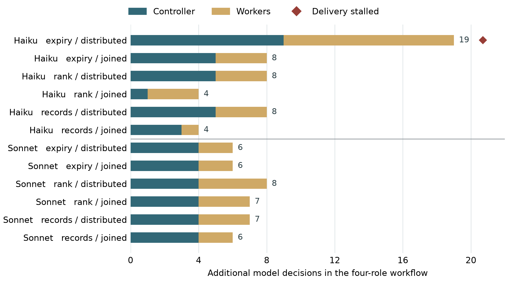

# 多智能体软件交付中的依赖协调：工作流复杂度的成本与质量收益

*Coordinating Dependencies in Multi-Agent Software Delivery: The Costs and Quality Benefits of Workflow Complexity*

**作者：** oopslink、OpenAI Codex（AI 共同作者）

**oopslink 主页：** [https://github.com/oopslink](https://github.com/oopslink)

## 中文摘要

多智能体软件工作流通过分工和独立验收控制质量，也可能因交接要求增加而停摆。本文分析 Agent Center 的协作记录，并在任务、交付物和启动上限相同的条件下比较两角色与四角色工作流。12 对执行中，四角色的控制端和工作端决策数均较高，分别累计增加 52 次和 39 次。两组的 24 个实现全部通过独立检查，两角色与四角色完整交付分别为 12/12 和 11/12。停摆案例中，审查者提供了四份有效回执，控制者却不认可其他会话产生的证据；重复审查耗尽了集成所需的启动预算。部署记录也显示，独立验收能发现上游未覆盖的产品缺陷。工作流复杂度的取舍应依据每次交接引入的依赖、能发现的错误和付出的协调成本。候选版本和可核验凭据应随任务交接，重复确认同一事实不宜成为发布的必要条件。

**关键词：** 工作流复杂度；多智能体交接；独立验收；协调成本

## Abstract

Division of labor and independent verification may improve delivery quality, but handoffs can also prevent integration. We analyzed coordination records from Agent Center and compared two- and four-role workflows with identical tasks, deliverables, and worker-start limits. Across 12 matched pairs, both controllers and workers required more decisions with four roles: 52 and 39 additional decisions in total, respectively. All 24 implementations passed independent checks; complete delivery was 12/12 for two roles and 11/12 for four. In the stalled run, the controller rejected valid receipts from other sessions. Repeated review exhausted the start budget before integration. Other deployment cases show independent checks detecting defects missed upstream. Whether a handoff is warranted therefore depends on the dependency it creates and the errors it can detect. Candidate-bound, verifiable receipts should accompany the handoff so that repeated confirmation of the same fact does not become a release requirement.

**Keywords:** workflow complexity; multi-agent handoffs; independent verification; coordination costs

## 1 引言

多智能体工作流将实现、测试、集成和发布交给不同角色，并通过依赖与验收门槛约束交付。这种设计希望把一个复杂目标拆成可管理的局部责任。Agent Center的实际运行却显示，知道角色职责和启动条件，仍不一定足以决定下一步行动：协调者识别出任务缺负责人，却等待他人确定分配；参与者同意谁负责合并，却把合并目标理解成不同分支。用户需要重新说明动作主体、对象或阶段，工作才得到继续组织。（B01–B03）

**研究问题是：给 Agent 配置更复杂的工作流程，会怎样改变它的决策负担、交付质量和停摆风险？哪些新增环节值得保留？** 分析单位是围绕同一交付目标的一条工作流。主要对照保持实现、测试、审查、交付清单四项要求一致，只改变这些工作如何分配与交接。这样可以判断，多付的决策成本究竟伴随更多合格产物，还是消耗在已有证据的往返确认上。

“流程复杂”在本研究中有三个不同含义：任务图中的依赖和跨负责人连接，行动中需要同时确定的对象、阶段与合同关系，以及相同事实的呈现方式。前两者用于描述真实协作，第三者用于短题比较；多轮执行实验改变实际角色与交接边界。消息多、节点多或角色多本身都不是失效判据；“扯皮”也只描述反复转交和解释的表面现象，不推断大语言模型（LLM）具有推诿动机。

已有研究覆盖角色规范违背、重复步骤和协调错位。[1]<!--ref:R01--><!--anchor:section:4--> 本文的分析进一步区分“职责已经规定”与“当前行动关系已经闭合”：前者说明某角色通常做什么，后者还要说明此时由谁对哪个对象、依据何种合同采取什么动作。案例、反例与实验共同支持的结论是，**该部署需要人工补足的关键内容是具体行动关系，而独立检查仍有价值；现有证据不支持通过一概削减角色或门槛解决问题。**（B01–B09）

本文先比较相同任务和验收要求下的决策数、实现终验与完整交付，再用真实轨迹追踪额外步骤做了什么。生产案例检验相反的可能：若下游发现了新的缺陷，往返就是质量控制；若只是反复索取同一有效凭据，往返本身可能阻断交付。短题中规则条数的变化只回答文本呈现问题，不能替代对实际交接的检验。

## 2 相关研究与分析框架

### 2.1 结构化协作的收益与失效边界

结构化流程的合理性不能只从失败案例评价。MetaGPT把角色、标准作业过程、结构化产物和消息订阅联合设计；[2]<!--ref:RV16_METAGPT--> ChatDev把分工与阶段通信、具体澄清结合，其角色消融同时移除了职责与任务提示。[3]<!--ref:RV16_CHATDEV--> 两者说明有效协作需要具体通信和工作约束，不能把结果归于角色名，也不能反向推导“流程越少越好”。生产调查同样显示可靠性与可控自治是实际关注点，但其观察数据不是复杂度效应试验。[4]<!--ref:R04-->

MAST将角色规范、协调错位和验证问题区分，Failure as a Process强调错误起点与恢复过程，模型—harness研究则提醒运行机制也会改变可见行为。[1]<!--ref:R01-->[5]<!--ref:R05-->[6]<!--ref:R03--> 本文沿用这种分辨要求，将动作关系没有闭合与合法等待、有价值的独立验收分开。局部贡献是指出角色规定之后仍需由人工补充的主体、对象和合同关系；不是重新发现多Agent系统会失败。

AgentConductor在特定代码任务中按反馈调整图结构，说明流程形态应与任务共同评价。[7]<!--ref:R29--> Lost in the Middle研究的是信息位置对检索／问答的影响，[8]<!--ref:R32--> 不能单独证明本部署发生认知过载。本文的结构盘点、实际交接案例和表示短题因而分别承担描述、过程解释和局部行为检验。

### 2.2 依赖协调：何时值得增加一道交接

Malone 与 Crowston 将协调界定为管理活动之间的依赖。[9]<!--ref:MC94--> 用这一概念观察软件交付，角色数量只是表面指标：测试者产生回执，集成者需要判断这份回执是否对应当前候选，这才是必须管理的依赖。额外验收若能产生前序步骤没有的事实，可能值得其成本；若上下游已经有同一版本的有效证据，新增步骤却只要求另一个会话再证明一次，劳动增加而检错范围没有扩大。由此应同时观察控制者与工作者的决策，以及新增步骤究竟改变了什么质量判断。

本文区分角色职责、行动绑定与目标闭合。角色职责规定通常由谁做哪类工作；行动绑定还需确定当前动作、对象、合同、授权及前提；目标闭合要求尚未满足的义务在交接后仍有承接者。工作流结构复杂度、单步表示复杂度和语义关系缺失是不同变量，不能互相充当指标。

解释命题是：**如果流程只规定角色与门槛，却未绑定当下行动关系，参与者可以遵守局部规则而无法共同推进。** W01用于检查前提与承担者是否脱节，W02检查同一动作是否指向不同对象，验收案例检查局部结论是否保留剩余义务。相反，缺外部批准、有效NO-GO报告和新增事实核查是合法停止或有益协调，不属于该命题预测的失效。

命题用于解释目的性片段，没有完成全库编码或证明复杂度的剂量效应。若只展开同一条门槛的文字而不增加真实依赖或交接，得到的差异只能评价呈现方式；§4.7的实验须按这一层次解释。

## 3 材料与方法

### 3.1 研究设计与分析单位

本研究采用单部署的解释性案例比较，并辅以描述统计、动作选择探针与实际角色交接对照。案例分析回答责任如何在实际交接中变得不明确、人工补充了什么；结构统计描述协作关系的规模；动作选择实验检验表示方式对下一动作选择的影响，多轮交接实验检验具体角色组织的交付与开销。这些材料回答不同问题，不合并为一个工作流成功率。

案例的分析单位是一个**工作项推进片段**：从某个目标或前提尚未满足开始，包含参与者对下一步的解释、转交或等待，以及随后的纠正或继续记录。本文据既有材料将其组织为`〈目标，动作，主体，对象，合同，授权，前提〉`的分析关系；这不是对全库新完成的字段标注。判定责任关系是否清楚，需要同时确认下一动作服务于哪个未完成目标、由谁承担、针对哪个对象以及是否满足授权和合同。原生状态记录用于确认发生了何种变化，消息用于识别参与者如何理解责任，二者不互相替代。（B00–B09）

### 3.2 材料选择与纳入边界

资料来自同一部署的冻结消息、任务图与既有监督案例。目的性检索从26,961条消息得到429条去重候选，围绕11个锚点保存并阅读全文67条不同原生消息，另复读既有分支案例。纳入与当前动作、工作对象、验收范围或剩余目标直接相关的片段；同时纳入合理拒绝、外部等待、事实核查与结果同步，作为协调有用的对照材料。这些正反片段用于机制比较，不构成随机样本或故障率分母。（B00、B03、B07–B09）

责任分析以W01任务分配和W02分支交接为主要片段，以Graph、Spark及自有候选拒绝案例检验验收与目标范围。明显调度、依赖消费和运行失联问题不承担流程设计负效应。若等待源于权限或资源缺失，只有能够分离的责任解释进入分析，不把全部等待时间归于设计。历史提示、授权及部分源码不可得的片段保持相应证据等级。全部分析由AI完成，尚未人工复核。（B00–B09）

### 3.3 比较方法与结果判据

对每个片段，先对照任务要求与参与者的行动解释，确定缺口落在主体、对象、阶段、合同还是外部条件；再检查人工或下游成员新增了何种信息；最后区分责任解释修正、原生状态推进和最终交付。W01的后续分配可由原生快照和系统通知确认，但首次空负责人及启动拒绝仅有PD报告；W02的分支事实核查是参与者报告，不视为本研究重新完成Git验证。（B01–B03）

“不推进”与“失效”分别判断。拒绝不合格候选、等待已请求的外部批准、完成一份NO-GO报告，都可能是当前合同要求的正确动作。相反，局部验收结束后，尚未满足的交付目标仍需要可识别的承接者。分析同时保留修复关系和新增质量证据，以免把有效检查误记为无效往返。（B05、B07–B09）

描述统计使用两个不同层次。W01、W02固定区间内的全部28条消息用于计算用户参与构成、相邻发送者切换及响应间隔，人工补充按启动／继续、责任对象顺序纠正、转贴指令和完成追问归类。26个非显式夹具Plan的195个累计快照用于配对比较根与最后记录的节点数、负责人数量、依赖深度、拓扑层规模和跨负责人边比例。中位数与四分位区间（IQR）描述选定材料，消息间隔不表示修复耗时，累计结构也不表示实际并发量。窗口、公式与定位见[方法细节附录](argument-methods-015.md)及[原证据附录](evidence-details.md)。

另以四对形式反例检验角色原则是否足以唯一确定下一步：保持受限视图相同，分别改变负责人、阶段目标、合同或外部请求状态。如果合法处置随之改变，则仅靠该受限视图无法作出一致正确决定。该分析证明信息表示的不足，不证明历史模型只见到了这些信息，也不计为模型错误或生产事故。

### 3.4 受控动作选择与有效性检验

实验包含分配、迭代集成、运行验收、请求审批、合理等待、原任务修复、NO-GO报告交付和证据复用八类情境。三个二水平因素分别为：同一合取门槛的单层／八gate分解表达，行动—角色—主体关系的联表／分表呈现，以及无／有12条无关scope记录。前两组保持事实与合法动作不变；展开gate不增加真实工具调用、工作量或参与者。因此实验检验表示与关系联结，不能直接检验真实团队规模、长程依赖或停摆。

固定Sonnet 5.5与Haiku 5.5，每模型8情境×8条件×2顺序版本，共128次，两模型合计256次。每次使用隔离进程，不携带项目记忆或真实工具；顺序版本是固定呈现检查，不是独立随机重复。合格响应须同时选对动作、主体、对象与合同并满足输出格式，语义字段与格式分别统计；合法等待和升级属于正确处置。比较在相同情境及顺序版本内配对，报告固定题集的描述性差异，不推断生产发生率。

协议、输入及评分在正式响应前冻结，输出后另行检查题目状态是否一致、唯一答案是否由可见事实支持。发现问题的情境按全部条件排除负面归因，原评分仍保留；随后64次材料修复响应作为事后诊断单列，不并入主分母。一次字段反馈也只测量改答，不解释为工作流恢复。详细调用配置、材料缺陷及评分审计见[实验附录](controlled-experiments.md)。

### 3.5 构念检查与可复现范围

全部256个主输入直接要求不要把已授权的准备工作交给人，并说明gate是谓词而非必经工具调用。因而本实验不是对真实工作流长度或人工依赖的操纵，不能据语义全对证明已解决协调停摆。W2/W8的有效性问题涉及2/8情境，其全部64个条件输出按原记录保留；材料修复后的结果缺独立新情境检验，不能回写成无缺陷的确认性实验。

本文按软件工程案例研究区分情境解释与因果识别，[10]<!--ref:RV16_METHOD--> 案例为目的性选择，研究问题和分析框架经材料阅读后调整，未预注册，也未完成全库盲法编码。输入、评分和统计可复算，不等于题目具有充分内容效度；设计、答案与解释同由AI形成，现有分工审阅不能替代独立人工判定。模型响应是固定情境的交叉观测，不按独立生产任务计算置信区间或显著性。

[构念、排除标准与反证](../research-validity-016/README.md)及[图表所支持的主张](../research-validity-016/figure-claim-map.md)列明各项分析的判据与推断范围。

### 3.6 实际角色交接与工件验收对照

执行对照使用记录聚合、时效过滤和稳定排序三个函数任务。每次均需交付实现、可执行测试、带版本的审查及发布manifest四项工件。短链由builder承担实现／测试、verifier承担审查／发布；长链拆为implementer、tester、reviewer、integrator四个独立角色。共同Supervisor不计入这里的两／四角色数。两组保留相同工件、依赖和验收门槛，但会话分区、交接数和角色上下文共同变化，因此研究的是这两种具体组织方案，不是抽离其它因素的角色数效应。

另一因素将相同角色权限、工件合同及依赖作分表或联结显示；均不推荐下一动作、不自动交接。2组织×2视图×3任务×2模型共24次执行，每格一次。每次控制者最多18次决策和6次worker启动，每个worker最多6次决策；长链基础角色更多，剩余启动余量也更少，预算内差异包含这一组织成本。初始脚本executor提供固定失败实现，之后代码、测试、审查与manifest均由实际模型worker生成。测试回执须绑定当前工件且早于相应pass审查，终验不能倒补出有效审查。

主要终点为预算内控制者报告完成且终止快照通过独立验收；产物合格与自主闭合另列，避免把预算内已写出正确代码但尚未完成交接算作同一种结果。每个任务前三个测试向量可在执行中运行，其余至少五个只在终止后检查，结果不反馈给模型。所有工件版本、工具事件与模型尝试保留；对同一任务、模型及另一因素水平作配对描述。实验包含研究者构造的三个任务家族、每格一次，不作总体置信区间或显著性推断。

实验使用隔离的JSON工具运行器：合法操作实际写文件、执行Python测试或启动独立worker进程，工具结果进入该角色后续输入。CLI safe-mode禁用本地旧上下文，每次调用重放同角色完整历史；这是真实执行而非动作答题，但不是Agent Center生产版本回放，也不是原生持久聊天会话。一次只运行一个worker，检验的是串行异步交接。模型固定为Sonnet 5.5与Haiku 5.5、low effort。研究者提示只给目标、合同、权限和工具语义，不含“executor失败必须由你修复”或“复杂流程有害”等待验证原则；模型自行产生的委派内容属于观察结果。

身份恢复与工作流交接两项实验共用运行器。首批运行中，测试器误拒了合同允许的描述字段；整批排除，包括 34 次已执行和 20 项未启动的条件。校正后按相同任务、条件、顺序和预算执行全部 54 个条件。主分析只纳入校正后的运行；由于研究者已见过部分相同任务的结果，这属于探索性复验，不构成未见任务验证。缺陷、排除清单、两批结果和复算脚本见[运行器校验与排除记录](../runtime-experiments-017/README.md)。

### 3.7 交接成本的配对分解

以任务、模型和信息呈现方式匹配同一对两角色与四角色执行。对 12 对分别计算控制者决策差、各工作会话决策数之和的差；两项相加为总决策差。单列双方均完成交付的 11 对，用来判断总体结果是否只由一次停摆驱动。该子集按事后结果选择，只用于敏感性检查，不替代全部 12 对。受测试器校验缺陷影响的批次按 §3.6 的标准整体排除。[逐对数据与复算](../mechanisms-020/p2-pairs.csv)。

## 4 研究发现

### 4.1 启动门槛暴露了缺口，却没有自动确定补足者

W01揭示的是前提责任未绑定：流程要求负责人齐全，却没有在协调者的当次解释中转化为其自己的分配动作。PD知道每个任务须有负责人，也知道实现与独立验收需要分开，却将下一步表述为“需要先确定”负责人。用户要求其自行分配后，原生初始generation记录了五个节点分给四个不同assignee，系统随后通知首任务ready。后续分配具有结构化证据，图2展示了纠正与记录之间的时序。（B01、B02）

用户明确了分配动作的承担者，没有取消独立验收，也没有提供新仓库或执行环境。可见的协调缺口位于“前提不满足”与“由谁补足前提”之间。保留分配门槛有助于暴露缺失条件，但门槛本身没有在PD的当次解释中落实行动责任。（B01c–B01e）

该过程未呈现双方反复拒绝的循环。首次拒绝仍是报告级证据，后续分配也不能证明更早授权与状态完全相同。因此，W01支持一次需要用户补动作绑定的协调片段，不能据此确定永久停摆或无人介入时的结果。（B01、B02）

表1和图1展示W01后续分配的五节点依赖链，四个不同assignee分别承担实现、独立验收、集成和运行验收。这里的四种职能不等于配置中的四种role枚举。

**表1。W01原生初始generation中的五个节点**

| 拓扑顺序 | Task | 任务短名 | assignee显示标签 |
|---:|---|---|---|
| 1 | `task-a1e1746e` | 实现状态机 | dev1 |
| 2 | `task-b9ff74f6` | 历史迁移 | dev1 |
| 3 | `task-effb5a81` | 独立验收 | tester1 |
| 4 | `task-84279343` | 合并 main | integration |
| 5 | `task-b38e6bee` | runtime 验收 | tester2 |

**图1。**W01任务与责任结构。上部为职责入口示意；下部为该案例初始快照中的原生节点、依赖与assignee映射，箭头按“前置→依赖者”绘制，与原生from依赖to的字段方向相反。首次空assignee及API拒绝仍是PD报告，不能由后续快照反推为已核前态。

**图2。**W01动作责任纠正与后续记录。用户指令后31.295246秒保存带分配的generation，31.872839秒出现首任务ready消息。分别标识报告、指令、原生快照与系统通知；不将这些间隔称为人工干预效果或停摆时长。

### 4.2 职责共识不能消除对象和阶段歧义

W02揭示的是对象与阶段未绑定：同意谁负责合并，仍不足以确定合并到哪里、何时进入发布。integration与PD都接受开发期合并和发布职责的划分，却对“迭代主干”指向不同对象。PD将迭代主干表述为main，并要求integration执行相应合并；用户随后明确区分开发分支、版本迭代分支与发布main，并分别指定合并责任。角色共识没有自动形成对象和阶段共识。（B03.1–B03.3、B03x）

纠正角色映射后，PD又以迭代分支不存在为前提要求重建。integration核对远端后报告该分支已包含开发成果与验收证据，拒绝重复创建。这一检查具有正面作用：下游没有仅因指令来自协调者或由用户转贴，就将错误前提作为事实继续执行。（B03.4–B03.6）

表2区分了职责、对象、事实和发布顺序的补充。该案例的机制在于，抽象职责仍须落到具体源对象、目标对象和阶段；有效事实核查则能纠正交接中的错误。发布报告保留为历史叙述，不作为本研究重新验证部署成功的依据。（B03.7–B03.10）

**表2。分支交接案例（W02）中的对象、责任与事实纠正**

| 交接阶段 | 记录主体 | 记录内容 | 对判断的作用 |
|---|---|---|---|
| 目标分支识别 | PD报告 | 将迭代主干称为main，并交给integration合并 | 职责口号相同，目标分支仍被误映射 |
| 责任与目标澄清 | 用户 | 澄清开发分支→迭代主干→main及ship责任 | 补充对象、阶段与行动者 |
| 远端状态核对 | integration报告 | 核对后称迭代主干已存在，不应重建 | 下游事实核对具有正面作用；分支状态仅有参与者报告 |
| 发布次序澄清 | 用户 | 纠正构建、文档、tag、合main与清理次序 | 是发布操作顺序纠正，不是明确提前done |

### 4.3 独立验收可以发现上游未覆盖的缺陷

独立验收具有实际用途的条件，是检查上游未覆盖的产品行为。Graph案例中，Supervisor已报告跨页合并、计数与回归通过，Tester对同一候选继续检查点击聚合边后的证据请求，指出计数正确仍不足以证明两页证据进入详情视图。后续候选又暴露跨项目请求使用错误作用域的问题。这些判定对应逐步展开的检查范围，不能仅以标签不同认定责任推诿。（B04、B05）

该案例将目标责任具体化为覆盖关系：谁负责连接已经证明的局部行为与尚未覆盖的产品要求。独立验收的增量来自新的输入、断言和作用域检查。由于相应源码未能完整读取，这些案例仅支持对检查报告的分析，不足以估计监督误判率。（B05a–B05f）

### 4.4 局部完成与剩余交付义务可以同时存在

Spark说明必须把工作项合同与产品目标分别追踪。报告任务要求给出可审计的GO或NO-GO，而非保证产品可发布。报告被接受时仍列明输入、环境和实现方面的发布缺口，持久报告也保存了NO-GO结果。因此，报告任务完成与产品尚不可发布可以同时成立；目标层仍需追踪剩余条件。（B07）

四组近似消息承担了Task到Plan的结果传播或完成状态补记，未见相应新增产品检查。它们提供同步证据，不能累计为独立验收。另一个反例中，Agent明确承担自身候选责任，却因缺生产证据拒绝放行。这些行为提醒流程评价同时保留同步、质量控制与外部依赖的用途。（B08、B09）

### 4.5 人工参与主要补充动作、对象与操作顺序

两个固定区间包含28条消息，其中12条由用户发出。W01的6条消息中有3条用户消息；W02的22条消息中有9条（表3）。这些比例描述所选案例的沟通构成，不代表全系统人工干预率。

**表3。固定区间的全部消息与下一条Agent消息间隔**

| 区间 | 消息数 | 用户消息 | Agent消息／不同发送者 | 系统消息 | 用户消息至下一条Agent消息：中位秒数 [IQR] |
|---|---:|---:|---:|---:|---|
| W01 | 6 | 3 | 2／1 | 1 | 40.11 [37.69, 280.32]，n=3 |
| W02 | 22 | 9 | 13／6 | 0 | 110.77 [32.68, 210.30]，n=9 |

12条用户消息中，5条是启动或继续要求，5条补充或质询责任、对象及操作顺序，另有1条转贴指令和1条追问完成状态（表4）。用户补偿的内容由此可以具体定位到控制关系；这些消息没有提供新执行器或独立运行测量，但确实包含新的动作和语义信息。

**表4。十二条用户消息的内容编码**

| 互斥主类别 | 消息数 | 实际补充内容 |
|---|---:|---|
| 启动／继续要求 | 5 | W01两次启动、W02一次ship及两次继续 |
| 责任、对象或顺序纠正／质询 | 5 | 谁分配、角色边界、错误交接质询、三层分支映射、发布顺序 |
| 转贴操作指令 | 1 | 重建分支请求；随后Agent以已存在分支的报告反驳 |
| 完成状态追问 | 1 | 是否已经合入main |

转贴的重建指令随后被Agent的分支核查反驳，说明人类参与并不天然提供正确事实。固定时间窗内的首条回复有时仍指向错误的分支。因此，消息回应与责任纠正需要分别编码，下一条Agent消息的时间不能作为问题已解决的时间。时间窗、编码与证据定位见案例附录。

### 4.6 依赖结构扩展不能由成员数量概括

W01的5对相邻消息中有4对切换发送者，W02的21对中有18对（表5、图3）。这些顺序统计展示了往返分布；它们没有识别直接回复关系，也不把每次换人发言解释为无效协调。

**表5。两个固定区间的发送者切换**

| 区间 | 全部消息 | 相邻消息对 | 发送者不同的相邻对 | 未发生切换 |
|---|---:|---:|---:|---:|
| W01 | 6 | 5 | 4 | 1 |
| W02 | 22 | 21 | 18 | 3 |

**图3。**（a–b）完整有界区间按发送者绘制，每点一条消息，菱形为用户；（c）W02相邻发送者计数，行是前一条、列是下一条，不意味着直接回复；（d）全部用户消息至下一条Agent消息的间隔，黑线为中位数，重合点可能遮挡且多个间隔可共用回复。区间由既有案例首尾确定，不是系统总体样本。

在26个Plan的根与最后累计快照之间，节点数中位数从8增至17.5，seq最长路径从3条边增至6条边，最大拓扑层从3个节点增至6.5个，而不同assignee数中位数均为6.5（表6）。结构扩展发生在任务和依赖层面，成员数量不足以概括这种变化。

**表6。根／最后快照的配对结构中位数**

| 指标 | 配对Plan数 | 根记录 | 最后记录 |
|---|---:|---:|---:|
| 累计节点数 | 26 | 8 | 17.5 |
| 不同assignee数 | 26 | 6.5 | 6.5 |
| seq最长路径，边数 | 26 | 3 | 6 |
| 最大拓扑层节点数 | 26 | 3 | 6.5 |
| 跨assignee边占比 | 21 | 100.0% | 93.8% |

两端均有可比较边的21个Plan中，跨assignee边占比中位数从100.0%变为93.8%。它描述跨负责人连接程度，不是交接错误率。最大拓扑层也不是实际并发容量，因为累计快照可能保留已完成节点，并受到其它依赖与同一负责人约束。图4保留每个Plan的配对关系，避免把汇总中位数理解为所有Plan均按同一方式增长。

**图4。**四面板分别比较不同负责人、seq深度、跨负责人边比例与最大拓扑层；每条细线连接同一Plan，黑线为该面板配对支持上的中位数。不同负责人、seq深度和最大拓扑层各26对，跨负责人比例21对；拓扑层轴为对数。未进行随机干预或复杂度—失败回归。

这些结果将“流程复杂”分解为成员、依赖深度、层规模和交接边界。它们为后续比较提供可操作指标，尚未建立复杂度与停摆之间的因果关系。

### 4.7 事实完备的短题未出现语义映射错误

在状态与合同定义有效的六个情境中，两模型均能选对动作、主体、对象和合同；现有实验没有观察到联表／分表、gate展开或无关记录造成的语义映射错误。这个结果约束了“流程表示一复杂就会认知失效”的解释，但没有测量多轮交接时责任能否持续维持。严格输出格式仍有差异，不能把语义字段正确等同于接口响应合格。

原256次响应的冻结严格得分为Sonnet 107/128、Haiku 102/128（表7）。其中W2同时给出待集成目标与integration_ok=true，W8没有说明回执适用哪份合同，却预设release为唯一答案。两题共64次响应中42次未匹配；这些结果保留用于审计，不承担模型或流程负效应归因。

排除这两题的全部条件后，Sonnet为91/96，Haiku为96/96。Sonnet其余五次均在正确JSON前附加解释，违反指定输出接口；事后从原文提取唯一内嵌JSON，六个情境的动作、主体、对象与合同两模型均为96/96。该诊断单列语义判断，不改变接口合规得分。Sonnet原始collapsed减expanded差4.69个百分点，排除两题后为6.25个百分点，但全部来自格式；Haiku排除后各因素差均为0。联表的原始优势同样不能脱离题目缺陷解释。

**表7。严格评分、歧义情境排除与事后复测（不合并分母）**

| 分析层 | Sonnet 5.5 | Haiku 5.5 | 含义 |
|---|---:|---:|---|
| 原冻结严格评分 | 107/128 | 102/128 | 含矛盾／缺信息题，保留审计用途 |
| 排除W2、W8全部条件 | 91/96 | 96/96 | 六情境；Sonnet剩五次为格式不合规 |
| 上行内嵌JSON字段诊断 | 96/96 | 96/96 | 事后提取，不覆盖严格得分 |
| W2、W8材料修复后新调用 | 32/32 | 32/32 | 事后冻结复测，未混入主分母 |
| 事前一次字段反馈 | 未抽到 | 0/24 | 全为缺陷题；不能估计真实纠错能力 |

事前反馈按固定排序取前24个未匹配输出，恰好全属Haiku的W2/W8，均未达到原判据。由于输入本身存在问题，该结果只说明此反馈没有消除与预设答案的差异，不能称模型坚持错误。另冻结修复W2状态与W8合同信息后的64次新调用，两模型分别为32/32与32/32；这是材料修复诊断，不能证明架构简化有效，也不能补成历史生产事故的对照。

**图5。**上左为排除缺陷题后的全条件严格得分（每格12次）；上右保留原八情境分数，星号标记不能承担负面归因的W2/W8；下部为六情境的配对差（每模型每因素48对）及另行材料修复结果。格式问题与语义字段分开解释，非团队停摆率。原128次／模型底表、全部反例和修复输入差分见实验附录。

### 4.8 增加真实交接带来稳定开销，但未增加实现通过数

24次实际工作流中，代码实现24/24通过独立终验，完整工件与自主交付均为23/24。两角色为12/12完成，四角色为11/12；分表为11/12，联表为12/12。后一组差异与角色组差异由同一个Haiku时效过滤episode贡献，不能当作两次独立支持，更不能由此认定联表解决了交接问题。（表9、图6）

四角色相对两角色在全部12个任务／模型／视图配对中增加总决策。Sonnet每对平均多6.67次［6–8］，Haiku多8.50次［4–19］；平均报告价分别增加0.17130和0.01202美元。代价来自增加独立会话、启动、等待和局部确认；在这些小函数上没有换来更多实现通过。这个结论针对受测的两种角色配置，包含角色上下文与启动预算余量的变化，不能推广为所有分工或独立检查没有收益。

**表9。P2全部实际交接条件（每格3任务；两模型分列）**

| 模型 | 条件 | 自主交付 | 实现／全工件通过 | 总决策均值［范围］ | 平均报告价（美元） |
|---|---|---:|---:|---:|---:|
| Sonnet | 四角色，分表 | 3/3 | 3/3；3/3 | 22.33［22–23］ | 0.49811 |
| Sonnet | 四角色，联表 | 3/3 | 3/3；3/3 | 22.00［22–22］ | 0.45627 |
| Sonnet | 两角色，分表 | 3/3 | 3/3；3/3 | 15.33［15–16］ | 0.29474 |
| Sonnet | 两角色，联表 | 3/3 | 3/3；3/3 | 15.67［15–16］ | 0.31704 |
| Haiku | 四角色，分表 | 2/3 | 3/3；2/3 | 27.67［24–34］ | 0.03687 |
| Haiku | 四角色，联表 | 3/3 | 3/3；3/3 | 23.67［23–24］ | 0.02784 |
| Haiku | 两角色，分表 | 3/3 | 3/3；3/3 | 16.00［15–17］ | 0.01810 |
| Haiku | 两角色，联表 | 3/3 | 3/3；3/3 | 18.33［16–20］ | 0.02258 |

总决策包含格式不合规响应，不含一次CLI超时后的额外传输重试。P2共7次格式错误，均在原episode内恢复；错误没有从底表删除。联表减分表的平均总决策差为Sonnet 0、Haiku −0.83次；Haiku的六对差值范围为−10到+4，正差3对、零差1对、负差2对。因此不能把平均值写成稳定的简化收益。

**图6。**上部给出全部24个单元的终态和控制者／worker决策数，D为自主交付，B为报告阻塞；下部为两项因素各模型的全部6对总决策差。两／四角色不包含共同Supervisor。没有以成功子集计算开销，也没有删除极端返工值。三个任务家族、每格一次，只作描述性比较。[完整底表与原始轨迹](../runtime-experiments-017/README.md)。

### 4.9 局部可见性被外推为证据不存在，审查返工挤掉了发布

唯一未闭合的时效过滤任务并非代码失败：实现和6条自编测试正确，审查也有真实的先行通过回执。控制者却认为审查者引用的worker回执不在自己的工具结果中，因而要求只引用controller的回执。新的审查者没有接收到controller的原始工具历史，拒绝把指定时间戳当作已亲自验证的记录，重新运行测试并引用自己的有效回执。控制者再次把新回执判为不存在，形成了重复审查。（表10）

**表10。回执争议中的可观察事实与边界**

| 层次 | 实际记录 | 机制含义 |
|---|---|---|
| 共同产物 | module与tests哈希保持相同；实现终验8/8，自编测试6/6 | 返工没有修复新的代码或测试缺口 |
| 可验证证据 | 共7张真实成功回执；4次审查引用各自先行、同版本回执 | 不是回执伪造、丢失或事后倒填 |
| 控制者视图 | 收到worker报告和工件，未接收完整worker工具历史 | 将本会话未直接见到外推为全局不存在 |
| 审查者视图 | 收到改写要求和文件，未收到controller原始回执对象 | 改用自己执行所得证据，与要求反复冲突 |
| 剩余义务 | implementer、tester各1次，reviewer 4次，integrator 0次 | 6次启动预算耗尽；16次控制决策后报告阻塞，缺manifest |

源码与原件核查确认，工具确实按协议返回报告和文件，未承诺共享全部历史；合同允许任一针对当前版本的真实成功回执，没有规定只能使用controller签发的回执。因此这不是已确认的运行器执行bug，而是**隔离证据视图与模型自行收紧认可条件的交互**。对该例的解释由四次真实回执核对支持，仍不是针对共享回执机制的因果实验。

同任务、同Haiku的另外三个条件均完成，包括四角色联表；同模型四角色分表的另外两个任务也完成。它们反对“四角色必然停摆”的解释。联表仅整理角色／权限／依赖，并未共享回执对象，故这一成功对照也不能证明联表修复了上述机制。全部负例、预先规则选取的正例及精确时序保留在[案例审计](../runtime-experiments-017/review/receipt-boundary-case.json)，终态按预设预算截止时的运行记录计量。

### 4.10 交接成本分布在控制者与工作者两端

为判断协调成本是否集中于停摆案例，分别分析全部配对和双方均完成交付的配对。全部 12 对中，控制者与工作者的决策数均逐对上升。两角色增加到四角色，共多出 91 个决策，其中 52 个发生在控制端、39 个发生在工作端；两端增加量的中位数分别为 4 和 3。即使仅比较双方都完成交付的 11 对，总增量的中位数仍为 7（范围 4–8）。因此，重复审查解释了该案例为何停摆，但两种流程的决策数差异并不限于该例。

**图7。** 同一任务、模型和视图下一对执行的决策差；每条分开标出控制端与工作端，菱形标出未完整交付的四角色执行。额外决策不全是浪费；图6与表10进一步区分增加质量证据的检查和仅重复确认的往返。[矢量图](figures/p2-fig7-paired-decisions.pdf) · [12 对底表](../mechanisms-020/p2-pairs.csv)。

## 5 交接依赖与证据认可的失效机制

### 5.1 角色职责不能唯一确定下一步由谁行动

W01与W02具有共同结构：一般规则已经存在，但规则没有充分确定当前动作。前者缺少“由协调者补齐负责人”的主体绑定，后者混淆了源分支、目标分支及发布阶段。人工补充使这些关系明确，下游事实核查又纠正了新的错误前提。由此可见，形式上拥有角色分工并不意味着当前工作项已可执行；增加角色说明或重复启动要求，也未必补足缺失关系。（B01–B03）

这一解释不要求假定Agent有推诿动机，也不将关系缺口认定为所有不推进的唯一原因。事实、权限和运行能力均可能限制行动；缺事实应查询，缺授权应升级，已请求外部资源则可以等待。区分这些状态，才能判断何时需要由当前主体继续工作，何时停止才符合要求。历史输入不完整，仍限制各因素贡献的分离。（B01、B03、B09）

### 5.2 验收的价值取决于能否发现上游遗漏

一次局部动作正确，并不保证整体目标继续推进。测试者可以正确拒绝候选，协调者可以准确转述结论，但如果未满足断言没有成为带对象、授权与承担者的工作项，后续修复仍可能悬空。Spark的NO-GO报告说明了另一面：报告任务可以完成，产品目标仍应保持未完成。问题在于这两个层级的剩余义务如何关联，不能通过要求所有任务都保持running来解决。（B05、B07–B09）

设计上，验收结论应携带精确候选、适用合同、未满足断言及后续处理主体。只有产生新输入、新断言或新作用域检查，才计为新增验证；已知结果向Plan传播属于同步。Graph的独立检查与W02的下游核查表明，这些边界可以增加有用事实。减少流程时应优先减少对同一关系的反复确认，保留能够发现缺口的检查。（B03、B05、B08）

### 5.3 角色数量与依赖关系的可见性

根据这些案例，可执行工作项至少需要清楚表达目标、下一动作、主体、对象、合同、授权与前提。对尚未完成且没有明确外部等待的义务，应能够定位合法的继续路径。该要求提供一种设计检查条件，但不保证流程活性：循环依赖、资源不可用、无人调度或持续无效动作仍可能阻止完成。完整协议的端到端收益尚需验证。

W01纠正后仍保留四个不同负责人的分工，W02的下游角色仍提供事实核查。因此，当前材料支持的简化目标是减少模型临场补全控制关系的需要，而不是根据角色数量决定好坏。生产研究和动态拓扑研究也将结构选择置于具体任务条件下，不能由此推断统一的最优角色数。[4]<!--ref:R04--><!--anchor:section:5.4, 7.1-->[7]<!--ref:R29--><!--anchor:section:2.1.2, 3.2.2-->（B02、B03.6）

### 5.4 人工介入揭示的流程缺口

本文观察到的人工作用包括补主体、补对象与阶段、纠正操作顺序，以及催促继续；它们不是同一种干预。下一步应固定任务、事实、工具与权限，比较一般角色规则与完整工作项交接，测量无提醒推进、剩余义务丢失、重复动作和最终验收质量。用户消息减少或回复加快都不能单独证明改进：正确拒绝、必要升级与外部等待同样是合格结果。（B01、B03、B07–B09）

短题实验只覆盖事实完整后的表示变化；多轮交接对照显示了交接成本及一次证据认可争议，但没有实施一般角色规则与完整工作项的全部干预。有效情境没有语义错误，是反对简单“表示复杂度致错”解释的证据；实验材料自身的歧义则要求评分依据必须从模型实际可见的事实推出。两者都不能取消真实案例中人工补足行动关系的事实。表8汇总仍相互竞争的解释。

**表8。责任与复杂度的竞争解释**

| 解释 | 当前支持与反证 | 仍需怎样检验 |
|---|---|---|
| 角色到动作的关系缺失 | W01/W02需补主体或对象；形式反例说明受限表示不足 | 恢复实际输入，比较完整工作项与角色规则 |
| 关系齐全但联结困难 | 短题排除材料缺陷后未见有效语义错误；不支持普遍困难 | 固定信息，增加合法对象数量与关联深度 |
| 局部完成掩盖剩余义务 | Graph及NO-GO区分局部与全局；跨会话回执争议阻断集成与发布；其余23次交接完成 | 在新任务操纵证据共享，区分有效拒绝与重复索证 |
| 复杂表述增加负担 | Sonnet严格格式有差异，未形成语义错误证据 | 匹配长度，操纵必要推理深度与真实依赖 |
| 授权或事实不足 | 人工补充类型不同；缺生产证据时拒绝有用 | 分开干预授权、事实、催促，记录恢复路径 |
| 模型训练或协调动机 | 训练过程和模型动机均未测量 | 跨模型训练／提示干预；不能从reason倒推 |

### 5.5 行动关系完整后，还需要跨会话的证据认可关系

交接实验中的角色、工件和允许动作均已定义，未闭合却发生在另一层：双方把“我直接观察到的工具结果”作为认可证据的隐含边界。审查者能生成有效证据，控制者也能组织继续工作，但新增的controller专属引用要求使这些局部正确行为反复冲突。原始合同允许任何当前版本的真实成功回执；同版本的新增测试并没有补足新质量缺口。因而这一例把剩余义务问题具体化为：认可条件是否在交接时被一致理解，是否能由可查凭据判断，而非反复让另一角色重述。

候选改进是将回执标识、产物版本、合同和验证结果作为可查询的共享对象，并将其与说明性notes分开。程序化核对可避免把本地可见性直接当全局真实性，但其收益仍需新的实际对照验证；实验中的联表条件只整理静态职责，没有实现共享回执。不得由一个负例推出普遍机制，也不能把控制者声称“没有回执”当作已核事实。更高交接成本与这条失效轨迹提供了具体改进目标，尚未提供普遍最优的角色数。

## 6 交接协议与独立验收

### 6.1 凭据随候选交接

增加一个验收条件不一定要增加一次交接。把同一规则拆成多条叙述，改变的是读法；让独立验收者检查上游没有覆盖的行为，改变的是可发现的缺陷；把同一检查交给多个隔离会话分别确认，改变的则是取证和认可的成本。三者不能用步骤条数相加，再当成一个复杂度分值。本文中，规则呈现对照未显示稳定的语义损失，独立检查有正例，可重复测到的成本集中在增加真实交接的工作流。（§4.3、§4.7–4.9）

在相同的六次启动上限下，顺利执行两角色方案只需启动两名 worker，四角色方案需启动四名，因此后者容纳返工的余量较小。若每次交接还要让新会话重新取得、解释并认可证据，一次分歧就可能耗尽原本留给集成的机会。这个机制解释了为何质量合格仍会停摆；实测差异同时包含角色细分、会话隔离和预算余量，不是单独增加一个流程节点的效应。设计评审可以逐项问：这一步有何独立验收价值，交给谁，传递哪个版本的凭据，发生分歧后谁还能推进？

同一候选的审查回执应能由集成者独立核对：回执注明候选版本、检查范围、结果和签发者，接收者据此决定是否复用。若候选改变或原检查不能覆盖新义务，再安排复验。应为最终集成预留启动预算。该方案针对实验中观察到的回执争议；其节省的决策数尚未通过干预测量。

### 6.2 证据边界

本研究是单部署、目的性选例的探索。历史提示、授权与全部执行输入未恢复，用户后续要求也可能改变当时条件。因此，案例能够支持具体责任解释与人工补充的存在，不能估计其总体发生率、无人介入时的持续时间，或认定所有不推进都来自同一机制。W02早于后来的内部Supervisor/executor设计，只用于跨角色协作；Graph检查部分依赖历史报告，未重跑生产验收。（B00–B05）

结构统计使用累计快照，未校准为认知负荷、沟通成本或实际并发量，也没有进行复杂度—失败因果比较。消息回应与修复成功是不同结果，多个用户消息可以共用同一次回复。跨论文复用的记录不是独立重复；全部分析尚未人工复核。过程研究只提供分析视角，不替代本系统的效果测量。[5]<!--ref:R05--><!--anchor:section:II-->

动作选择实验仅有八类固定英语短情境，两种呈现版本不构成独立随机重复。两模型、明确规范及部分直接提示动作的目标带来较强天花板；gate展开没有增加真实工作量，联表和分表长度也不同。该动作探针没有测量真实交接或训练机制；§3.6 的多轮实验检验有限长度的真实串行交接，仍未覆盖长期生产协作。无缺陷情境中的语义正确不能证明一般流程可靠，格式失败也不能反推内部认知失效。

24 次交接来自三个研究者构造的英文函数任务，每格一次；没有自然生成的错误候选，代码质量达到本题集天花板。两／四角色同时改变上下文分区、启动与等待次数和预算余量；分表／联表没有操纵跨会话回执的可达性。唯一未闭合episode不能提供稳定故障率或机制中介效应；同一负例同时进入两个因素比较。校正测试器后的执行使用相同任务，不构成未见任务验证，且没有人工提醒、并行分支或真实外部权限阻塞对照。

明确的系统故障不计入设计失效；材料审计的缺陷、实施偏差和原分数均在附录保留。历史输入不完整，也未直接检验共享回执的干预效果。（B00、B07、B09）

## 7 结论

在交付物与验收要求相同的短函数任务中，四角色工作流比两角色工作流需要更多协调。12 个配对中，控制端与工作端的决策数均增加，合计多出 91 次；只比较两种流程均完成交付的 11 对，总增量的中位数仍为 7 次。24 个实现均通过检查，两角色与四角色的完整交付分别为 12/12 和 11/12。（表9、图6–7）

停摆的关键不在代码质量，而在证据能否跨会话得到认可。四次审查均产生有效回执，但重复确认耗尽了集成所需的启动预算。与之相对，能发现上游漏检行为的独立验收具有明确用途。（表10；B03、B05、B07–B09）

工作流设计应先确定不可省略的质量检查，再确定承担者和交接次数。每个候选应附版本一致的可核验凭据，并为最终集成保留执行预算。这些结果支持减少不能增加质量证据的交接，不足以确定长程任务的最优角色数。

## 参考文献

[1] M. Cemri et al., “Why Do Multi-Agent LLM Systems Fail?,” arXiv:2503.13657v3, 2025. doi: [10.48550/arXiv.2503.13657](https://doi.org/10.48550/arXiv.2503.13657). [已核版本](https://arxiv.org/abs/2503.13657v3).

[2] S. Hong et al., “MetaGPT: Meta Programming for A Multi-Agent Collaborative Framework,” arXiv:2308.00352v7, 2023, revised Nov. 1, 2024. doi: [10.48550/arXiv.2308.00352](https://doi.org/10.48550/arXiv.2308.00352). [所引预印本版本](https://arxiv.org/abs/2308.00352v7).

[3] C. Qian et al., “ChatDev: Communicative Agents for Software Development,” in *Proceedings of the 62nd Annual Meeting of the Association for Computational Linguistics (Volume 1: Long Papers)*, 2024, pp. 15174–15186. doi: [10.18653/v1/2024.acl-long.810](https://doi.org/10.18653/v1/2024.acl-long.810).

[4] M. Z. Pan et al., “Measuring Agents in Production,” in *Proceedings of the 43rd International Conference on Machine Learning*, Proceedings of Machine Learning Research, vol. 306, 2026, pp. 95649–95695. [正式论文](https://proceedings.mlr.press/v306/pan26a.html).

[5] X. Zhao, H. Li, S. Li, T. Zhao, E. T. Barr, F. Sarro, and H. Ye, “Failure as a Process: An Anatomy of CLI Coding Agent Trajectories,” arXiv:2607.09510v1, 2026. doi: [10.48550/arXiv.2607.09510](https://doi.org/10.48550/arXiv.2607.09510). [已核版本](https://arxiv.org/abs/2607.09510v1).

[6] J. Chen, S. Chen, H. Zhu, J. Cao, J. Shen, and S.-C. Cheung, “Understanding Agent-Reactive Bugs at the Model-Harness Boundary: An Empirical Study of LLM Agent Issue Reports,” arXiv:2607.15684v1, 2026. doi: [10.48550/arXiv.2607.15684](https://doi.org/10.48550/arXiv.2607.15684). [已核版本](https://arxiv.org/abs/2607.15684v1).

[7] S. Wang et al., “AgentConductor: Topology Evolution for Multi-Agent Competition-Level Code Generation,” arXiv:2602.17100v1, 2026. doi: [10.48550/arXiv.2602.17100](https://doi.org/10.48550/arXiv.2602.17100). [已核版本](https://arxiv.org/abs/2602.17100v1).

[8] N. F. Liu et al., “Lost in the Middle: How Language Models Use Long Contexts,” *Transactions of the Association for Computational Linguistics*, vol. 12, pp. 157–173, 2024. DOI: [10.1162/tacl_a_00638](https://doi.org/10.1162/tacl_a_00638). [出版记录](https://aclanthology.org/2024.tacl-1.9/).

[9] T. W. Malone and K. Crowston, “The interdisciplinary study of coordination,” *ACM Computing Surveys*, vol. 26, no. 1, pp. 87–119, 1994. [原文](https://crowston.syr.edu/sites/default/files/acmcs94.pdf). DOI: 10.1145/174666.174668.

[10] P. Runeson and M. Höst, “Guidelines for conducting and reporting case study research in software engineering,” *Empirical Software Engineering*, vol. 14, pp. 131–164, 2009. doi: [10.1007/s10664-008-9102-8](https://doi.org/10.1007/s10664-008-9102-8).

## 证据附录

正文 B 编号对应项目原始材料，不是外部文献编号。消息支持当时表述，generation 支持指定快照状态，报告及源码只按实际读取层级使用。所有消息时间均为协调世界时（UTC）。C07-E07 按发布顺序纠正解读；C07-E10 的发送者为 PD，与 E09 同源，不计为第二角色独立核验。

| 编号 | 用途 | 原生 ID / 类型 | UTC 时间 | 原文路径 |
|---|---|---|---|---|
| B00 | 010检索、纳排、C07更正与证据范围 | 文档/派生索引 | 不适用 | [原文](/Users/oopslink/works/research/agent-harness-study/run-001/papers-010/phase1_evidence/findings.md) |
| B01a | 第一次启动要求 | `01M14JPXVK1Z8CKDYMTD3TSPAX` | 2026-08-28T16:19:40.531485Z | [原文](/Users/oopslink/works/research/agent-harness-study/run-001/papers-010/phase1_evidence/records/01M14JPXVK1Z8CKDYMTD3TSPAX.json) |
| B01b | 再次启动要求 | `01M14K5QQTGJF62VANSQC5WW38` | 2026-08-28T16:27:45.786608Z | [原文](/Users/oopslink/works/research/agent-harness-study/run-001/papers-010/phase1_evidence/records/01M14K5QQTGJF62VANSQC5WW38.json) |
| B01c | PD报告assignee拒绝并待确定负责人 | `01M14K6T665DY5ZSR50T9ACMW4` | 2026-08-28T16:28:21.062508Z | [原文](/Users/oopslink/works/research/agent-harness-study/run-001/papers-010/phase1_evidence/records/01M14K6T665DY5ZSR50T9ACMW4.json) |
| B01d | 用户要求自行分配 | `01M14KC5XZJD4PGDV4614XEWSV` | 2026-08-28T16:31:16.927437Z | [原文](/Users/oopslink/works/research/agent-harness-study/run-001/papers-010/phase1_evidence/records/01M14KC5XZJD4PGDV4614XEWSV.json) |
| B01e | PD报告分配与启动 | `01M14KDD3C9JDTE6PYV3Y01MB1` | 2026-08-28T16:31:57.036572Z | [原文](/Users/oopslink/works/research/agent-harness-study/run-001/papers-010/phase1_evidence/records/01M14KDD3C9JDTE6PYV3Y01MB1.json) |
| B01f | 原生首任务ready系统消息 | `01M14KD520A5X362XVHJ64EKC7` | 2026-08-28T16:31:48.800276Z | [原文](/Users/oopslink/works/research/agent-harness-study/run-001/papers-010/phase1_evidence/records/01M14KD520A5X362XVHJ64EKC7.json) |
| B02 | 五节点、四个不同负责人的初始分配，仅读初始generation | `generation-709baba8` | 2026-08-28T16:31:48.222683Z | [原文](/Users/oopslink/works/research/agent-harness-study/run-001/papers-010/phase1_evidence/raw/pm_plan_generations-plan-2a8bc24c.json) |
| B03.1 | 旧006 C07-E01原文；sender和顺序按010核对 | `01KV71B56MYTKFX58W48VARSTA` | 2026-06-16T01:39:41.396427Z | [原文](/Users/oopslink/works/research/agent-harness-study/run-001/papers-010/phase1_evidence/inherited/C07-E01.json) |
| B03.2 | 旧006 C07-E02原文；sender和顺序按010核对 | `01KV71F5Q1DGQ5MP1Q29XMQ2H4` | 2026-06-16T01:41:52.993389Z | [原文](/Users/oopslink/works/research/agent-harness-study/run-001/papers-010/phase1_evidence/inherited/C07-E02.json) |
| B03.3 | 旧006 C07-E03原文；sender和顺序按010核对 | `01KV71PF2XKD4YY5ERFD4ACJNV` | 2026-06-16T01:45:51.965601Z | [原文](/Users/oopslink/works/research/agent-harness-study/run-001/papers-010/phase1_evidence/inherited/C07-E03.json) |
| B03.4 | 旧006 C07-E04原文；sender和顺序按010核对 | `01KV71VRQBZC147BD2RTTQ0KYE` | 2026-06-16T01:48:45.675353Z | [原文](/Users/oopslink/works/research/agent-harness-study/run-001/papers-010/phase1_evidence/inherited/C07-E04.json) |
| B03.5 | 旧006 C07-E05原文；sender和顺序按010核对 | `01KV71XZ0F9CXTWEMS6YEAP4DK` | 2026-06-16T01:49:57.64719Z | [原文](/Users/oopslink/works/research/agent-harness-study/run-001/papers-010/phase1_evidence/inherited/C07-E05.json) |
| B03.6 | 旧006 C07-E06原文；sender和顺序按010核对 | `01KV724CC96MF8A8SKPZACE06C` | 2026-06-16T01:53:27.945879Z | [原文](/Users/oopslink/works/research/agent-harness-study/run-001/papers-010/phase1_evidence/inherited/C07-E06.json) |
| B03.7 | 旧006 C07-E07原文；sender和顺序按010核对 | `01KV72HHZQN6EXSGA9DCWZ7ZS7` | 2026-06-16T02:00:39.671089Z | [原文](/Users/oopslink/works/research/agent-harness-study/run-001/papers-010/phase1_evidence/inherited/C07-E07.json) |
| B03.8 | 旧006 C07-E08原文；sender和顺序按010核对 | `01KV72MY58X8TTJ7PCJ3P7DXA9` | 2026-06-16T02:02:30.440646Z | [原文](/Users/oopslink/works/research/agent-harness-study/run-001/papers-010/phase1_evidence/inherited/C07-E08.json) |
| B03.9 | 旧006 C07-E09原文；sender和顺序按010核对 | `01KV730J1MXKES7PXRRD3WJXNJ` | 2026-06-16T02:08:51.252117Z | [原文](/Users/oopslink/works/research/agent-harness-study/run-001/papers-010/phase1_evidence/inherited/C07-E09.json) |
| B03.10 | 旧006 C07-E10原文；sender和顺序按010核对 | `01KV736EDS5M1P398Y28DJXKPF` | 2026-06-16T02:12:04.153627Z | [原文](/Users/oopslink/works/research/agent-harness-study/run-001/papers-010/phase1_evidence/inherited/C07-E10.json) |
| B03x | integration明确开发期职责、移交ship | `01KV71C7NM79RDSTBBVEM5K6BY` | 2026-06-16T01:40:16.692144Z | [原文](/Users/oopslink/works/research/agent-harness-study/run-001/papers-010/phase1_evidence/records/01KV71C7NM79RDSTBBVEM5K6BY.json) |
| B04 | 009合同范围、源码不可读及调查限制 | 文档/派生索引 | 不适用 | [原文](/Users/oopslink/works/research/agent-harness-study/run-001/synthesis-009/reports/exact/agent-harness-review-increment-cases-009.md) |
| B05a | Graph G7 Supervisor局部通过 | `01M1KYSW1EP98VCC0DFPJMXQB1` | 2026-09-03T15:39:36.366098Z | [原文](/Users/oopslink/works/research/agent-harness-study/run-001/synthesis-009/evidence/S04-02.json) |
| B05b | Graph G7 Tester点击取证拒绝 | `01M1KYWDAFAM06Z867W7QFMVVX` | 2026-09-03T15:40:59.599882Z | [原文](/Users/oopslink/works/research/agent-harness-study/run-001/synthesis-009/evidence/S04-03.json) |
| B05c | Graph G8同项目通过 | `01M1KZNHMCRFAE8VWDHE36XFHT` | 2026-09-03T15:54:43.212456Z | [原文](/Users/oopslink/works/research/agent-harness-study/run-001/synthesis-009/evidence/S05-02.json) |
| B05d | Graph G8跨项目拒绝 | `01M1KZSCCMZHXY1PQXAM1FNNRS` | 2026-09-03T15:56:48.916638Z | [原文](/Users/oopslink/works/research/agent-harness-study/run-001/synthesis-009/evidence/S05-04.json) |
| B05e | Graph G9 scope通过 | `01M1M0YT5A3RYX7GE2NE3XEXSB` | 2026-09-03T16:17:15.434128Z | [原文](/Users/oopslink/works/research/agent-harness-study/run-001/synthesis-009/evidence/S05-07.json) |
| B05f | Graph G9 Tester最终通过 | `01M1M1CV7QBV5NABRJ817XFCWH` | 2026-09-03T16:24:55.287485Z | [原文](/Users/oopslink/works/research/agent-harness-study/run-001/synthesis-009/evidence/S05-09.json) |
| B07a | Task task-045a426e创建合同：给出GO/NO-GO报告 | `generation-57b10f96` | 2026-09-01T13:31:02.01844Z | [原文](/Users/oopslink/works/research/agent-harness-study/run-001/synthesis-009/evidence/C05.json) |
| B07b | 报告验收通过而产品NO-GO | `01M1EPVGFF85ZSCH2KNSDSKGHX` | 2026-09-01T14:44:29.295627Z | [原文](/Users/oopslink/works/research/agent-harness-study/run-001/synthesis-009/evidence/S06-02.json) |
| B07c | 持久NO-GO报告及已测实现标识；未重跑命令 | 文档/派生索引 | 不适用 | [原文](/Users/oopslink/works/research/agent-harness-study/run-001/synthesis-009/sources/spark-release-README.md) |
| B08.1a | R01 Task结论 | `01M0QM59RA181QMKVGFFYGHDR9` | 2026-08-23T15:34:52.426323Z | [原文](/Users/oopslink/works/research/agent-harness-study/run-001/synthesis-009/evidence/S01-05.json) |
| B08.1b | R01 Plan同步 | `01M0QM5VPGR8P4F4377DGRB2PN` | 2026-08-23T15:35:10.800032Z | [原文](/Users/oopslink/works/research/agent-harness-study/run-001/synthesis-009/evidence/S01-06.json) |
| B08.2a | R02 Task结论 | `01M1EH0A4N0RMSPQ2C1ZJHCHX1` | 2026-09-01T13:02:15.189491Z | [原文](/Users/oopslink/works/research/agent-harness-study/run-001/synthesis-009/evidence/S02-04.json) |
| B08.2b | R02 Plan同步 | `01M1EH0JHBMX3Y4V7HZT9HKAZX` | 2026-09-01T13:02:23.787519Z | [原文](/Users/oopslink/works/research/agent-harness-study/run-001/synthesis-009/evidence/S02-05.json) |
| B08.3a | R03 Task结论 | `01M1KZNHMCRFAE8VWDHE36XFHT` | 2026-09-03T15:54:43.212456Z | [原文](/Users/oopslink/works/research/agent-harness-study/run-001/synthesis-009/evidence/S05-02.json) |
| B08.3b | R03 Plan同步 | `01M1KZPB1G13XSA48KKT8BY36P` | 2026-09-03T15:55:09.232526Z | [原文](/Users/oopslink/works/research/agent-harness-study/run-001/synthesis-009/evidence/S05-03.json) |
| B08.4a | R04同Task第一条 | `01M1M0YT5A3RYX7GE2NE3XEXSB` | 2026-09-03T16:17:15.434128Z | [原文](/Users/oopslink/works/research/agent-harness-study/run-001/synthesis-009/evidence/S05-07.json) |
| B08.4b | R04同Task第二条 | `01M1M0Z2N5WM8TNNXMSEAGKFYW` | 2026-09-03T16:17:24.133138Z | [原文](/Users/oopslink/works/research/agent-harness-study/run-001/synthesis-009/evidence/S05-08.json) |
| B08 | 四组配对与会话归属派生索引 | 文档/派生索引 | 不适用 | [原文](/Users/oopslink/works/research/agent-harness-study/run-001/synthesis-009/derived/relay-pairs.json) |
| B09a | I05明确自身责任 | `01KZDJ41E4XMR6RSRDW2342DCE` | 2026-08-07T07:31:07.844252Z | [原文](/Users/oopslink/works/research/agent-harness-study/run-001/papers-010/phase1_evidence/records/01KZDJ41E4XMR6RSRDW2342DCE.json) |
| B09b | I05生产证据门槛与拒绝 | `01KZDKN7K7XRNZ0DPE7G9V0GQA` | 2026-08-07T07:57:59.783637Z | [原文](/Users/oopslink/works/research/agent-harness-study/run-001/papers-010/phase1_evidence/records/01KZDKN7K7XRNZ0DPE7G9V0GQA.json) |
| B09c | I05后续补证或回撤计划 | `01KZDKS2M645VTZJ9GR8SW0MDJ` | 2026-08-07T08:00:05.766163Z | [原文](/Users/oopslink/works/research/agent-harness-study/run-001/papers-010/phase1_evidence/records/01KZDKS2M645VTZJ9GR8SW0MDJ.json) |

## 声明

**数据可用性。** [动作选择实验](controlled-experiments.md)和[逐次评分](experiment-results.csv)记录提示与处置；[多轮交接实验](../runtime-experiments-017/README.md)与[配对成本底表](../mechanisms-020/p2-pairs.csv)记录工件、回执、排除批次及正反结果。分支交接的精确时序见[事件时间表](../case-timestamps.md)。 部署原件保存在授权本地档案；开放许可和脱敏范围尚未确定。

**伦理与隐私。** 记录含用户与 Agent 的协作内容。伦理机构、批准或豁免情况尚未由作者声明；本文不推断无需审查。公开前须由责任作者复核访问授权、可识别信息和必要脱敏，原生标识符（ID）供本地追溯。

**作者贡献。** oopslink：提出流程复杂度可能阻碍交付的问题，并提供部署情境。OpenAI Codex（AI 共同作者）：分析工作流与回执，设计和执行交接对照、复算决策成本，撰写并修订文稿。

**利益冲突。** 待作者声明，未据资料缺失写作“无利益冲突”。

**资助。** 本研究未获得资助。

**AI 使用与复核。** AI 共同作者参与取证、实验分析与写作。模型响应是行为记录，不能直接揭示其内部推理。研究尚未经过独立人工复核。

**同源材料。** Graph、Spark 与 I05 案例亦用于身份、监督或成果继承分析。同一部署记录只计为一项证据，跨篇引用不构成独立重复验证。
