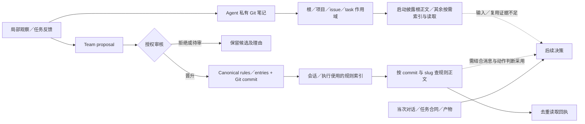
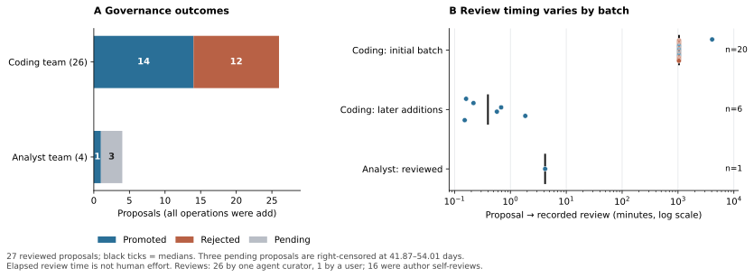
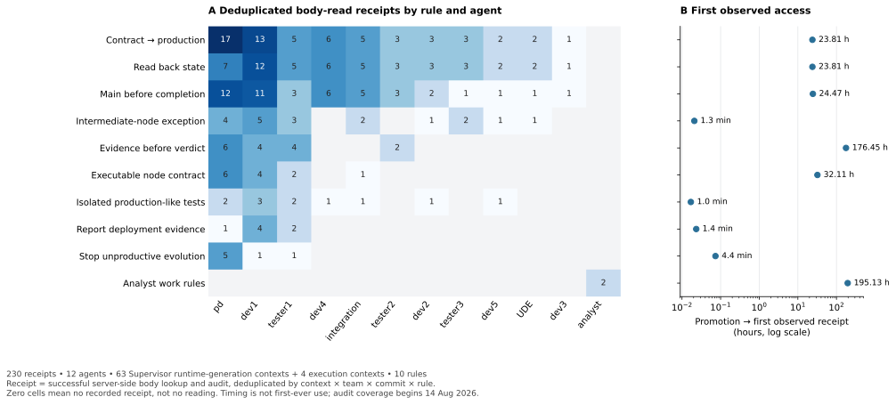

# 多智能体团队中的组织记忆：分层存储、跨成员传播与规则适用性

*Organizational Memory in Agent Teams: Layered Storage, Cross-Member Dissemination, and Rule Applicability*

**作者：** oopslink、OpenAI Codex（AI 共同作者）

**oopslink 主页：** [https://github.com/oopslink](https://github.com/oopslink)

**研究类型：** 部署案例研究与规则版本对照实验。

## 中文摘要

多智能体团队既需要保存局部经验，也需要判断共享经验是否适用于接收任务。本文重建 Agent Center 私有笔记、项目作用域和团队规范的写入与读取路径，并以固定任务合同的规则版本对照检验适用性。项目目录属于各 Agent 的私有仓库；跨成员传播由团队提案、审核和版本化发布实现。两个非空团队仓库的 57 个提交对应治理事件，230 条去重正文回执覆盖 12 名 Agent，10 条规则中有 9 条被多人读取。在 32 次受控处置中，无条件要求合入 main 的规则阻断了 4 次中间交接中的 1 次；其余 3 次仍按任务阶段交接。无规则、阶段限定规则及明确替代旧版本三组均完成 4/4 次中间交接；最终集成阶段四组均保留合并门禁。团队记忆应分别记录谁能读、规则何时适用、哪一版本生效。读取回执可验证传播，不能单独证明正确采用，也不足以比较三种记忆用途的长期交付收益。

**关键词：** 团队记忆架构；项目作用域；知识治理；知识复用

## Abstract

Agent teams must retain local experience and determine when shared knowledge applies to a different task. We reconstructed the storage and retrieval paths for private notes, project namespaces, and team rules in Agent Center and compared rule versions under fixed task contracts. Project notes remained private to their agent; cross-member dissemination used reviewed and versioned team publications. Fifty-seven commits matched governance events. Across 230 deduplicated rule-body access receipts from 12 agents, nine of ten rules were read by multiple agents. In 32 controlled decisions, an unconditional merge-to-main rule blocked one of four intermediate handoffs; the other three proceeded. Handoffs proceeded in 4/4 cases in each of the absent, stage-specific, and explicitly superseded conditions. All conditions preserved the final integration gate. Team memory should record readership, applicability, and version separately. Access receipts establish dissemination, but do not establish correct use or comparative long-term delivery benefits.

**Keywords:** team memory architecture; project scope; knowledge governance; knowledge reuse

## 1 引言

Agent Center的记忆管理希望同时满足两类需求：保留某个agent的局部工作经验，以及把可复用经验提供给团队后续任务。为此，系统使用带作用域的私有笔记，并通过提案、审核和版本化发布形成Team知识。项目、issue与task目录提供局部组织方式；Team规则提供跨成员访问路径。这些安排解决了知识放在哪里、由谁发布和如何读取的问题，但尚需判断读取后的规则是否适合当前任务。

**研究问题是：Agent Team 的记忆架构该如何在 Agent、项目与 Team 之间安排写入、共享和读取？部署之后，各机制是否让后续任务用到了合适的知识？** 本文依次考察谁能写、写入属于谁、哪些成员可以读、读到的版本是否被用于当前任务，以及该动作是否满足当时的合同。发布记录不能代替阅读证据，阅读也不能代替有效采用；只有把记忆联系到具体动作，才能讨论复用效果。

真实材料给出一个可追溯的失败机制：防止候选分支被误报为最终交付的经验，被写成所有任务必须先合入main才能完成的通则。该规则遇到“先完成候选、再独立验收、最后合并”的流程时形成循环。知识没有丢失，共享通路也存在，问题在于最终交付的门槛被用于中间节点。后续条件化规则的采用提供了正面对照，但同时存在人工提示和工作组织调整，不能只归因于记忆。

在实现层，私有笔记负责让同一 Agent 保留经历，项目作用域让它按工作对象整理经历；跨成员规范另经 Team 仓库发布。在效果层，Git 与读取回执验证共享是否真正发生，正反案例辨别共享有没有帮助交接。三种用途的观测条件不同：私有笔记历史不完整，不能用 Team 层有更详尽的日志推断它比私有记忆更有效。

分层存储、检索和记忆更新本身已有研究。这个部署可以补充的经验是，知识处在什么目录、以什么权限发布、在什么阶段适用，是三个独立问题。下文先还原写入与读取路径，再把可核查的复用结果和未被观测到的环节分别列出。

## 2 相关研究与分析框架

### 2.1 从记忆机制到规则适用性的研究位置

长期记忆的保存、选择和更新已有明确方案。Generative Agents以记忆流、相关性选择与反思支持情境行为；MemGPT通过上下文内外分层管理有限容量；A-Mem允许新经历链接并更新既有记忆。[1]<!--ref:park2023generative-->[2]<!--ref:packer2023memgpt-->[3]<!--ref:xu2025amem--> 这些机制不能被概括为只做静态存储。其社会模拟、长期对话或文档任务中的结果，也不能直接换算为软件团队规范的正确复用。

共享经验和规范效力同样需要区分。G-Memory已组织多智能体交互、历史问题和经验层级，并按任务与角色筛选，利用成功或失败反馈更新。[4]<!--ref:zhang2025gmemory--> 这类研究解释了如何提取相关经验。团队规范还涉及发布权限与适用范围：私有经验可被检索，不代表它已获准作为团队规则；获准发布的最终交付条件，也未必适用于中间任务。

LongMemEval将索引、检索和阅读分开评价，并包含知识更新与拒答能力。[5]<!--ref:wu2025longmemeval--> 本文沿用访问与任务结果分开判断的原则，把评价对象落实到工程规则的版本、阶段条件与明确采用。现有研究为机制和评价分层提供依据；部署记录可用于分析main门禁与候选验收顺序的具体冲突及其治理背景，不构成新记忆算法或优越性证明。

### 2.2 系统组成与知识状态

**Agent私有记忆**保存局部观察、任务反馈和操作知识；**项目作用域**在所核实现中是该私有空间内的组织边界；**Team记忆**通过授权审核将候选知识发布为成员可访问的canonical规则或条目。三者是不同的所有权与传播机制，不能仅依据目录名称将其视为三个等价的共享层级。实现依据见[源码分析](../../agent-harness-memory-implementation-011.md)。

本研究区分知识内容与知识状态。相同正文处于个人笔记、pending提案或canonical规则时，传播权限和生效地位不同；仓库HEAD变化也不必然表示规则已经更新。规则自身还需说明适正确采用象、阶段与条件。图1把这些关系与后续行为分开：存储或访问通路可以完整，行为证据仍可能缺失。

**图1。分层记忆的存储、治理与使用关系。**实线表示存储／接口路径，虚线表示还需要行为证据的关系；并非所有图中节点均有完整生产轨迹。entries 不由当前 rule-load 审计覆盖。

Agent 私有仓库的 `projects/<id>/...` 是组织局部知识的作用域，不能仅凭目录名称为“所有项目成员共享的项目记忆”。旧 Worker 根目录还属于历史存储形态，不能直接套用当前每 agent home 的所有权。项目仓库中由 Git 协作共享的规约文件是另一种载体，也不等同于这里的私人 project scope。

Team 路径则有明确的提出、审核和 canonical 发布边界。编码团队配置 `curator_auto`，授权 PD；analyst 团队为 `proposal_only`。前者的 26 次审核由同一个 agent curator 完成，后者可见 1 次用户批准。审核主体和权限可追溯，但授权与独立复核是两件事：27 次已审核提案中有 16 次作者与审核者相同，不能描述为“全部经独立审查”。

### 2.3 组织记忆：从保存经验到约束当前决策

Walsh 与 Ungson 将组织记忆分解为信息的获取、保留和提取，并讨论组织如何使用或误用过去的经验。[6]<!--ref:WU91--> 对 Agent Team，这三个环节分别留下不同证据：经验可以被写成私有笔记，被审核为团队规范，并被另一成员读取。前三类证据都不足以判断规则是否适用于接收任务的当前阶段。这里对“组织”的借用限于跨成员保存与传播的机制，不把数据库读取当成认知。机制的判别情境是：在候选与合同不变时，相同发布权威下改变规则的适用范围，是否改变中间节点的交接，却仍保留最终发布门禁？

本文以“知识状态—任务条件—行为结果”组织分析。知识状态包括私有保存、提案待审与正式发布；可达性是特定上下文取得指定版本的能力；适用性是规则前提、对象及阶段与当前任务相容；采用则要求决策或行动明确体现该规则。各层相邻但不蕴含下一层，读取回执不直接证明采用，局部任务完成也不直接证明最终交付。

解释命题是：**当局部经验以无条件通则发布时，共享通路可以正常工作，却扩大规则与任务合同的不相容范围。** M02通过规则文本与原生阻塞理由检查这一机制；M03检验条件化规则的采用正例；M04以pending与会话采用并存，检验“发布等于采用”的替代解释。M05–M07界定私人保存的证据范围，不用于比较三层记忆的收益高低。

这是一套从现有案例提炼的分析关系，没有以跨案例差异代替同任务干预。它把已有记忆研究中的访问、更新和使用问题具体落实到团队规范与软件验收合同，未声称提出一般性的记忆理论。

## 3 研究方法

### 3.1 研究设计与分析单位

研究采用单部署的实现分析与回顾性案例比较，结合全量可得Team提案、Git历史和读取审计开展描述统计。分析单位分为三类：知识提案及审核事件用于评价发布治理；去重正文回执用于评价可见访问；知识与具体任务决策相连的片段用于评价采用及适用性。三类单位有不同分母，不串接为“记忆成功率”或转化漏斗。

数据来自冻结数据库与随后采集的记忆仓库、遗留文件和部署材料。两个非空Team仓库的历史可与数据库事件核对；私有层仅恢复两个新home的初始化历史及23个遗留Markdown文件。数据库与文件不是同一时刻的原子快照，历史部署也未逐执行恢复。统计因此描述留存材料及相应截止时点，不能由当前私有内容倒推早期从未写入。（[数据与版本附录](argument-methods-015.md)）

**表1。证据单位与评价对象**

| 证据单位 | 可得规模 | 评价对象 |
|---|---:|---|
| Team提案及状态 | 30个提案，27次已审核，3个pending | 发布、过滤与等待；非正确知识数量 |
| Git提交／原生Team事件 | 各57条，逐项对应 | 持久化与发布版本的一致性 |
| 去重正文回执 | 230条，12名agent，10条规则 | 指定版本的正文访问；非理解或使用次数 |
| 目的性案例 | 7组关联材料 | 治理、适用冲突、条件化采用与覆盖缺口 |
| 私有与遗留材料 | 2个新home；23份遗留笔记 | 存储组织与追溯；缺完整跨会话复用轨迹 |

### 3.2 选择规则与证据判据

案例通过消息检索和既有证据扩展选择，保留能够关联知识正文、治理状态、任务约束或后续行动的材料。七组包括治理正例、宽规则冲突、条件化采用、pending与会话采用并存、遗留笔记以及需要排除的混合片段。它们用于机制比较，既非随机抽样，也非七次独立实验。精确选择理由与原生定位见[案例附录](../../agent-harness-memory-cases-011.md)。

证据依次判断为保存、正式发布、正文回执、明确采用、局部结果和独立交付。读取回执必须能解析到相应commit、规则正文、enabled状态和phase；明确采用还要求消息或动作将规则关联到当前任务。任务完成只用于相应局部节点，不能自动提升为Plan或部署成功。缺原始输入时，规则访问与稍后行动的相邻时间不当作完整输入证据。

### 3.3 比较与统计

实现比较检查所有权、作用域、读写入口和发布权限。治理统计报告提案状态、审核主体和等待时间，并将集中整理、后续追加和pending分开；pending在数据库截止时点右删失。访问统计使用去重回执，检查跨agent覆盖、版本和规则可用性，不估计完整读取次数或token成本。

机制分析重点比较宽main规则与任务合同的冲突，以及条件化规则在另一组任务中的采用；同时以“未发布但已在会话采用”和“已保存但缺后续读取证据”检验从存储状态直接推断复用的错误。两组任务并非同条件对照，人工提示、候选证据与改图均作为竞争解释。明显运行bug、未接线和部署故障排除于记忆设计效果；可分离的语义冲突保留。历史材料由 AI 分析，未作独立人工编码；规则版本实验使用模拟任务，不干预实际部署。

### 3.4 构念检查与可复现范围

原现场比较不属于干预实验。M02与M03分别位于不同任务且伴随人工提示、证据和图变化，属于机制对读，不能计算条件化规则的干预效果。私有历史缺失使“agent／项目／Team哪层更有效”目前无法回答；读取回执也没有提供全部复用机会的分母。

本文按软件工程案例研究区分情境解释与因果识别，[7]<!--ref:RV16_METHOD--> 案例为目的性选择，研究问题和分析框架经材料阅读后调整，未预注册，也未完成全库盲法编码。治理与访问统计可以复算，但案例的适用性解释尚未经过独立人工判定。取证、选择与解释同由AI完成，分工审阅不能替代这种判定。相互关联的案例、提案和回执不作为独立生产任务计算置信区间或显著性。

[构念、排除标准与反证](../research-validity-016/README.md)及[图表所支持的主张](../research-validity-016/figure-claim-map.md)列明各项分析的判据与推断范围。

### 3.5 固定任务阶段的团队规则对照

从 M02 和 M03 抽取“远端不可变候选尚未进入 main”的决策点，重建中间候选与最终集成两种合同。每一阶段固定候选、证据和权限，只替换已披露的 Team 记忆：无规则、所有任务合入 main 才能完成、区分中间与最终阶段、以及同时展示新旧规则并明确旧版已被替代。两模型、每格两个工单标记，共 32 次。独立判据是当前节点的合同：中间节点满足候选交接条件，最终节点尚未满足合入条件。若两条规范冲突，暂缓可体现谨慎，但在“是否实现此次交接”指标上仍记为未交接。没有把运行器、仓库缺失或授权错误注入实验。[冻结协议、完整响应与判据](../mechanisms-020/README.md)。

## 4 研究发现

### 4.1 Team发布机制产生了可追溯的过滤，但授权不等于独立核查

两个非空Team仓库的57个提交与数据库中30次提案、15次晋升、12次拒绝逐一匹配。治理机制在真实运行中既发布经验，也拒绝或归并候选，而非单纯收集所有文本。表2与图2显示，发布等待受批量整理和即时追加两类使用方式影响，不能用一个总中位数概括治理始终缓慢或快速。

**表2。Team知识提案与发布状态**

| 指标 | 编码 Team | analyst Team | 解释 |
|---|---:|---:|---|
| 提案 | 26 | 4 | 全部为 add；没有观察到 update／disable／delete 提案 |
| 晋升／拒绝／pending | 14／12／0 | 1／0／3 | 状态不是知识正确率或团队效率 |
| Canonical rules／entries | 9／5 | 1／0 | 15 个知识文件，不含 proposal 和索引 |
| 有记录的审核 | 26 次 agent curator | 1 次 user | 无可靠人工耗时数据 |
| 最早一批整理 | 20 个候选→8 个晋升、12 个拒绝 | — | 一次集中清理，不是 20 次独立实验 |

**图2。**全量 30 个提案的状态及 27 次已审核事件的等待时间。黑线为各组中位数；3 个 pending 右删失，不填入已完成审核的均值。时间表示从提案到记录审核的墙钟间隔，不是审阅人时。

早期 20 个候选的审核等待中位数为 1,042.52 分钟（约 17.38 小时）；后续编码团队 6 个新增提案的中位数为 0.396 分钟（约 23.8 秒）；analyst 唯一已审核提案为 4.18 分钟。合并后的 27 个审核中位数为 1,041.89 分钟，但掩盖了“批量整理”与“即时追加”的差异，因此不能用于概括机制始终缓慢或始终快速。

M01 的 12 条拒绝理由中，11 条明确指向被 canonical 条目吸收、拆分或替代；剩余 1 条认为尚未稳定的 DAG 实现不宜升级为全局硬规则。一条还指出机器本地绝对路径不适合作为团队通则。这证明治理层进行了可见的边界整理，而非只是存储所有经验。其反面是：这些是同一个 curator 的判断，尚未做独立内容真值复核；拒绝 12 条不能算“阻止 12 条错误知识”，也不能直接换算节省 token。

新增规则通常靠追加而非替换。纠正中间节点门禁后，旧的宽规则仍 enabled，新规则也 enabled。这保留了最终交付门禁，但把两条规则的组合解释留给消费者。它是值得进一步实验的维护负担，现有材料没有测出冲突发生率或额外推理成本。

### 4.2 跨成员读取已经发生，访问记录仍不等于有效采用

**表3。正文访问与版本覆盖**

| 审计口径 | 观测结果 |
|---|---:|
| 去重正文回执 | 230 |
| 唯一 agent／规则 | 12／10 |
| Supervisor runtime-generation 上下文 | 63 个，对应 211 条回执 |
| execution ID 上下文 | 4 个，对应 19 条回执 |
| 有至少一条回执的 canonical rules | 10／10 |
| 被多名 agent 读取的 rules | 9／10；另 1 条 analyst 规则只有该 agent 的记录 |
| commit、slug、enabled、phase 均可核验 | 230／230 |
| 相对读取前最新已入库 Team 事件的旧 commit 回执 | 0／230 |

**图3。**左图是 agent×规则的去重回执，空格表示无此审计记录，不表示从未读过；右图是晋升到首次可见回执的间隔，不是首次使用或正确复用时长。历史审计覆盖从 08-14 开始，较早规则的延迟尤其受左截断影响。

回执由服务端成功查询正文后登记，因此比消息中的已读声明更接近实际访问，但仍不证明客户端完整收到、模型理解或正确执行。回执按上下文、团队、commit和规则去重；重复读取不会增加计数。按首次留存回执的phase统计，execute为125、plan为38、review为40、recovery为27，不能解释为各阶段全部读取量或token成本。这里的planning generation是Supervisor运行代际，与任务图代际不同。接口顺序与字段细节见[实现分析](../../agent-harness-memory-implementation-011.md)。

全部 230 条回执的 commit 都等于读取之前最新已入库 Team 变更的 commit，规则正文 blob 也一致。这是对“commit 冻结必然导致旧知识误用”的反证；它只覆盖有审计的读取时点，不能证明长会话的后续输入永远新鲜，或没有绕过此 API 的访问。

读取分布也不能用用于判断哪条规则对交付最有效：契约到生产链有 60 条回执，写后回读 49，main 门禁 46，中间候选例外 19；需求暴露、规则年龄、agent 活跃程度和上下文重启频率均不同，尚无有效复用机会的共同分母。

### 4.3 无条件通则与中间任务合同冲突，改图未解除约束

宽main规则要求所有任务完成前都合入主分支，而候选任务又要求先独立验收才能合并。下游验收依赖候选完成，两条规定形成循环。任务的原生阻塞理由直接指出这一矛盾；将候选改为evidence-only并重建流程后，后继节点仍因规则没有例外而阻塞。（M02）

这里的失败发生在知识适用层级。要求最终交付进入main有明确用途，但把它无条件用于中间候选，使本应串接的验收步骤互相等待。改图改变了任务组织和名称，没有改变行为规范的适用条件，因此未解决冲突。该解释不依赖读取失败或调度故障；owner在对话中也强调同一约束，故不能把全部影响专归因于持久记忆。

### 4.4 条件化规则支持了局部交接，其作用依赖候选与阶段证据

新规则明确区分中间实现／验收和最终集成：前者可依据唯一、不可变、远端可达的候选完成，后者仍需满足main门禁。该规则有8名agent的19条正文回执，并在后续任务中被PD和tester明确引用。原生事件支持独立验收节点完成，随后集成节点完成。（M03）

可复用的内容因而是与候选标识和任务阶段相连的判断条件，而非“遵守正确流程”这样的笼统要求。这里同时存在PD提示、已有验收报告和新增集成节点，能够确认的是条件化规则被用于局部交接，不能确认它单独带来恢复。后续部署故障不计作记忆失效，整个Plan也不据局部完成判为成功。

### 4.5 正式发布与当次采用是两种状态，私有保存的长期效果尚缺证据

analyst的三个提案在快照截止时仍pending，等待约41.87–54.01天；但其中一种新工作方法在提案前的同一会话输出中已经出现。之后读取的仓库commit虽包含新提案，所读取的仍是旧canonical规则。这同时说明：repo更新不等于规则生效，尚未发布也不等于当次没有采用。（M04）

遗留项目和任务笔记保存了用户要求、候选和验收缺口，具有追溯价值，但没有充分证据连接到后续自动读取与正确交付。私人quickfix漂移仅有事后自述并混有并发问题，不纳入设计负例；两个新home的初始化内容只能证明组装路径启动过，不能证明业务知识被保留或历史从未写入。（M05–M07）

### 4.6 同一条团队规则，在候选交接与最终集成中有不同作用

**表4。固定阶段与候选，仅改变 Team 记忆版本。** 每格 4 次，两模型各 2 次；内容为实际提交的工单操作。中间阶段的合同要求交接，最终阶段的合同要求暂缓。

| 披露的记忆 | 中间候选：完成交接 / 暂缓 | 最终集成：关闭 / 暂缓 |
|---|---:|---:|
| 无规则 | 4 / 0 | 0 / 4 |
| 无条件合入 main | 3 / 1 | 0 / 4 |
| 按任务阶段限定 | 4 / 0 | 0 / 4 |
| 新旧并列，明确旧版已被替代 | 4 / 0 | 0 / 4 |

在唯一一次未交接中，模型正确识别候选已可取得，却以尚未合入 main 为由保持节点未完成；下游验收恰在等该节点交接。同组另外三次并没有忽略规则，而是在说明中把“完成整个任务”与“完成当前候选节点”区分开。四次输入属于同一规则条件，给出了两种可能解释。最终阶段 16/16 暂缓，说明给中间节点设例外没有在本题中放松发布门禁。无规则组也全部处置合宜，因此不能把条件化组的正确结果都归功于记忆。

这项比较为生产案例中的冲突提供了受控对应，而不是冲突率估计。实验提供了已读到的规则，未测试检索；也未设置“新旧并列但不标替代”，不能单独估计版本标记的作用。四种版本均没有真实部署或人工提示差异，32 次处置均止于首个动作。[逐条动作与理由](../mechanisms-020/p5-outcomes.csv)。

## 5 团队规则可达但不适用的原因

### 5.1 规则可达性与任务适用性

成功读取只是将文本带到决策入口。宽main规则的案例表明，规则在一个层级上合理，在另一个层级上却可能制造循环。因而，记忆条目需要表达对象、阶段、前提与例外，并允许消费者识别当前任务是否落在该范围内。增加检索命中或扩大共享范围，不能替代适用条件。

纠正规则通过追加发布，旧宽规则仍保持enabled。这保留了最终交付约束，却把新旧规则如何组合解释留给消费者。对规则更新，应考虑显式的替代、细化或例外关系，使知识版本关系能够被检查。现有材料支持这一设计需求，尚未比较不同更新策略的冲突率和推理成本。

### 5.2 发布权限与规则有效性的区别

提案、canonical规则和正文回执让知识流转可追踪，拒绝与归并说明治理确实有所选择。但是27次审核中16次作者与审核者相同，授权主体不自动成为独立验证者。审核可以控制发布权限，知识是否准确、是否被过度泛化仍需具体依据。评价治理应检查被拦截的错误、被保留的有效条件与审核成本，而非只看通过或拒绝数。

## 6 分层记忆与团队规则治理

### 6.1 项目作用域与共享权限

私有仓库中的project scope解决同一agent如何组织项目知识；跨agent项目共享则还需要共同存储、访问授权或明确传播。用同一个“项目记忆”名称涵盖两者，容易把目录存在误当信息可达。现有证据不足以比较私有、项目和Team三者的有效复用率，但足以要求实现与评价明确区分这些边界。

记忆状态也不应合并为一个“已记住”。系统可以分别记录个人已保存、团队待审、正式发布、某上下文已读取和当前决策已采用。后两者需要不同证据；长期评价还必须在固定目标和验收条件下追踪实际结果。这样的分层保留了已经有效的存储与治理能力，同时使语义冲突和复用缺口可被发现。

### 6.2 私有、项目和团队记忆的评价指标

对 **Agent 私有记忆**，最有意义的结果是原会话结束后，同一 Agent 能否找回一条已写入的经验，并在新任务中正确采用。实现提供私有写入、根内容披露和按索引读取；保留局部知识不需要经过团队审核，但私有历史缺少将写入内容与后续任务决策相联系的连续记录。对 **项目记忆**，问题是经验能否随项目延续。现有私有仓库的项目目录有助于同一 Agent 定位笔记，却不自动让另一名接手者读到；要满足后一个目标，须另设有项目权限的共同载体或经过授权的发布路径。没有足够资料比较这两类笔记的复用率。

对 **Team 记忆**，发布者和后续使用者可以不同，因此可以核查提案、晋升、版本、读取和引用。观察到 9/10 条规则被多名 Agent 读取；限定候选和任务阶段的规则还有行为采用证据。代价也在同一路径上：一个成员形成的局部经验若被审核为无条件规范，就能在多个任务中传播同一错误约束。架构取舍因而是让私人笔记便于保存，让团队发布可追溯，并在共享规则上标明适用阶段、例外和替代版本；是否改善交付还需要对照任务验证。（图1、表2；M02、M03）

团队发布时应同时记录适用的任务阶段、触发条件、例外和替代版本；接收者核对当前任务合同后再采用规则。版本对照检验了规则呈现条件，但没有单独识别替代标记相对于阶段限定的增益。

### 6.3 证据边界

这是单部署探索，目的性案例相互关联，未估计记忆的净交付收益。私有仓库历史缺失、读取审计左截断且去重、异步采样与部署版本冲突限制了跨层比较。230条回执均使用相对读取前最新已入库事件的commit，只约束有记录的读取时点，不能推广为所有长会话输入始终新鲜。

宽规则与条件化规则涉及不同任务，并伴随人工提示、证据和图变化，不能据此估计规则修订的独立效果。对话中的明确引用比纯访问更接近采用，但仍不等于完整模型输入或内部推理。没有可靠的人类耗时、必要事实真值或复用机会分母，因此不报告节省token、有效复用率或自动交付提升。

文献比较有范围，未系统覆盖整个领域。规则版本对照只测试已呈现的规则如何与当前阶段相互作用；没有生产权限干预、原会话重放或可比的三层记忆历史。小样本中一例停交与三例继续并存，不能据此估计生产发生率。

## 7 结论

Agent Center 的记忆架构划分了私有保存与团队发布两类边界。项目目录组织同一 Agent 的项目知识，并不自动赋予其他项目成员读取权限。跨成员复用依赖提案、审核和版本化发布：两个非空团队仓库的 57 个提交与治理事件对应，230 条去重正文回执覆盖 12 名 Agent，10 条规则中有 9 条被多人读取。（图1、§4.1–4.2）

传播成功不保证使用恰当。将最终合并要求推广到中间候选，会使验收节点等不到其输入；明确限定阶段的规则则曾被协调者和验收者用于交接，尽管人工提示和流程调整也可能促成了恢复。在固定任务事实的对照中，无条件规则使 4 次中间交接中的 1 次暂缓，另 3 次仍按任务合同推进；无规则、阶段限定和显式替代条件均完成 4/4 次交接。最终集成阶段各组均保留合并门禁。（M02、M03；表4）

记忆设计应分别记录知识的所有者、可读范围、适用阶段及版本替代关系。评价时也应从写入和读取追踪到具体动作是否满足当时的合同。私有及项目记忆缺少连续的跨会话采用记录，不能据团队层较完整的日志断言其长期交付效果优于其他层。

## 参考文献

[1] J. S. Park, J. C. O’Brien, C. J. Cai, M. R. Morris, P. Liang, and M. S. Bernstein, “Generative Agents: Interactive Simulacra of Human Behavior,” in *Proceedings of the 36th Annual ACM Symposium on User Interface Software and Technology*, 2023, doi: [10.1145/3586183.3606763](https://doi.org/10.1145/3586183.3606763).

[2] C. Packer, S. Wooders, K. Lin, V. Fang, S. G. Patil, I. Stoica, and J. E. Gonzalez, “MemGPT: Towards LLMs as Operating Systems,” *arXiv preprint arXiv:2310.08560*, 2023, rev. v2, Feb. 12, 2024, doi: [10.48550/arXiv.2310.08560](https://doi.org/10.48550/arXiv.2310.08560).

[3] W. Xu, Z. Liang, K. Mei, H. Gao, J. Tan, and Y. Zhang, “A-Mem: Agentic Memory for LLM Agents,” in *Advances in Neural Information Processing Systems*, vol. 38, 2025, doi: [10.52202/085713-0593](https://doi.org/10.52202/085713-0593).

[4] G. Zhang, M. Fu, G. Wan, M. Yu, K. Wang, and S. Yan, “G-Memory: Tracing Hierarchical Memory for Multi-Agent Systems,” *arXiv preprint arXiv:2506.07398v2*, Jun. 16, 2025, doi: [10.48550/arXiv.2506.07398](https://doi.org/10.48550/arXiv.2506.07398).

[5] D. Wu, H. Wang, W. Yu, Y. Zhang, K.-W. Chang, and D. Yu, “LongMemEval: Benchmarking Chat Assistants on Long-Term Interactive Memory,” in *International Conference on Learning Representations*, 2025. [正式 PDF](https://proceedings.iclr.cc/paper_files/paper/2025/file/d813d324dbf0598bbdc9c8e79740ed01-Paper-Conference.pdf).

[6] J. P. Walsh and G. R. Ungson, “Organizational memory,” *Academy of Management Review*, vol. 16, no. 1, pp. 57–91, 1991. [原文](https://journals.aom.org/doi/10.5465/AMR.1991.4278992). DOI: 10.5465/amr.1991.4278992.

[7] P. Runeson and M. Höst, “Guidelines for conducting and reporting case study research in software engineering,” *Empirical Software Engineering*, vol. 14, pp. 131–164, 2009. doi: [10.1007/s10664-008-9102-8](https://doi.org/10.1007/s10664-008-9102-8).

## 证据与复现入口

外部文献用于限定已有覆盖和本地研究位置，经验主张由以下原始资料支撑。有范围的叙述性文献比较及版本核验见[文献审计](../research-validity-016/literature/p5-synthesis.md)，不声称系统综述已经完成。

| 资料 | 支持范围 |
|---|---|
| [实现分析](../../agent-harness-memory-implementation-011.md) | 私有／项目作用域、Team提案及读取路径 |
| [M01–M07案例与排除](../../agent-harness-memory-cases-011.md) | 治理、约束冲突、条件化采用及反证 |
| [统计与重建数据包](../../memory-011/round-002/README.md) | 提案、规则、回执、Git事件和图源 |
| [历史研究报告](../../agent-harness-memory-study-011.md) | 原取证过程、版本审计与未完成工作 |
| [方法与版本附录](argument-methods-015.md) | 数据截止、Git历史、部署缺口及复算入口 |

## 研究声明

**数据可用性。** [记忆仓库、治理事件与读取回执](../../memory-011/round-002/README.md)给出来源和复现入口；[规则版本实验的逐条处置](../mechanisms-020/p5-outcomes.csv)分别记录中间交接与最终集成。 部署原件保存在授权本地档案；开放许可和脱敏范围尚未确定。

**伦理与隐私。** 使用既有开发协作资料，未新增用户实验。伦理审查或豁免状态待作者声明；不推断已经获批或无需审查。

**作者贡献。** oopslink：提出 Agent、项目与团队记忆的架构与效果问题，并提供部署背景。OpenAI Codex（AI 共同作者）：核对实现、版本与读取证据，设计并执行规则适用性对照，撰写并修订文稿。

**利益冲突。** 待作者声明。

**资助。** 本研究未获得资助。

**AI 使用与复核。** AI 共同作者参与取证、实验分析与写作。模型响应是行为记录，不能直接揭示其内部推理。研究尚未经过独立人工复核。

**同源材料。** 规则读取、合同冲突和部分交接案例亦用于工作流与上下文研究。同一部署记录只计为一项证据，跨篇引用不构成独立重复验证。
