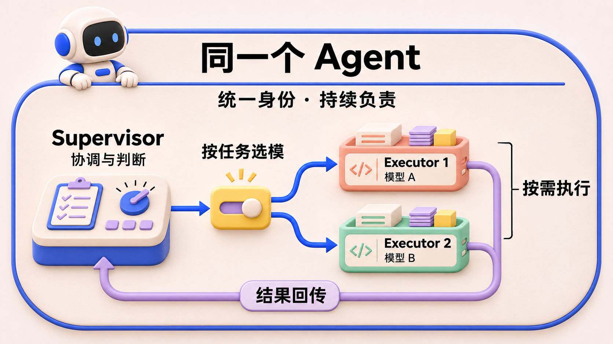
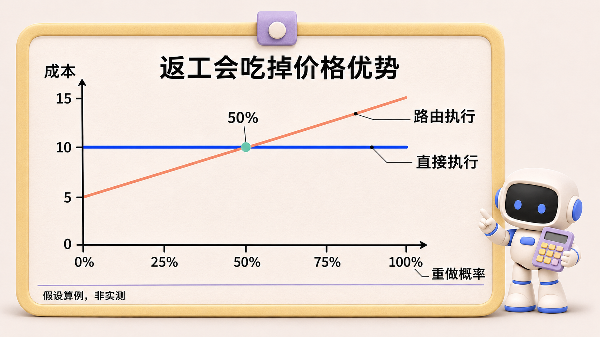
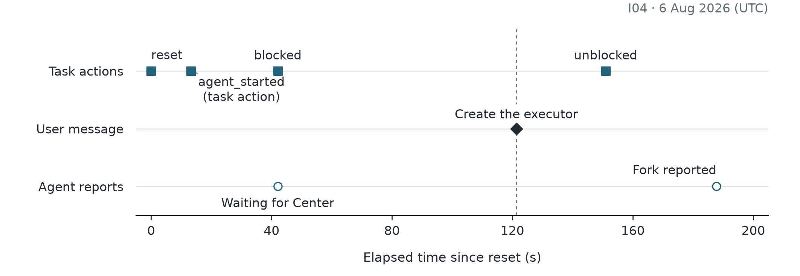

# Supervisor–Executor：并行、模型选择与责任交接，为什么没有同时做好？

> agent-center 是一个组织多个 AI Agent 协作完成软件开发任务的系统。Agent 在其中接收目标、调用工具，参与实现、检查与交付。《Agent 协作手记》以这个项目的开发和运行记录为线索，讨论各模块的设计选择、实现效果，以及实践中暴露的问题。

*Agent 协作手记 · 第 3 篇*

## 一、需求动机

一次部署记录中，任务已经恢复为“进行中”，负责它的 Agent 却发现没有任何临时执行在工作。它看见了这个缺口，但给出的解释是：需要中心修复调度。随后，任务又被标记为阻塞。

用户纠正的恰好是下一步该由谁来做：临时执行应由这个 Agent 内部负责协调的 Supervisor 创建。Agent 随后修改了解释，并报告已显式调用创建执行的工具。这里的 Supervisor 是常驻协调部分，Executor 是按需创建的临时执行部分；两者共同构成对外承接任务的同一个 Agent。执行分开了，未完成目标的责任并没有转给平台。[现场记录与时间线：研究工作稿 P1 §4.2](https://github.com/oopslink/agent-center/blob/main/docs/plans/reports/papers-010/p1-logical-agent-identity/paper.md)

这段材料还不能写成“提醒后就修好了”。原生任务日志可以确认恢复、阻塞等状态变化，创建执行和后续推送则仍是参与者报告；同一任务后来还因交付要求没有补齐而阻塞。它让我们看清的，是**发现无人执行与主动承接下一步之间，仍可能断开**。

之所以要把一个 Agent 拆成这两部分，首先是为了让长任务不占住它接收消息和安排工作的能力。底层的 Claude Code、Codex 等编程工具可以通过命令行运行，下文简称 CLI。把具体工作交给隔离执行，可以让常驻部分继续协调；但新执行替谁工作、结果交给谁、失败后谁继续处理，也必须一起规定。

另一个约束来自成本。检查一处配置与重构一个复杂模块，对模型能力的要求不同。如果全部沿用同一个模型，简单工作可能付出不必要的费用；如果一律选便宜模型，困难工作又可能因失败和返工变得更贵。我们希望每次派出具体工作时，都能选择适合它的执行工具和模型，在交付质量与总成本之间作出判断。

因此，这个模块需要同时解决三件事：让一个团队成员可以安排多项工作，为不同任务选择执行模型，并在临时执行结束后保持责任连续。拆开进程只是实现手段；用户关心的是任务是否有人接着做，以及最终交付花了多少代价。

## 二、方案选择

早期一个 Agent 往往对应一条持续的命令行会话。为满足并行处理和模型选择的需求，需要重新安排“接收与协调”和“具体执行”之间的关系。项目采用的两个名称是 Supervisor（负责接收消息、安排工作并跟进结果的常驻控制者）和 Executor（受委派完成具体工作的临时执行者）。

一种做法是让常驻会话顺序处理全部工作。上下文连续，用户也知道找谁，但长任务会占住会话，每个任务沿用同一执行模型。另一种做法是把每个子任务都交给独立的团队成员。这样能并行，却要反复建立任务归属、汇集上下文和交回结果。Agent Center 选择在同一逻辑 Agent 下委派临时执行。对外承接任务的仍是同一个 Agent，Supervisor 与 Executor 是它内部的运行分工；创建 Executor 不意味着团队里新增一位成员。运行时在每次创建临时执行（下文沿用代码称作 fork）时，解析执行器的 CLI 和模型。

这个选择把两个原本绑在一起的决定分开了。Supervisor 根据任务性质决定要不要委派。确定委派后，路由器根据任务指定、允许的候选和默认配置决定用谁执行。前者错了会造成不必要的交接，后者错了会造成过高费用或返工，两种代价需要分别观察。

### 当前执行链路

先看图中最外层的边界：整个框才是团队中的一个 Agent，机器人头像代表这个整体。框内的 Supervisor 负责协调和判断，Executor 是按需创建的执行单元，可以针对不同工作选择不同模型。图中画出两个 Executor，是为了说明同一 Agent 内部可以有多个临时执行，并不代表三个独立 Agent 在协作。

图 1：同一个逻辑 Agent 内部的运行分工。蓝色路径表示委派与模型选择，紫色路径表示执行结果回到 Supervisor 后继续判断；对外的身份与任务责任始终属于同一个 Agent。外框表示逻辑归属，不表示共享一个进程或同一份上下文。两个 Executor 及模型 A/B 均为示意，不是固定数量或绑定关系。

具体到调用链路，`work_available` 是有任务可处理的通知，只把任务提示注入 Supervisor，不直接 fork。代码里的提示要求它先检查任务，再选择内联处理或通过 `fork_executor` 请求创建临时执行，并且在判断结果之前不要完成任务。[代码：Supervisor 唤醒](https://github.com/oopslink/agent-center/blob/main/internal/agentruntime/local_runtime.go) 这是设计上的责任分工，不是结果自动成立的保证。

进程边界也是真实的：在 Claude 的生产适配路径中，管理执行进程的后台服务 Worker daemon 持有 SupervisorSession，而 Supervisor 拥有 Claude 进程；daemon 停止时可以断开连接（detach），之后再连接。Executor 则有独立的运行句柄和并发池。另一个需要明确标注的状态是：ADR-0056 已接受“稳定 Executor Slot 与唯一 Execution Run ID 分开”的设计，但本次核对的 `executor.Pool` 仍通过 active map 管理并发，没有看到相应的 `slot_index` 分配与恢复实现。不能把 Accepted 文档写成已经落地的功能。[代码：SupervisorSession](https://github.com/oopslink/agent-center/blob/main/internal/workerdaemon/supervisor_session.go) · [代码：当前 Pool](https://github.com/oopslink/agent-center/blob/main/internal/agentruntime/executor/pool.go) · [ADR-0056](https://github.com/oopslink/agent-center/blob/main/docs/design/decisions/0056-stable-executor-slots.md)

图 2：依据 `ResolveExecutor` 函数体概括选择优先级，具体条件见正文；智能判断默认关闭。函数头部注释对默认模型与候选池的先后概括并不完全一致，这里以可执行分支为准。

### 模型路由到底怎么选

当前 Agent Profile 可配置 `orchestrator_model`、`default_executor_model`、最大并发数以及候选 `{CLI, model}`。路由优先级可以概括为：Task 明确指定模型时先尊重任务；否则如果启用了难度判断，并且存在候选池，就让判断器选一个候选；判断无效时退回显式默认模型或确定性的候选；再没有合适配置才报告无法解析。选中的不仅是模型名，还有实际运行的 CLI。[代码：配置](https://github.com/oopslink/agent-center/blob/main/internal/agent/agent.go) · [代码：路由顺序](https://github.com/oopslink/agent-center/blob/main/internal/agentruntime/modelrouter/router.go)

难度判断的提示会读取任务目标，以及候选的能力层级、输入/输出价格和上下文窗口，要求选“能完成任务的最便宜模型”。但这个 LLM 判断开关默认关闭；即使开启，缺少可解析的 orchestrator model 时也会退回确定性路径并记录警告。[代码：判断输入](https://github.com/oopslink/agent-center/blob/main/internal/agentruntime/orchestrator/judge.go) · [代码：启用条件](https://github.com/oopslink/agent-center/blob/main/internal/agentruntime/executor_runtime.go)

这就带来至少三个实验问题。第一，判断器的额外调用成本能否被便宜 Executor 节约的费用抵消？第二，误把困难任务交给便宜模型后产生的返工是否吃掉收益？第三，候选模型价格和能力注释是否及时、完整？没有把这些因素纳入同一任务集的对照，我们只能说系统实现了选择机制，不能说成本和效果已经达到最优。

### 同一个 Agent，也有彼此看不见的部分

首先是身份边界：对团队来说，目标仍分配给同一个 Agent。其次是进程边界：Supervisor 和 Executor 有不同的生命周期、目录和恢复动作。最后是知识边界：Executor 看到的任务包与 Supervisor 的长期会话并不相同。代码上的父子关联只能解决前两层的一部分；它不会自动让 Supervisor 知道某个文件、测试或失败解释。

因此“临时执行者是你的一部分”不是完整的协议。临时执行者结束时，必须告诉当前控制者：产物在哪里、对应哪个版本、验收要求还差什么、当前有哪些资源可用、它获准怎么继续。否则 Supervisor 可能既承认目标属于自己，又缺少下一步所需的证据；也可能具有行动权，却因旧说明误以为应等中心。两种情况要用日志区分，不能一律诊断成身份混淆。

**算例 · 便宜模型何时反而更贵？** 假设在同一验收标准下，直接使用强模型完成一项工作花 10 个成本单位。智能路由先花 1 个单位判断，再花 4 个单位执行。如果首次尝试未通过，就另花 10 个单位重做。设重做概率为 p，两种策略的期望成本分别为 10 和 5 + 10p。当 p 达到 50%，首次调用的价格优势被完全吃掉。如果重做还需要人工重建上下文，临界点会更低。这些数字是说明用假设，项目需要实测的正是不同任务类型的 p、重做费用和终验通过率。

图 3：正文假设的成本曲线，非项目测量。重做概率达到 50% 时，本算例中两种策略的期望成本持平。

## 三、实现效果

### 更难的是：Executor 退出之后，谁继续负责？

进程成功隔离，目标责任却未必自动连续。项目中的一篇论文工作稿重建了这样一类现场问题：Supervisor 识别出 Executor 失败，却把后续修复和交付理解成外部责任，需要人工提醒才继续。论文也保留了后期正确承责的反例，因此不能简单归因于“Supervisor–Executor 架构必然失效”。它提出的更精确问题是：一次临时执行的结束，是否在模型看来变成了目标义务的结束？[研究工作稿 P1](https://github.com/oopslink/agent-center/blob/main/docs/plans/reports/papers-010/p1-logical-agent-identity/paper.md)

代码可以保证某个 Executor 属于某个 Agent，可以检查任务 assignee 与运行时身份是否匹配，可以保存运行记录；这些都不能替代 Supervisor 对“还差什么才能交付”的判断。相反，判断必须依赖可见的候选成果、验收缺口、失败原因和允许的恢复动作。路由决策与责任交接也应一起观察：昂贵模型完成得更好，若结果无法被 Supervisor 正确接住，端到端成本仍可能更高。

图 4：直接引用 P1 工作稿原图。原生任务动作、用户纠正和 Agent 报告属于不同证据层；fork 报告并不等于已经取回的执行控制事件，后续仍存在合同缺口。

这组现场材料很重要，但论文中的反证同样重要：在另一组短函数任务里，两种身份表述各 12/12 自主交付。说明“统一身份”并非必然导致责任外置；它也没有证明长程任务里只靠身份提示就足够。[P1 §4.8](https://github.com/oopslink/agent-center/blob/main/docs/plans/reports/papers-010/p1-logical-agent-identity/paper.md) 我选择的工程方向是把责任留在数据和反馈中持续呈现，而不是寄希望于给角色换一个更好的名字。

### 从“准备重试”到真正交付，还有一段距离

P1 还在同一个可恢复开场后比较了三种干预。12 个可恢复开场都表达了重新分派的意图，真正执行分派的是 10 个。复制相同的开场状态后，各组分别得到中性唤醒、一次操作者式提醒或持续的系统责任记录。这样可以在候选和工具权限相同的条件下观察交回责任的作用。[P1 案例重建](https://github.com/oopslink/agent-center/blob/main/docs/plans/reports/papers-010/p1-logical-agent-identity/paper.md)

| 从同一开场继续 | 得到合格候选 | 正式通过验收 |
|---|---:|---:|
| 中性唤醒 | 10/12 | 8/12 |
| 操作者式提醒 | 10/12 | 9/12 |
| 系统记录并交回责任 | 10/12 | 9/12 |

为什么同时保留两列？有合格候选，说明执行器已经交出能通过检查的成果。完成验收还要求控制者在预算内找到候选、检查它并作出终态判断。三组的第一列相同，第二列也没有显示持续记录优于一次提醒。因此我会把系统记录用于恢复可追溯性。至于它能减少多少人工干预、智能路由能省多少费用，这两个问题分别需要长期恢复记录和同任务的路由成本对照。

## 四、总结反思

保留常驻控制者和按任务选择模型的入口。此前设计低估了结果交回的难度，Supervisor 即使知道运行失败，也可能缺少当前候选、验收缺口和可执行的恢复动作。下一轮评估应把每次回退的原因、重做的费用和最终交付关联到同一任务。

### 把返工算进去，再看模型是否便宜

“选最便宜的模型”如果没有“能完成任务”这个前提，几乎没有意义。一个廉价 Executor 三次返工，再加 Supervisor 的复核、恢复和人工提示，可能比一次较强模型更贵。因此成本目标应该按交付任务统计，而不是按单次调用统计：

**每个验收通过任务的成本 =（判断调用 + 全部执行尝试 + 复核与恢复 + 可计量的人工介入成本）÷ 验收通过任务数。**

这是建议采用的评价口径，不是已经测得的节约结果。若失败任务的费用从分子里删除，便宜策略会被高估；若只比较成功样本的 token 单价，同样会隐藏返工。质量约束也必须固定：同样的验收合同、同样的测试集合、同样的交付终点，才有资格比较哪条路由更经济。

当前 Judge 主要读取任务标题与描述，以及候选的 tier、价格和上下文窗口。它并不天然知道未来要改多少文件、隐藏测试难度或仓库中有哪些陷阱。一个描述简短的任务可能有很高的调查成本。**我支持任务级智能路由，但不支持把一次难度判断当作可靠的全程难度估计。** 后续应检验能否在执行中根据失败证据升级模型，并把升级开销纳入总成本；这属于待验证的改进方向。

| 路由策略 | 它解决的问题 | 容易付出的代价 | 应比较的结果 |
|---|---|---|---|
| 固定强模型 | 减少初始低估 | 简单任务也支付高价 | 总成本、交付率、延迟 |
| 固定便宜模型 | 控制首次调用费用 | 困难任务反复返工 | 重试与升级后的总成本 |
| 一次 Judge 选择 | 根据任务差异分配模型 | 判断本身有成本，也可能误判 | 与固定策略的逐任务配对差 |
| 根据失败证据升级 | 初始低成本并保留纠错机会 | 升级过晚、上下文重复 | 最终成本及升级前浪费 |

这张表不是现有系统的 benchmark 排名。它给出了我们应当做、但不能用架构图代替的实验。尤其要把确定性回退单列：开关没开、Judge 不可用、Judge 越界、显式默认模型生效，都是不同来源；若日志只记最后用了哪个 model，就无法知道“智能路由”到底贡献了什么。代码已有 `task_override`、`llm_judged`、`default_fallback`、`pool_fallback` 等来源，应该用它们审计真实运行比例。[路由决策类型](https://github.com/oopslink/agent-center/blob/main/internal/agentruntime/modelrouter/router.go)

这些失败并没有让我放弃 Supervisor–Executor 的分工。并行执行和按任务选模型仍有必要，只是评估不能停在“这个 Executor 跑完了”。**要看的是同一个目标最终是否交付，以及为了交付一共付出了多少成本。** 把返工、恢复和人工提醒也放回这笔账里，才能判断模型选得是否合适，Supervisor 是否接住了剩下的工作。
