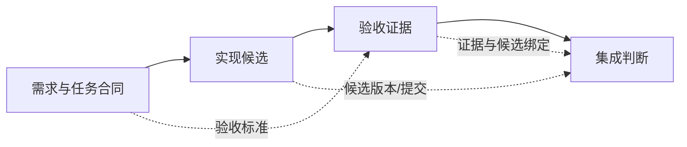
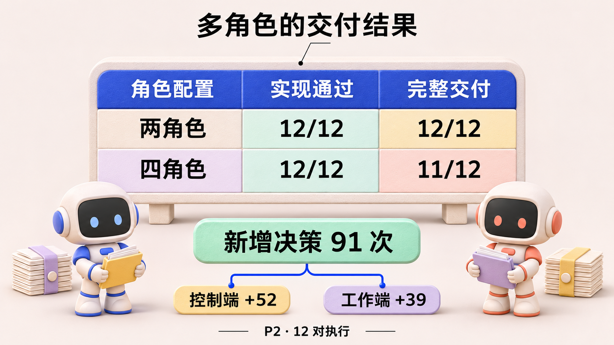
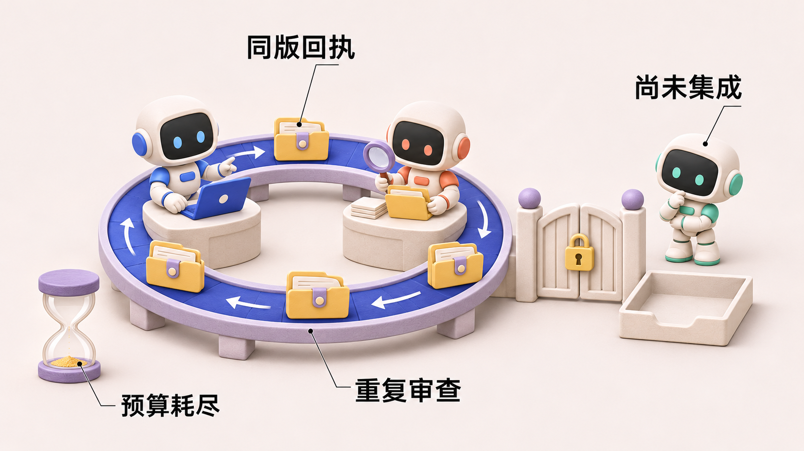
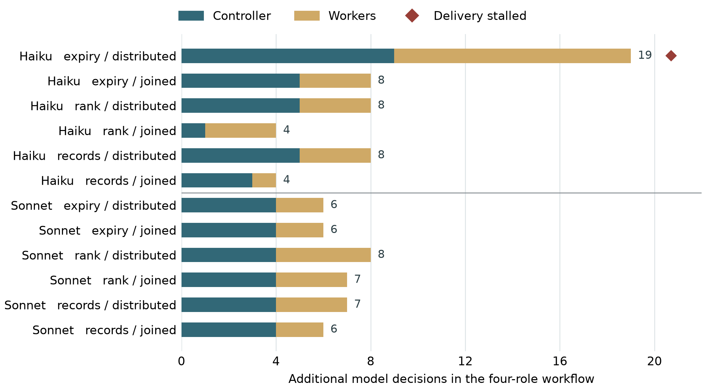
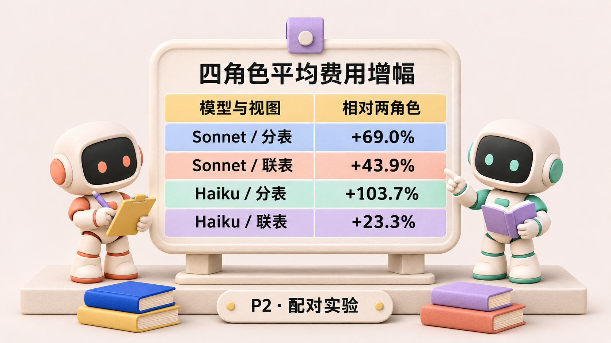

# 多一个角色，多一条交接：Agent Team 的工作流为什么越做越重

> agent-center 是一个组织多个 AI Agent 协作完成软件开发任务的系统。Agent 在其中接收目标、调用工具，参与实现、检查与交付。《Agent 协作手记》以这个项目的开发和运行记录为线索，讨论各模块的设计选择、实现效果，以及实践中暴露的问题。

*Agent 协作手记 · 第 5 篇*

## 一、需求动机

有一次实际运行的协作实验，代码已经写对，团队却没有完成交付。任务是实现一个时效过滤函数，流程设了开发、测试、审查、集成四种职责。终止后独立检查发现，实现通过了 8 项检查，执行中编写的 6 条测试也全部通过。但集成者一次都没有启动。[执行案例：研究工作稿 P2 §4.9](https://github.com/oopslink/agent-center/blob/main/docs/plans/reports/papers-010/p2-workflow-responsibility/paper.md)

工作停在了审查结果的交接上。审查者提交了针对当前代码的成功检查记录，负责安排工作的控制者却因为自己的会话里没有那条工具记录，不认可它。换一轮审查，新的审查者又运行测试、留下自己的通过记录，控制者仍要求重做。最终，四次审查占掉了剩余的启动机会，流程没有走到集成。这是隔离运行器中的真实代码执行实验，并非生产系统事故的原样回放。

这里的“候选”是准备交给下一环节的一版成果，“回执”是针对它运行检查后留下的记录。候选没有变，回执也确实存在，阻塞却发生在接收者如何认可证据上。**多设置一道检查，既可能增加缺陷发现，也可能增加一道无法通过的交接。**

本文把成员被分配的职责称为“角色”，把这些职责的顺序、输入、输出与完成条件称为“工作流”。开发、测试、审查和集成可以拆给不同成员，也可以合并部分职责。需要比较的不是角色名称有多齐全，而是每一轮独立检查究竟新增了什么信息，又付出了多少交接代价。

在 agent-center 中，Task 是具体工作记录，Plan 组织任务的先后依赖，Conversation 保存讨论和消息。这些机制让系统能够分配工作、启动后续环节并保留交流过程。设计工作流时还需要决定：哪些检查值得交给独立角色，每次交接必须附带什么，以及下一位接收者在什么条件下可以认可前一步的结果。

本篇讨论的就是这笔取舍：增加角色带来的独立检查，能否抵偿新增的沟通、等待和重复验证。后面会先说明分工方案，再用项目中的对照执行与故障记录检查实际效果。

## 二、方案选择

同一次软件交付可以安排两种分工。少数角色贯穿实现与检查，可以直接复用上下文。把实现、测试、审查、集成进一步拆开，独立检查者有机会发现开发者自己的盲点，但每次换人都需要说明哪个版本可以接手，以及前一张回执是否仍然有效。两种配置都能用 Task 与 Plan 表达。我们把验收合同，也就是判断任务完成的要求与检查标准，保持一致，让流程承担同一个终点，再观察拆分带来了什么。

比如开发者改了实现却没有改测试，单独的审查者若能从需求重建边界用例，就增加了新的信息。相反，若它只在相同提交上重跑相同命令，要先解释旧结果为什么不足以采信。这个差别决定了独立角色有没有必要。

### 把工作流画成依赖，而不是一排头像

图中的虚线不是装饰。如果 Gate 只收到“已通过”的一句自然语言，却不能确认是哪一个候选、哪些检查、哪个阶段，它要么盲信，要么重做。盲信可能放过缺陷；重做又可能占满原本留给集成的时间和调用预算。

从代码看，ProjectManager 的 `Task` 保留分配、状态、Plan 关联和动作记录；Plan 的任务依赖进一步决定谁现在可运行。Conversation 则提供讨论和消息轨迹。它们分别保存“任务是什么”“依赖是什么”“人或 Agent 说了什么”，却没有一个结构天然保证跨会话的验收回执被下一位接收者认可。[代码：Task 模型](https://github.com/oopslink/agent-center/blob/main/internal/projectmanager/task.go) · [代码：Plan 依赖](https://github.com/oopslink/agent-center/blob/main/internal/projectmanager/plan_dag.go) · [代码：Conversation](https://github.com/oopslink/agent-center/blob/main/internal/conversation/conversation.go)

图 1：交接协议建议。每项信息都对应接收者的一项判断，不代表当前界面已经实现全部字段。

**示例 · 接收者怎样判断要不要重跑？** 假定开发者交来提交 B，回执附着于提交 A。即使 A 的所有测试都通过，也要先弄清 A 到 B 改动了什么。如果改动触及被检查的行为，重新运行有明确理由。如果提交、合同和检查产物完全相同，只是签发者换了会话，接收者首先应能查询原回执。这样才能把“缺独立检查”和“缺读取权限”分开处理。

## 三、实现效果

### 一次受控比较告诉了我们什么

项目关于角色分工与交接责任的研究工作稿（编号 P2）保持任务、交付物、验收和启动预算相同，比较两角色和四角色的 12 对执行。24 个实现都通过了实现检查，但完整交付为 12/12 与 11/12；四角色一侧合计多出 91 次决策。唯一未闭合的执行，卡在有效回执的认可和重复审查，导致发布前预算耗尽。论文同时记录了独立验收发现上游遗漏的反例，因此不能据此宣布“测试角色没用”。[研究工作稿 P2](https://github.com/oopslink/agent-center/blob/main/docs/plans/reports/papers-010/p2-workflow-responsibility/paper.md)

这个比较有边界：它是特定任务、预算和角色设置下的实验，不是所有多 Agent 系统的性能排名。但它让一个长期被忽略的成本可见：每加一个角色，就加一个需要解释候选、证据、下一步动作的边。角色数是表面指标，真正消耗预算的是这些边上反复确认的次数。

图 2：依据 P2 §4.8—4.10 重绘。两/四角色不包括共同的 Supervisor（安排工作并跟进交付的控制者）；额外决策不自动等于无效决策。

### 把那一次停摆拆开，问题比“沟通太多”更具体

回到开头那次时效过滤任务，进一步核对的重点是：审查者交来的证据究竟有没有问题。终验中的实现检查 8/8，自编测试 6/6；运行过程中有七张真实成功回执，四次审查都引用了各自针对同一版本的有效回执。代码与测试的哈希保持不变，说明重复审查没有修复新的实现缺口。控制者要求“只引用我这边的回执”，新的审查者却没有收到控制者的原始工具历史，只能重新验证并交回自己的记录。双方都在追求可验证性，最后却没有人执行集成。[P2 表 10 与案例审计](https://github.com/oopslink/agent-center/blob/main/docs/plans/reports/papers-010/p2-workflow-responsibility/paper.md)

| 阶段 | 已经具备的事实 | 实际发生的动作 | 没有增加什么 |
|---|---|---|---|
| 实现与测试 | 候选与自编测试正确 | implementer、tester 各启动一次 | — |
| 首轮审查 | 真实的同版本成功回执 | 控制者要求换成本会话回执 | 没发现新的实现缺陷 |
| 后续审查 | 审查者重新运行成功 | reviewer 共启动四次 | 候选和测试哈希保持相同 |
| 预算截止 | 六次启动全部用完 | 控制者报告阻塞 | integrator 启动零次，缺少最终 manifest |

图 3：P2 中唯一未闭合执行的过程概括。实现检查与自编测试均通过，但集成者没有启动。

这里的设计错误，是把**证据的可信度**和**证据由谁亲眼产生**混在一起。如果协议允许任一针对当前候选的真实成功回执，就不应该临时增加“只能来自我的会话”的条件。这会让隔离会话的优点变成证据孤岛。修复应面向可核验的回执对象，而不是要求每个角色都重演之前的全部动作。

### 成本增加并不只来自这个失败案例

把停摆的那一对去掉，双方都交付的十一对中，四角色仍多出决策，中位增量为七次。全部十二对的增量中，控制端增加 52 次，工作端增加 39 次。也就是说，控制者要解释、启动、等待和核对，工作者也要重建局部上下文；交接费用是双向的。

| 模型与视图 | 两角色决策均值 | 四角色决策均值 | 两角色平均报告价 | 四角色平均报告价 |
|---|---:|---:|---:|---:|
| Sonnet，分表 | 15.33 | 22.33 | $0.29474 | $0.49811 |
| Sonnet，联表 | 15.67 | 22.00 | $0.31704 | $0.45627 |
| Haiku，分表 | 16.00 | 27.67 | $0.01810 | $0.03687 |
| Haiku，联表 | 18.33 | 23.67 | $0.02258 | $0.02784 |

表 2：原论文表 9，每格三项任务。报告价是该实验运行记录中的价格口径，不能换算成当前所有模型的产品报价。表格支持的观点很具体：对这些小任务，拆出更多执行角色增加开销，却没有提高实现通过数。

图 4：直接引用论文原图。每行对应同任务、模型和视图下的一个配对；蓝色为控制端、黄色为工作端，菱形标记未交付的四角色执行。它让“只有失败案例浪费决策”的解释无法成立。

图 5 按表 2 的同一行比较，增幅等于“四角色均价 ÷ 两角色均价 − 1”。Haiku 分表的一组约涨 104%，Sonnet 分表的一组约涨 69%。如果预算关心实际多付了多少钱，次序恰好相反。两组分别多付约 0.019 与 0.203 美元。前者的比例更突出，后者的绝对支出更大。规划工作流时，决策次数用来定位哪道交接昂贵，金额用来判断削减这道交接是否值得，独立检查发现的缺陷则决定该不该削减。

## 四、总结反思

值得保留的是能发现上游遗漏的独立验收。做错的是默认每多一位审查者就多一层保障，却没有先让接收者能核对已有回执。在预算固定的执行里，这个遗漏甚至占掉了最后一次集成机会。

### 职责写清楚了，交接仍然可能停住

第一个错误是把“明确职责”当作“明确行动”。规定 Tester 应验收，并没有说明 Tester 在证据不足时应请求什么、请求谁、多久没有回应可以升级；规定集成者负责发布，也没有说明它能否复用前一会话的有效检查。流程图画的是名词，运行时需要的是可执行的动词和停止条件。

第二个错误是把局部可见性误当作全局事实。某个 Agent 没在自己的上下文里看到回执，就说“没有回执”；另一个 Agent 看到一句回执，就说“验收完成”。两者都跳过了候选版本、测试合同和证据来源的匹配。多做一个角色并不能修复这种错位，反而可能增加传播次数。

### 接收者需要的，比一句“做完了”更多

我更愿意把交接设计成一个可核验的包：当前候选的标识、交付物位置、适用的验收合同、已完成检查的结果与时间、仍然存在的缺口，以及接收者获准执行的下一步。接收者可以核对并接受，也可以明确指出哪一项无效。这是本文提出的改进方向，不是声称系统已经完整实现了这种协议。

真正需要的不是“每步都再查一次”，而是区分两类检查：一种重复确认同一事实；另一种有能力发现上游没有覆盖的新缺陷。前者可以通过可验证回执减少，后者应保留。要验证这个取舍，需要同时记录发现的新缺陷、增加的决策、调用开销和最终交付，而不能只看某一步是否显示绿色。

### 先让少一些角色，把交接走通

第一，简单任务先采用最少能覆盖风险的角色配置，不预先复制一整套人类组织。第二，把新增角色的理由写成“它能发现什么前一步发现不了的错误”，并跟踪实际发现数量。第三，为最终集成保留预算，避免前面所有局部节点都绿色、最后一步却启动不了。第四，给回执定义候选标识、合同、检查命令、结果、签发者和时间，接收者按这些字段判断，而不是按会话归属猜测。

这一建议有明确的反例条件：如果独立角色持续发现新的高价值缺陷，而且节约了后续修复成本，它就值得保留。我们需要减少的是没有增加证据的重复确认，而不是独立判断本身。流程是否专业，应该由新增检查的效果决定，不能由头像数量决定。

再回到最初那张分工图，我会先把每条交接线补完整：交出哪一版成果，附上什么证据，接收者怎样决定继续。**交接说清楚以后，再决定需要多少角色。** 有些独立检查会因此留下，有些重复确认可以省去。接下来还要看接收者本身：它是否有权行动，又是否看到了足够的材料，这也是下一篇要继续讨论的事。
