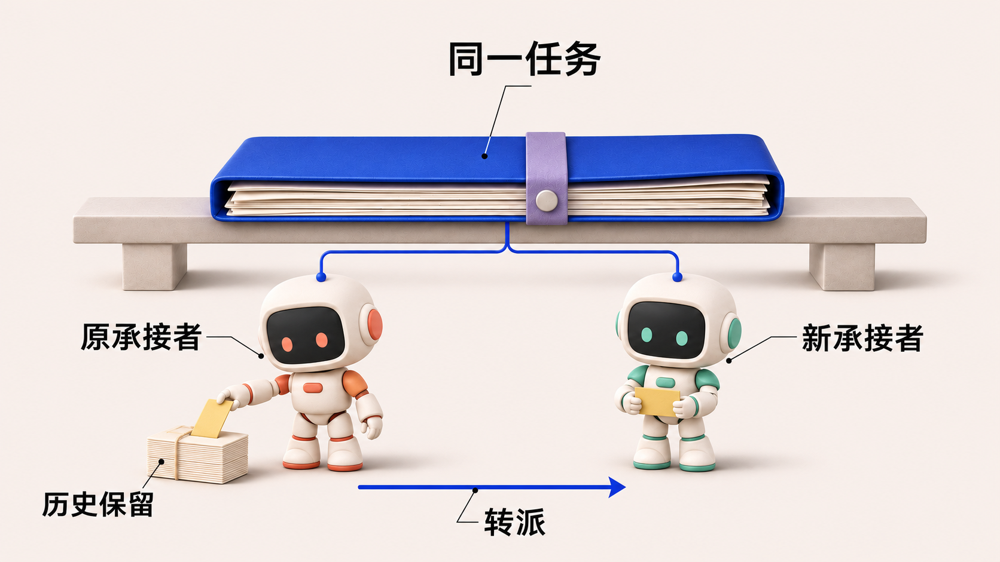
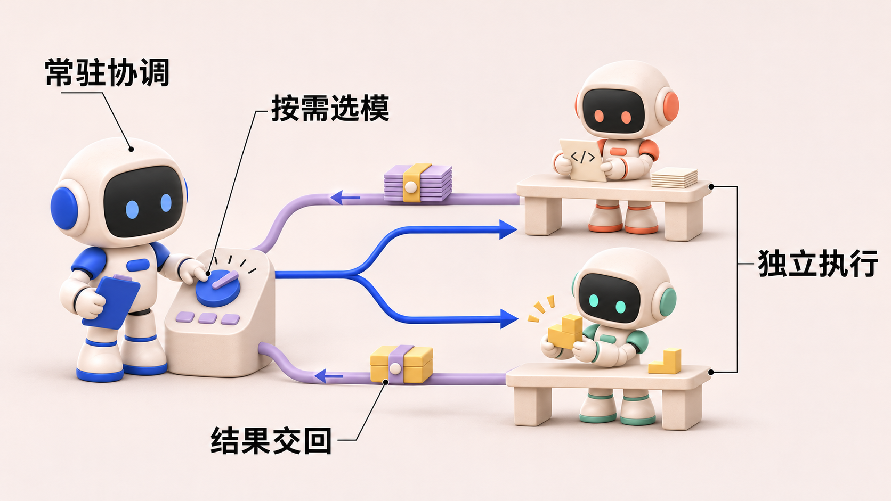

# Guizang 材质插画：两张风格试稿

采用 [guizang-material-illustration](https://github.com/op7418/guizang-material-illustration) 的材质插画规范，通过内置图像生成工具制作。根据用户后续要求，采用 Q 版人形机器人、暖白背景、灰白哑光材质与蓝 / 珊瑚橙 / 薄荷绿 / 柔黄 / 淡紫配色，保留短中文标签，适合正文概念导入。

## 任务转派

同一业务任务保留，旧承接关系结束，新承接关系建立；图中连接不表示同时执行。

## 协调与执行

常驻协调者选择执行者，独立执行后把结果交回。图为概念示意，不表示模型选择已经达到最优效果。

完整提示词、来源及检查结果见 [PROMPTS.md](PROMPTS.md)。本轮保留两张试稿；原技术图、真实截图与数据图未替换。

角色统一为大头、小身体、黑色面屏、完整四肢的 Q 版人形机器人；通过动作、道具和局部配色区分角色。原单色物件版留存为对照，本页展示最新彩色机器人版。
