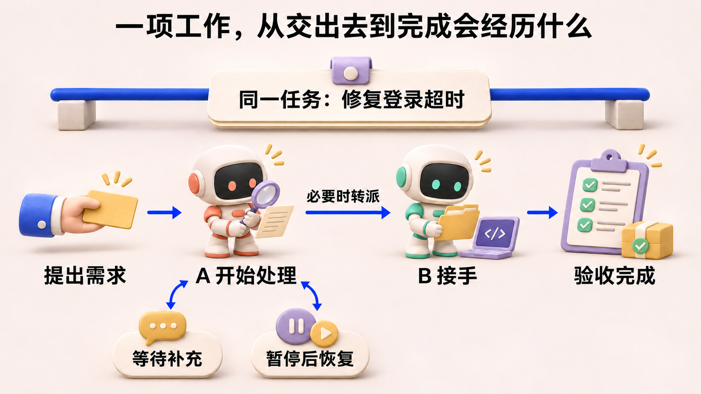
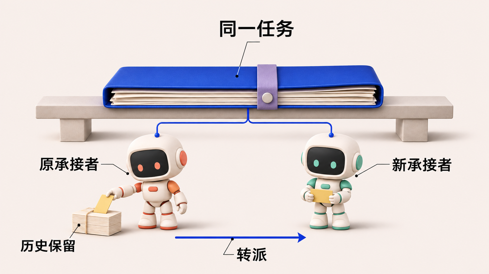
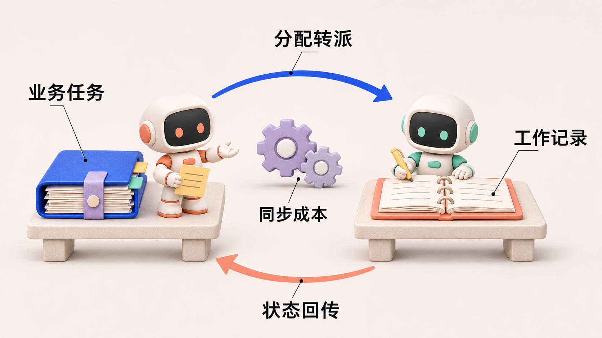
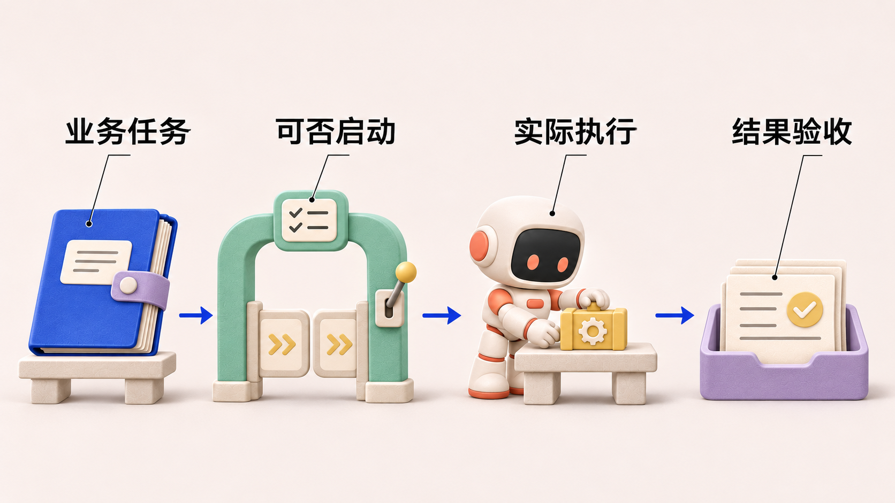
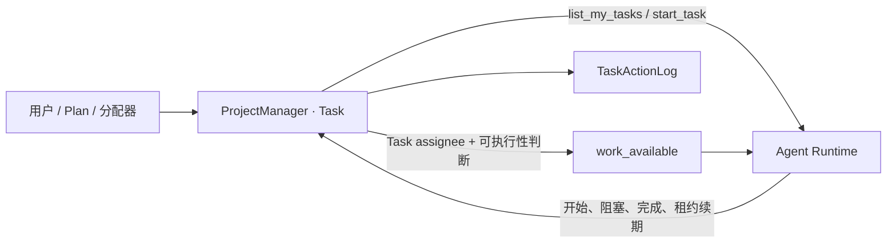
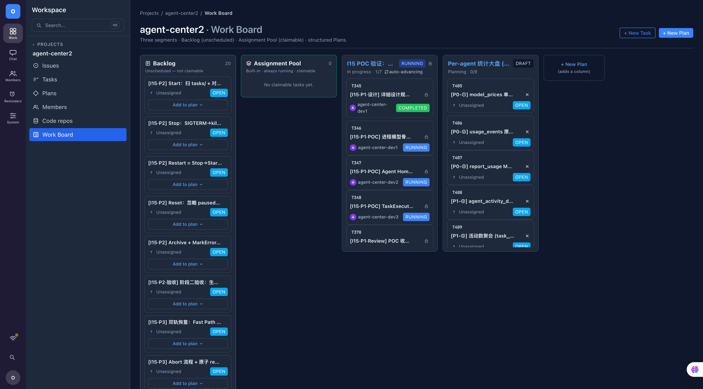
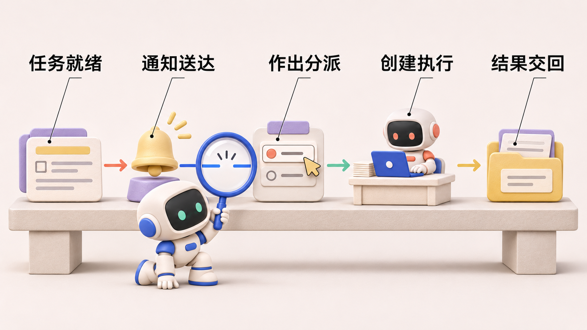

# 任务究竟归谁管：从 AgentWorkItem 到 Task 的模型收敛

> agent-center 是一个组织多个 AI Agent 协作完成软件开发任务的系统。Agent 在其中接收目标、调用工具，参与实现、检查与交付。《Agent 协作手记》以这个项目的开发和运行记录为线索，讨论各模块的设计选择、实现效果，以及实践中暴露的问题。

*Agent 协作手记 · 第 4 篇*

## 一、需求动机

项目早期有过一次很容易让人误判的恢复失败。计划页面里，一项工作显示为“暂停”；操作者点击恢复，页面却只让他重试。任务还在，按钮也在，但界面没有告诉他：究竟是任务坏了，还是现在不能继续。

设计记录保留了排查结果：承接这项工作的 Agent 暂停它以后，已经转去处理另一项工作。当时系统约定，一个 Agent 同时只能有一条活跃工作项，因此后端拒绝了恢复请求，返回“Agent 正忙”的错误。前端把这个具体原因抹掉了，只留下笼统提示。这是记录为 T101 的实际问题；修复选择保留并发约束，改为向用户解释为何无法立即恢复。[恢复失败记录：ADR-0048](https://github.com/oopslink/agent-center/blob/main/docs/design/decisions/0048-pause-resume-recovery.md)

这件事暴露出一个容易被“任务状态”四个字遮住的区别：**业务工作尚未完成，承接它的 Agent 却可能已经暂停处理。** 用户需要知道工作还归谁管、为什么停下、怎样继续。理解这几个问题，才能看懂当初为什么既有业务任务，又为 Agent 增加了一层工作记录。

在一次简短的人机对话里，这些信息通常隐含在聊天上下文中。你提出要求，Agent 开始处理，遇到困难再问你。只要一直盯着对话，就大致知道它在做什么。但当多个 Agent 同时承担不同的工作，一项任务又可能经历等待、暂停和转派时，系统就需要把这些事实明确记录下来。否则，用户看到“进行中”，仍然不知道工作是在推进、等回复，还是已经无人接手。

### 一项工作，从交出去到完成会经历什么

用一个示例来看这件事。用户提出：“修复登录超时，并补上回归测试。”为了跟踪这项工作，系统需要一条稳定的任务记录，保存目标、负责人和业务状态。下文把这种业务任务称为 Task。无论后面换了谁来处理，大家都应该能找到同一项任务，接着原来的目标和讨论继续工作。

假设任务先交给 Agent A。A 开始调查，发现缺少复现条件，于是向用户提问；用户回复后，A 继续处理。期间也可能出现更紧急的故障，A 需要暂停手头的工作，稍后再回来。如果 A 最终无法完成，负责人还可能把这项任务转给 Agent B。接手者提交修复和回归测试后，还要核对登录故障是否确实消除；验收通过，这项工作才算完成。

图 1：沿着“修复登录超时”这个示例看工作如何流转。上方始终是同一项任务，下方是处理者及处理状态的变化；等待和暂停结束后可以继续，必要时才转派给 B。这是一条包含转派的示例路径，并非每项任务都必须换人，也不是系统的完整状态机。

这些变化没有改变任务的目标，却改变了 Agent 处理它的方式。项目管理需要知道“登录故障是否修复、现在由谁负责”；Agent 一侧还需要记录更细的工作状态：

- A 的工作队列里有哪些事项，当前哪一项占着处理槽位？
- A 是正在处理、等待回复，还是主动暂停？等待结束后应恢复哪条工作记录？
- 任务转给 B 后，怎样结束 A 的承接关系，并保留 A 曾经处理过的历史？

单靠任务上的一个“进行中”，无法表达这些差别。任务可能还没完成，但 A 已经停下来等待；任务也可能仍在推进，只是处理者从 A 换成了 B。业务工作的进展与某个 Agent 的处理状态，需要分别描述。

把这些场景放在一起，任务管理至少要满足四项要求：

| 用户需要知道的事 | 系统必须保留的事实 |
|---|---|
| 换人后，原来的工作还在不在 | 稳定的任务目标、编号和讨论记录 |
| 现在由谁继续处理 | 当前分配关系，以及过去转派的历史 |
| 为什么还没有完成 | 正在处理、等待信息、暂停或失败等原因 |
| 等待结束后怎样继续 | 可以明确定位的待处理工作与恢复入口 |

这些需求还没有规定数据应放在哪个对象里。接下来的设计选择，是怎样组织这些事实，让项目负责人和执行工作的 Agent 都能得到所需的信息。

## 二、方案选择

### 起初，我们把两种进度分开记录

早期设计把 Task 放在项目管理模块 ProjectManager 中，保存业务目标和任务归属；同时为 Agent 一侧增加了一种工作记录，叫作 `AgentWorkItem`，下文简称 WorkItem。任务分配给某个 Agent 时，系统为它创建一条工作项，记录排队、处理、等待等状态；同一 Agent 等到回复后，可以继续原工作项。任务转派时，旧 Agent 的工作项结束，新 Agent 获得另一条工作项，业务任务本身则保留下来。

**Task 表示要完成的业务工作；AgentWorkItem 表示某个 Agent 承接这项工作后的一段逻辑处理过程。** 前者跟着工作目标走，后者跟着一次分配关系走。这是当时拆出两个模型的出发点：项目管理保留稳定的业务记录，Agent 一侧可以单独表达处理过程。两者的具体职责如下。

### Task 与 AgentWorkItem 究竟有什么区别

| 比较项 | Task：业务任务 | AgentWorkItem：Agent 的逻辑工作项 |
|---|---|---|
| 核心问题 | 什么工作需要完成，目前归谁负责？ | 某个 Agent 如何处理分配给它的这项工作？ |
| 所属领域 | ProjectManager | Agent |
| 身份的连续性 | 转派后保留原 Task ID | 转派时旧项结束，新负责人得到新项 |
| 与对方的关系 | 作为被引用的业务对象持续存在 | 通过 `taskRef` 引用 Task，不拥有 Task 的业务状态 |
| 典型信息 | 任务目标、业务状态、指派关系 | `agentID`、`taskRef`、工作项状态、交互计数 |
| 等待与恢复 | 业务任务仍可处于进行中 | `active → waiting_input → active`，同一项继续处理 |
| 历史组织 | 保持任务及其稳定的 Conversation（任务对话记录） | 通过工作项引用和交互引用组织活动事件 |

这张表描述的是**历史模型的职责划分**。`AgentWorkItem` 引入于 2026 年 5 月 29 日的提交，提交说明明确写出：它引用 Task，但不拥有 Task 状态；一次 WorkItem 可以包含多轮 AgentInteraction（逻辑交互）。代码也明确强调，它不是进程或一次运行。因此，“重启一次进程就新建一个 WorkItem”“一次模型调用就是一个 WorkItem”，都不符合当时的定义。[引入提交](https://github.com/oopslink/agent-center/commit/25d46144c919f6d81e3056dab6571aab3226e854) · [删除前的模型源码](https://github.com/oopslink/agent-center/blob/2b6af1de45b1157425ea234b4dcc716454a7e726/internal/agent/work_item.go)

图 2：历史模型示意。中间的任务档案对应 Task，两侧的工作记录对应先后承接任务的 AgentWorkItem；转派会留下历史记录，图中不表示同时由两个 Agent 执行。

用前面的登录故障举例，关系可以展开成下面这条时间线：

| 时刻 | 业务上发生的事 | Agent 侧发生的事 |
|---|---|---|
| t₀ | 创建任务 T，指派给 A | 创建 W-A，进入 `queued` |
| t₁ | A 开始推进 T | W-A 进入 `active` |
| t₂ | 等待用户补充复现信息 | W-A 进入 `waiting_input` |
| t₃ | 用户回复，继续处理 T | 同一 W-A 回到 `active`，交互计数增加 |
| t₄ | T 转派给 B，任务和对话保留 | W-A 进入 `superseded`，创建 W-B |

这里保留了两个有用的区别：**任务没有结束，不代表原 Agent 的承接关系仍然有效；一次等待结束，也不代表开始了一项新任务。** 如果把 WorkItem 一开始就当作 Task 的多余副本，就无法解释这两个需求。

### 状态不同，什么时候是合理的

后来加入的暂停能力提供了一个更具体的例子。旧实现允许 Agent 把工作项从 `active` 改成 `paused`，释放单活跃槽，也就是不再占用该 Agent 同时只能处理一项工作的名额，去处理另一项工作。原 Task 仍为 `running`，用于组织任务依赖的 Plan（计划）页面则根据 Task 与 WorkItem 的组合，把节点显示为暂停。这种差异有明确含义：任务还在进行，Agent 暂时不处理它。

架构决策记录 ADR-0048 记录过一次真实问题：用户在 Plan 页面恢复暂停节点时，Agent 正忙于另一条工作项，后端按单活跃约束返回 `409 agent_busy`，前端却显示笼统的“请重试”。这个问题不是两份状态必须相同，而是界面没有解释清楚恢复受什么约束。修复保留了该约束，改为展示准确原因。[暂停与恢复决策记录](https://github.com/oopslink/agent-center/blob/main/docs/design/decisions/0048-pause-resume-recovery.md)

所以，这次复盘真正要问的是：**业务生命周期与 Agent 处理生命周期需要区分，但是否值得为后者长期维护一个独立、可写、需要与 Task 同步的领域对象？**

### 两边的记录，渐渐需要更多照应

旧实现用事件投影连接两端：一端发生变化并留下事件，另一端根据事件更新自己的记录。具体来说，Task 分配或转派后，`pm-workitem-sync` 创建新工作项，并在转派时取代旧项；反过来，`pm-task-status-sync` 消费工作项状态变化，工作项激活时尝试启动 Task，失败时尝试阻塞 Task。后者名称中的“同步”，已经说明它不只是一个供页面查看的历史投影，而是参与了业务状态推进。[Task → WorkItem 投影](https://github.com/oopslink/agent-center/blob/2b6af1de45b1157425ea234b4dcc716454a7e726/internal/projectmanager/service/work_item_projector.go) · [WorkItem → Task 投影](https://github.com/oopslink/agent-center/blob/2b6af1de45b1157425ea234b4dcc716454a7e726/internal/projectmanager/service/task_status_sync_projector.go)

图 3：历史实现的两条同步方向。任务分配与工作状态分别推动另一侧更新；Task 完成时，不同工作项状态还需要不同收尾动作，具体映射见正文。

这些投影并非毫无防护：代码把投影效果与事件已应用标记放在同一事务里，避免重复消费反复改变状态。但幂等只能回答“同一事件再来一遍怎么办”，不能替我们定义两个状态机之间的全部业务映射。

一个具体细节足以说明维护负担：Task 完成后，处于 `active` 的工作项可以转成 `done`；如果工作项还在 `queued` 或 `waiting_input`，投影却要把它转成 `canceled`，因为这些状态没有直接到 `done` 的合法边。同一个“任务完成”，需要根据另一端所处状态选择不同的收尾动作。单独看两个状态机都说得通，组合起来就增加了必须解释、测试和观测的分支。

**问题不在于两个状态值不相等，而在于一次业务动作越来越需要协调两个可写状态机。** 转派要处理旧项与新项，完成要选择合法收尾路径，失败还要回写 Task。维护成本来自这些关联规则，而不只是多了一张表。

### 再看这层工作项，还有多少职责需要独立保留

沿着这些维护问题，可以比较三条调整路线。下表是依据历史实现和最终改动所作的复盘，不把它当作当时逐项讨论过的会议记录。

| 路线 | 需要承担的工作 | 主要取舍 |
|---|---|---|
| 保留两个独立状态机 | 继续维护转派、完成、失败与恢复的映射，补齐同步诊断 | 保留 Agent 侧的独立处理模型，也保留跨模型协调成本 |
| 把工作项改成只读视图 | 从 Task 和活动记录计算队列与历史，取消工作项独立写入 | 可以保留展示形式，但原有暂停与恢复规则仍需重新安排归属 |
| 撤销工作项模型，职责重新归位 | Task 接回分配、阻塞、租约和动作历史，运行层继续记录执行事实 | 减少双向同步，同时扩大 Task 的职责，要求重新核对读取与恢复路径 |

对这个项目而言，关键判断是：工作项提供的排队、承接历史和恢复信息，是否仍需要通过一个独立状态机来管理。转派和终态处理已经强依赖 Task，继续维护双向映射就需要持续付出成本。最终实现沿第三条路线收敛，把工作管理集中到 Task，并保留运行层自己的执行记录。

### 工作管理回到了 Task

现在的选择是让两端从同一个 Task 得到各自的答案。按负责人查询保留所有活跃分配，再叠加依赖和状态检查，才得到 Agent 的可执行清单。这个选择省掉了同步两份生命周期的工作，代价是每次判断可执行性都要读到足够的计划信息。

2026 年 6 月 23 日的删除提交记录了这次收敛：前序改动已经把阻塞、租约和动作日志归到 Task，最终移除了 WorkItem 模型、仓储和两个同步投影，并让相关读取转向 Task。可执行性门禁与 Agent 活动事件仍然保留。删除的是这层独立工作项的生命周期管理，不是取消任务与运行事实的区别。[删除提交及迁移范围](https://github.com/oopslink/agent-center/commit/7a9b12a9a8e550c9d06ce815f294318dc28cc0a4)

当前运行层把接收任务、安排工作和跟进结果的常驻控制者称为 Supervisor，把临时派出的具体执行者称为 Executor。图中的 fork 指创建一次这样的临时执行；它与业务任务被标记为“进行中”是两个需要分别记录的动作。

图 4：业务记录、启动门禁、实际执行和结果验收的机制概括。箭头表示需要逐段核对的处理关系；拥有任务记录，并不证明后续阶段已经发生。

### 一张图看当前边界

图中的 `Task` 是业务事实：标题、描述、状态、assignee、Plan 关联、阻塞原因、执行租约和动作记录都在它身上。`Agent` 聚合记录另一些事实：配置、Worker 绑定、生命周期、能力标签。把两者混成一个“Agent 的任务状态”，就会在失败恢复时丢掉边界。[代码：Task 字段](https://github.com/oopslink/agent-center/blob/main/internal/projectmanager/task.go) · [代码：Agent 字段](https://github.com/oopslink/agent-center/blob/main/internal/agent/agent.go)

## 三、实现效果

这次调整可直接核对的效果，是工作项模型及其两个双向同步投影被移除，读取与状态推进改走 Task。下面用转派、任务列表和故障记录检查行为上的变化。这里没有模型收敛前后的吞吐量或故障率对照，因而不据此宣称系统变快了，或恢复成功率提高了。

### 转派：同一任务上的责任与历史如何变化

**转派时，代码究竟少同步了什么？** 看一次从 A 到 B 的合法转派就很清楚。当前 `RecordReassignment` 先尝试改变指派，成功后清掉旧阻塞说明、阻塞类型和备注，同时清空执行租约，追加包含操作人与新负责人信息的转派记录。原任务的 ID 保留下来，B 不会接到一张还要求它替 A 续租的工作单，排障者也能追溯负责人何时变更。这里得到的是一个可检查的业务结果。旧进程是否已经退出，则要另看运行记录。[转派实现](https://github.com/oopslink/agent-center/blob/main/internal/projectmanager/task.go#L1266)

| 同一次转派 | 原因 | 保留旧值的具体后果 |
|---|---|---|
| 更新 assignee | 下一次拉取要找到新负责人 | B 看不到归自己的工作 |
| 清理阻塞说明与租约 | 先前的等待和续租属于前一次执行 | 接收者看到已经过期的恢复条件 |
| 追加转派记录 | 区分“当前归谁”与“谁改变了归属” | 历史只能根据当前字段猜测 |

### “分配给我”和“现在能做”不是同一个问题

当前代码有两个相近的读取面。`ListAssignedAgentTasks` 给人的 Agent 详情页展示所有活跃分配任务，包括因为依赖未满足而暂时不能运行的任务。`ListRunnableAgentTasks` 给 Agent 的 `list_my_tasks` 使用，只返回通过可执行性门禁的任务。这不是 UI 的两种排序，而是两种业务提问：我负有哪些任务，和我现在可以启动哪些任务。[代码：两种读取面](https://github.com/oopslink/agent-center/blob/main/internal/projectmanager/service/reads.go)

这个区分很必要，也产生新的检查义务：如果列表说“可做”，启动接口却拒绝，Agent 会反复尝试；如果列表说“不可做”，启动接口却放行，Plan 的依赖约束就被绕过。因此代码让任务读取和启动共用 `EnsureTaskRunnable`。同时，它仍保留第二道状态筛选。重复门禁看起来啰嗦，但它反映的不是审美，而是过去出现过的路径不一致风险。

任务进入 `running` 之后也不等于永远占着执行权。租约负责判断活跃执行是否仍在续期；阻塞、解除阻塞、租约过期、重新分配，则在 `TaskActionLog` 中留下可追溯的动作。我们曾把类似变化放进工作项的过渡日志；模型收敛后，日志归回 Task。[代码：租约与动作日志](https://github.com/oopslink/agent-center/blob/main/internal/projectmanager/task.go)

**示例 · 同一任务的两张清单。** 假定测试任务已经指派给 Tester，上游构建还没完成。负责人打开 Agent 详情应看到这项责任，Tester 调用 `list_my_tasks` 时则应暂时看不到它。上游完成后，两端才应同时看到可执行任务。如果此刻仍没有进程，排查要向唤醒、分派和启动继续，给 Task 再写一次 running 并不能补出执行记录。

### 从页面出发：为什么待办数字与“可运行任务”不能混用

图 5：仓库中的实际 Work Board 截图，展示 Backlog、Assignment Pool 和结构化 Plan；它是留存页面，不能作为当前部署版本的证明。

这个页面看起来只是几列卡片，背后却有三种不同的条件。Backlog 表示尚未进入安排的工作；Assignment Pool 为可领取的任务提供入口；Plan 还会给任务增加依赖。Agent 详情中的待办数回答“我还有多少责任”，而执行端的拉取列表回答“此刻哪项可以启动”。如果为了让数字相同，就把依赖未满足的任务也推给执行器，界面一致了，调度约束却被破坏；如果为了让执行列表干净，就不向人展示这些任务，用户又会以为分配丢了。

这也是我对单一来源更具体的理解：同一个 Task 可以有多个读取投影，但不能有多个彼此竞争的生命周期。读取投影允许回答不同问题，前提是标明含义。源码里甚至存在一条很有说明力的注释：Agent 详情改用全部已分配任务，是为了修复“backlog 非零，Tasks 页却为空”的不一致。修复方式是把两个查询的业务含义讲清楚，而不是再加一张队列表。[读取接口与问题记录](https://github.com/oopslink/agent-center/blob/main/internal/projectmanager/service/reads.go)

| 用户或系统的问题 | 应读取的事实 | 不应作出的推断 |
|---|---|---|
| 这项任务归谁 | Task.assignee | 名字出现在聊天里就代表已分配 |
| 现在能否启动 | 状态 + 依赖 + 可执行性门禁 | 已分配就可以运行 |
| Agent 有没有收到通知 | 唤醒与注入记录 | Task 已改成 running 就代表收到 |
| 有没有进程在工作 | 活跃 Executor 与运行记录 | Agent 生命周期 running 就代表在做这项任务 |
| 交付完成没有 | 候选、验收合同与终态 | 进程 exit 0 就代表完成 |

### 一次“running 但没有 execution”的故障，怎样被误诊

项目关于 Agent 身份与责任连续性的研究工作稿（编号 P1）记录了一段现场轨迹：任务恢复为 running 后，Agent 注意到没有新的 execution，于是再次阻塞，并把启动责任归给中心。用户指出需要由 Supervisor 显式 `fork_executor` 后，Agent 改正解释并报告已调用。这个片段同时包含业务状态、执行缺失和行动主体三个问题，单看状态列无法分辨。[P1 §4.2 与时间线](https://github.com/oopslink/agent-center/blob/main/docs/plans/reports/papers-010/p1-logical-agent-identity/paper.md)

如果我们把这类问题统称“调度失效”，就会去补自动重试；但如果真正缺的是 Supervisor 的显式分派，重试业务状态只会制造更多 running。如果错误地自动 fork，又可能与已有的显式 fork 竞争，造成重复执行。正确的排查顺序应沿图 4：Task 是否可运行，唤醒是否送达，Supervisor 做了什么决定，fork 请求是否被接收，Executor 是否真的创建。每一步都有独立证据，不能拿下一步的假设替代上一步的记录。

这段材料也暴露过协议漂移：历史工具说明曾保留 reset 后自动派发的承诺，而实现已经转向显式 fork。代码改了、工具说明没同步，模型就会根据旧契约等待一个不会出现的动作。这类错误应归入系统接口问题，不能直接甩给“模型不懂责任”。从工程修复上说，统一状态只是第一步，统一动作语义同样必要。

### 删除双重状态，不会自动删除调度难题

单一来源解决的是“哪个状态为准”，不是“唤醒一定送达”。任务满足依赖后，仍需有人把可用消息推给常驻 Agent；Agent 收到后，仍需决定是直接处理还是委派执行。即使把所有状态放回 Task，也可能发生任务留在待执行状态、唤醒丢失、重复唤醒或错误的 assignee 收到 fork 请求。当前执行入口对跨身份 fork 做了显式检查，代码注释还指出，某些留在队列里的路径必须有后续唤醒或被明确暴露，不能假定系统会自行恢复。[代码：fork 入口与防误派](https://github.com/oopslink/agent-center/blob/main/internal/agentruntime/executor_runtime.go)

图 6：诊断路径示意。每一段都要核对记录，不能把 running 当成执行已创建的证据。

因此，读设计图时我现在会追问四件事：业务状态的唯一写入者是谁？Agent 看到的队列是不是经过依赖判断？唤醒丢失后谁重新驱动？历史记录能否解释一次任务为什么被重新分配？只回答“我们用了事件”或“我们做了幂等”，不足以回答这些问题。

## 四、总结反思

回到开头那个登录故障的例子：工作从 A 转给 B，任务要接着走，A 的处理记录也要留下。当初引入 WorkItem，正是想把这两件事都照顾好。后来维护转派、失败和恢复时，才逐渐显出另一面的成本——每增加一种处理方式，都得重新检查它怎样与 Task 配合。

把这些职责收回 Task，减少了两边相互协调的路径。不过，前面的故障也提醒了我们，代码里少了一个模型，使用者眼中的含义不会自动变清楚。“进行中”究竟表示什么，下一步由谁启动，仍要在工具说明和页面上交代清楚。

### 职责收回来以后，还要给 Task 留一道边界

Task 现在已经带着租约、阻塞说明、动作历史和 Plan 关联。继续开发时，很容易顺手把进程编号、日志位置、工作区路径也放进来：既然都与任务有关，集中保存似乎更方便。但这样走下去，下一次进程重启或执行切换，又会牵动业务任务的模型。

这也是我希望在后续修改中守住的边界：**Task 保存责任与业务状态，Runtime 保存一次执行的资源与运行记录。** 两边需要能互相找到、解释清楚，但不必把所有细节放在同一个对象里。现有路径是否都守住了这条线，还需要随着功能扩展继续检查。

| 这次调整应保留的部分 | 应继续修正的部分 | 可以验证的验收条件 |
|---|---|---|
| Task 统一分配、阻塞、租约与动作历史 | 过时的 WorkItem 注释和接口语义 | 现行入口不再描述已撤销的状态机 |
| 读取与启动共用可执行性判断 | 唤醒、fork 与启动之间的诊断缺口 | 能重建一次任务从可执行到创建进程的轨迹 |
| 人的待办视图和 Agent 的可做视图分开 | 页面上含糊的“运行中” | 每个状态清楚标明它属于 Agent、Task 还是 Execution |

### 再回头看，当初的区分仍然有意义

WorkItem 删除以后，再读它最初的定义，仍能看出它要解决的问题。任务转派了，原 Agent 的承接关系应该结束；等待一次回复，也不应该变成新建一项业务任务。这些区别并没有随着代码删除而失去意义。

变化的是保存和管理它们的方式。承接历史可以留在动作记录里，待办可以从任务读取，实际执行可以由运行层记录。原来集中在 WorkItem 上的职责，重新找到了各自的位置。回头看，我们低估的是维护独立状态机的代价：**概念上能够区分，还不足以说明它需要一套独立的生命周期。** 当一次转派、一次失败都要两边联动时，就该重新检查这条边界了。

如果以后需要把同一项业务工作同时分给多个执行者，并分别验收结果，独立的承接模型也许还会有用。那时需要先讲清每份承接怎样完成、怎样影响总任务，再决定要不要引入新的对象。旧模型被删过，并不能代替下一次的设计判断。

就这次调整而言，把工作管理收回 Task 是合适的选择。接下来的工作，是让读取列表、恢复动作和运行记录也使用一致的含义。一个任务仍然显示“进行中”时，我们应该能沿着记录找到它停在哪里、由谁继续，而不是再猜某个状态到底指什么。

顺着这条线往下，就是下一篇要讲的 Supervisor 与 Executor：具体工作可以交出去，结果回来以后，同一个负责人又该怎样把它接住。

**延伸阅读：** [项目规约中的单一来源与领域边界](https://github.com/oopslink/agent-center/blob/main/docs/rules/conventions.md)；[Task 模型代码](https://github.com/oopslink/agent-center/blob/main/internal/projectmanager/task.go)。
