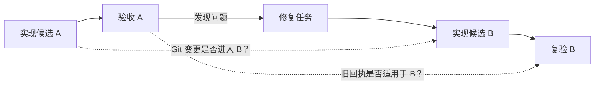
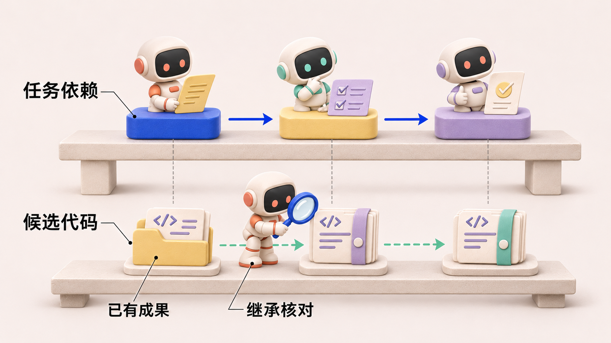
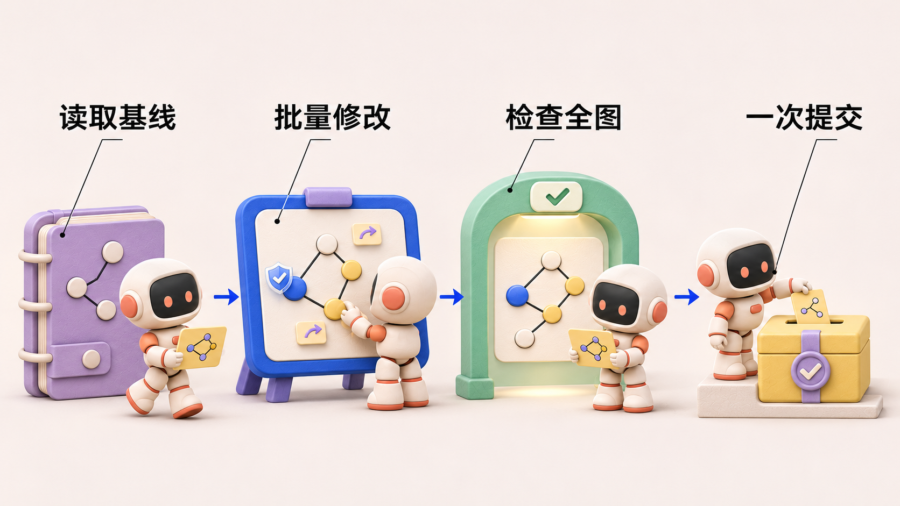
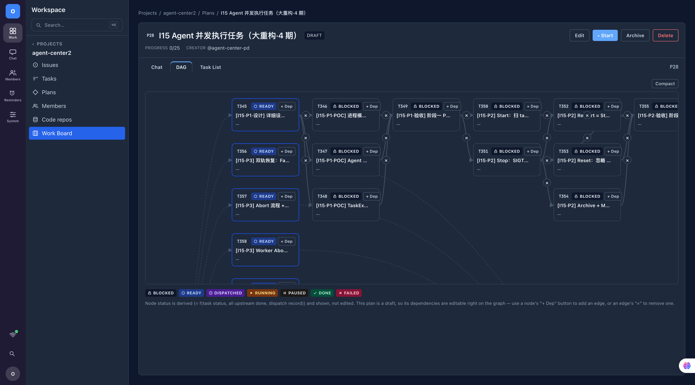
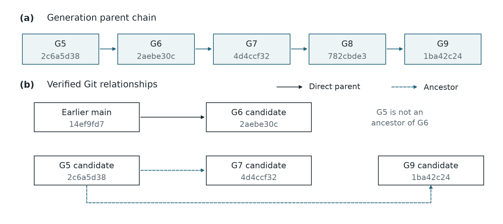
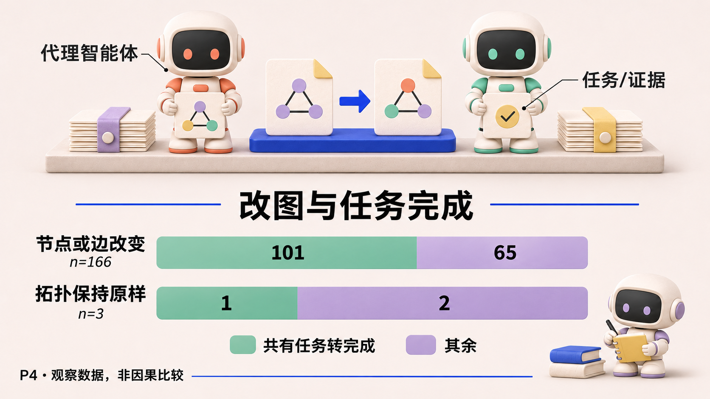
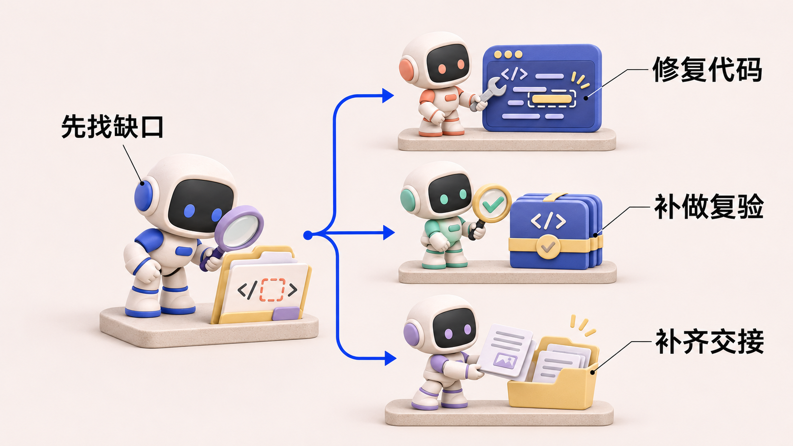

# 计划能改，成果能继承吗：Plan/DAG 演化中的一个盲点

> agent-center 是一个组织多个 AI Agent 协作完成软件开发任务的系统。Agent 在其中接收目标、调用工具，参与实现、检查与交付。《Agent 协作手记》以这个项目的开发和运行记录为线索，讨论各模块的设计选择、实现效果，以及实践中暴露的问题。

*Agent 协作手记 · 第 6 篇*

## 一、需求动机

在组织 Graph 功能的一次开发中，后续计划保留了前面的工作记录，看上去是在已有成果上继续推进。核对实际代码时，却发现中间一版从旧的主分支构建，没有带上前面已经通过局部验收的后端能力。

这并不只是对开发报告的怀疑。研究重新检查了 Git 中的版本关系和文件：前一版代码不是这版候选的祖先，对应的后端文件也确实缺失；后面的恢复候选才重新包含预期的祖先关系。这里把准备交给下一环节使用的一版代码称为“候选”。这条记录说明，**计划接着上一版走，代码却未必接着上一版走。** 它不能证明是改计划导致了文件缺失，但足以说明，仅检查任务图不够。[候选继承案例：研究工作稿 P4 §4.2](https://github.com/oopslink/agent-center/blob/main/docs/plans/reports/papers-010/p4-dag-evolution/paper.md)

要理解这类问题，先看计划在系统里承担什么工作。一项需求往往需要开发、测试和集成共同参与：测试要等到有代码可测，集成要等到必要检查完成。项目用 Plan 表达这样的执行计划，它是一张带箭头的任务图，节点代表工作，箭头代表依赖。

标题中的 DAG 是“有向无环图”的缩写，表示依赖沿着指定方向推进，不会出现 A 等 B、B 又等 A 的闭环。agent-center 对前向依赖做无环检查，同时另设有界回边来表达有限次数的重做；重做规则将在方案部分解释。

验收发现缺口之后，计划需要允许补修复、补复验或调整交接顺序。但有人改依赖时，另一个 Agent 可能已经开始执行；新建工作也必须接住前面的候选和检查记录，下文把后一类记录称为“回执”。任务图说明谁先做、谁后做，候选与回执则说明各环节实际拿到了什么。开头那次成果遗漏，就发生在这两种关系没有对齐的地方。

本篇要讨论的是：系统如何支持执行中的计划调整，怎样保护已经开始的工作，以及调整之后如何核对已有成果是否被继续使用。这三个问题决定了“计划改成功了”离“工作继续推进了”还有多远。

## 二、方案选择

固定计划的好处是容易重放，但验收发现新缺口时，操作者只能在图外补工作。逐条编辑运行中的依赖更灵活，却可能把一段改到一半的图暴露给调度器。项目选择批量提交拓扑变更，也就是一次提交对任务节点与依赖关系的调整，校验提交后的完整状态，并保护已经派发的节点。这样，调整顺序和补充复验可以成为有记录的一次决定。

### 先看 Plan 表达了什么

当前 `Plan` 下的任务可以通过依赖边组织。普通顺序边要求上游任务完成后下游才可启动；条件边依赖决策结果；有界回边允许某些工作在指定结果下再执行若干轮。前向图会做无环检查，回边另行受界限约束。[代码：依赖边与检查](https://github.com/oopslink/agent-center/blob/main/internal/projectmanager/plan_dag.go)



实线表示计划中的工作依赖；虚线是另一个系统事实。图能说“先做修复，再做复验”，但不能仅凭边存在就证明候选 B 包含 A 的有效修改，也不能证明 A 的测试回执对 B 仍然有效。一个 Agent 在旧工作区完成了修复，新节点在另一工作区重做同一件事；Plan 看起来不断前进，交付物却可能绕圈。



图 1：概念示意。上层是任务依赖，下层是候选代码的继承关系，两条链分别需要依赖检查与代码、证据核对；图不表示编辑计划会自动合入代码。

### 拓扑编辑里，哪些复杂度是必要的

`EditPlanTopology` 接收 `base_version` 和一批操作。它在事务内读取当前节点、边和分派记录，检查版本，再把操作应用到内存工作副本。只检查最终图，不要求每个中间步骤合法：例如一次改顺序可能先删边再加边，中途状态并不代表用户想提交的计划。随后还要确认新增任务属于同一项目、检查在途节点的可变性、验证最终图，最后再提交和推进。[拓扑编辑实现](https://github.com/oopslink/agent-center/blob/main/internal/projectmanager/service/plan_topology_edit.go)



图 2：依据拓扑编辑服务整理。版本检查和在途节点保护处理不同的竞争风险。

这里有两种竞争，不能用一个版本号笼统带过。两个 Agent 同时改图，靠 `base_version` 检查拒绝过期编辑，也就是提交时核对所依据的版本是否仍为当前版本；一个 Agent 改图而自动推进器正好分派节点，则还要重新检查分派记录，避免撤回已经开始工作的节点。只做这种版本比较后更新（CAS），后者仍可能错；只检查节点状态，前者又可能互相覆盖。这些复杂度属于计划引擎必须承担的结构约束。

| 检查 | 防止的问题 | 它无法证明什么 |
|---|---|---|
| base_version CAS | 旧编辑覆盖新编辑 | 新计划是否比旧计划合理 |
| 在途节点不可随意改动 | 已开始的工作被静默撤回 | 活跃执行是否真的健康 |
| 最终前向图无环 | 结构性依赖死锁 | 多代计划是否重复做相同工作 |
| 有界回边 | 一条回路无限重跑 | 换名新建任务是否绕过了局部次数界限 |
| 事务提交与审计 | 部分更新和不可追溯变更 | 新候选是否继承旧成果 |

代码为第一列提供了约束，但第二列之外的事情仍要独立处理。把“图通过验证”写成“修复方案正确”，是我们应该避免的越界推断。

**示例 · 同一个验收失败，可以有三种处置。** 候选里的实现确实错误，应安排代码修复。如果实现正确，只缺视觉复验，应让复验绑定原候选。如果实现与复验都完成，集成节点却取不到回执，应该补交接。三种情形在看板上都可能显示“未完成”，重新创建开发节点只对第一种有帮助。

## 三、实现效果



图 3：实际页面留存图。READY、BLOCKED 等节点状态是理解进度的入口，却不能单独证明候选代码的包含关系。

### 沿着计划快照，再去找代码里的变化

项目关于计划演化与成果继承的研究工作稿（编号 P4）重建了 26 个 Plan 的 195 份快照、169 次父子转移，并核对候选 Git 谱系和验收合同。它观察到局部改图有时补上必要复验，有时重复建链；在一个有限的重复恢复片段中，5 个重复节点最终全部废弃。这个证据支持“存在重复与候选继承失配”，不能据此说系统会无限循环，也不能计算出某个停止规则将带来多少收益。[研究工作稿 P4](https://github.com/oopslink/agent-center/blob/main/docs/plans/reports/papers-010/p4-dag-evolution/paper.md)



图 4：直接引用论文的候选谱系图。上部为 generation 父子链，下部为实际 Git 关系；这里的 G5/G6 等是研究中的代际标识，与前文说明用 A/B/C 不同。

更具体地说，研究重放 Git 检查后确认：组织 Graph 的 G5 不是 G6 的祖先，G5 中已验证的后端文件在 G6 缺失；到 G7 才重新包含 G5 祖先。这比“后续任务可能丢成果”更有力，因为它把计划关系与实际版本对象对齐了。但祖先也不是唯一标准：某些 cherry-pick 或同树重建可以继承内容而不保留原始祖先，因此检查还必须结合文件树与合同，不能再制造一个“没有祖先就是丢成果”的绝对规则。[P4 §4.8 与图 4](https://github.com/oopslink/agent-center/blob/main/docs/plans/reports/papers-010/p4-dag-evolution/paper.md)

论文还统计了拓扑变化和共有任务状态变化：

| 父子快照的变化 | 转移次数 | 有共有任务改状态 | 有共有任务转为完成 |
|---|---:|---:|---:|
| 节点或边改变 | 166 | 157 | 101 |
| 节点与边都不改变 | 3 | 3 | 1 |

表 2：直接采用 P4 表 5a。分母是快照转移，完成是 Task 的字段状态，不代表重新验收过的交付。它反对两个简单化判断：改图不等于任务完成，不改图也不等于停滞。166 次改图中未出现共有任务转完成的 65 次，可能包含合理的未来安排，不能一律贴上浪费标签。我们应检查的是每次改图解释了哪一个新的交付义务。



图 5 把表 2 的分母保留在每一行。拓扑改变的 166 个区间中，101 个出现共有任务转完成，另有 65 个没有这种变化。拓扑保持原样的区间只有 3 个，其中 1 个也有任务转完成。两行之间不能直接计算改图的收益。难以交付的计划本来就更可能需要修改，而一个区间内可能发生复验、转派等多种动作。对于某一次修复，更有辨别力的做法是追踪改图前缺的那项证据，看它是否在同一候选上补齐。图 4 的 Git 对照便属于这种检查。

## 四、总结反思

原子改图和在途保护值得保留。设计遗漏发生在图外，计划保留旧节点时，没有同时要求下一位执行者核对候选是否包含旧成果。新的修复请求应给出候选与缺口，并明确哪一份已有工作仍然有效。

### 为什么编辑接口也不能解决成果继承

当前拓扑编辑服务把一批操作作为一个原子变更：检查基础版本，应用操作，验证最终图，再整体持久化并增加版本。它解决了并发改图、半途形成非法图等问题。[代码：拓扑编辑](https://github.com/oopslink/agent-center/blob/main/internal/projectmanager/service/plan_topology_edit.go) 但它不读取仓库中的候选提交，也不替下一位执行者判断“哪些成果可以复用”。事务原子性保护图的一致性，不保护代码谱系的一致性。

这正是该设计容易让人误判的地方。界面上一个新节点被连在旧节点后面，看起来像继承；可真正决定交付的是代码、产物和验收证据是否沿着同一候选流转。若新节点只继承了任务描述，没有继承工作区变更，就会出现“计划复用了，成果没复用”。

### 无环为什么仍然可能重复

考虑一个说明用例：第一代计划是“实现 A → 验收 A”，验收失败后第二代建立“修复 B → 验收 B”；如果 B 没有继承 A 的有效修改，第三代又建立“恢复 A 的修改 → 再次验收”。每一代内部都没有环，但跨代工作在重复。这个用例解释机制，不是把论文中的全部 Plan 简化成同一种失败。

局部的 `MaxRounds` 只能限制指定回边；如果修复通过新建任务、新建阶段或替代计划实现，计数范围就变了。由此我主张：停止条件应围绕“同一个候选缺口是否在没有新证据时被重复处理”，而不只围绕某条图边的循环次数。要做到这一点，必须把候选标识和缺口保留下来，否则每个新任务都像第一次尝试。



图 6：建议的修复前判断。该流程尚未有独立对照实验验证，不标作已实现的自动决策器。

### 在加下一个节点之前，先停下来看看

当某个任务失败时，系统很容易自动加一个“再做一遍”节点。更稳妥的流程是先收集四种状态：当前候选是什么，已有检查对哪个候选有效，具体缺口是什么，以及是否已有 Agent 正在处理同一缺口。然后才决定复用原任务、补一个狭窄修复任务、重新验收，或停止无证据的重复恢复。

这不是说 Plan 应该成为 Git 或验收系统的另一个数据库。相反，Plan 应保持对工作依赖的表达，候选和证据需要被明确引用，避免复制出第二套彼此不同步的真相。是否足以修复实际失败，还要做端到端对照：看少了多少重复工作、有没有漏掉必要复验、最终候选是否保留有效修改。

下面是一份建议采用的修复记录，属于协议草案：

```yaml
current_candidate: <不可变 commit 或产物摘要>
required_baseline: <必须包含的上游基线>
acceptance_contract: <适用合同及版本>
remaining_gap: <哪一项检查失败，证据在哪里>
reusable_results: <仍对当前候选有效的检查>
active_work: <是否已有任务处理同一缺口>
proposed_change: <改图如何解除该缺口>
stop_condition: <没有新增证据时何时停止重建>
```

如果填不出 `remaining_gap`，就不应该仅凭“还没完成”自动创建下一条修复链。如果候选已经满足合同，缺的是发布或回执，应补交接而不是重写实现；如果已有活跃修复，则优先查其进展而不是并发创建第二个同义任务。计划引擎不能替代这些判断，但它的工具输入可以要求判断者把理由说完整。

再看一张不断更新的计划图，我更关心新节点接住了什么：哪一版代码、哪些已经验证的修改、还缺哪项检查。原子改图、版本检查和在途保护仍然需要保留；在它们之外，**工作安排的变化还要与成果的变化一起核对。** 只有这样，新建一个修复节点才有机会成为前进的一步。下一篇讨论另一种会被带进后续工作的东西：团队记忆里的经验和规则。
